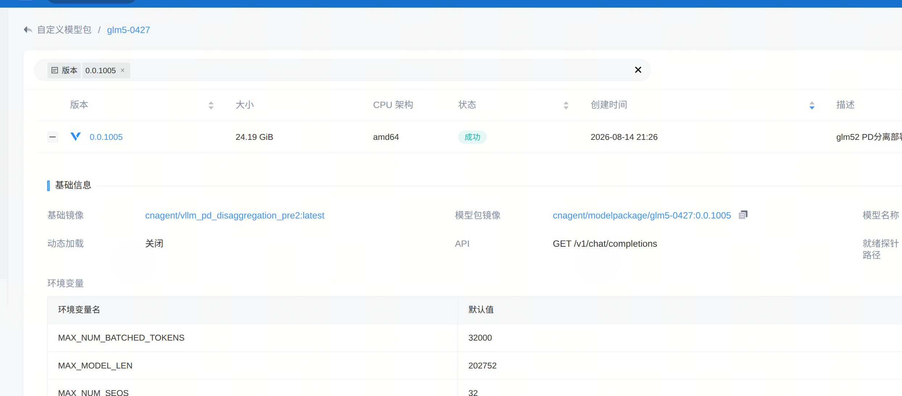
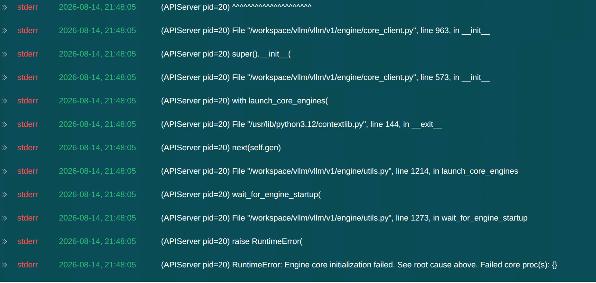
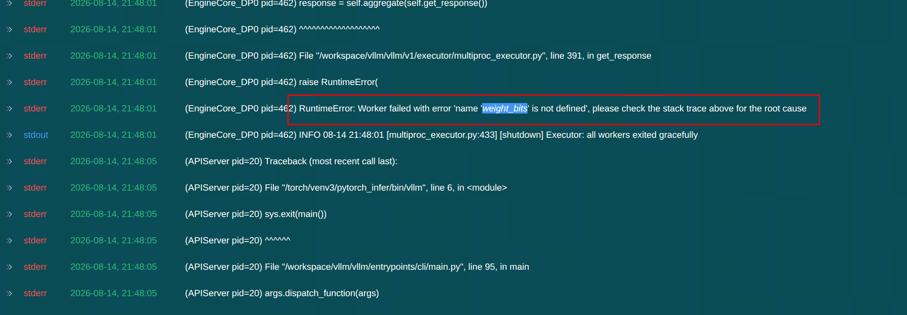
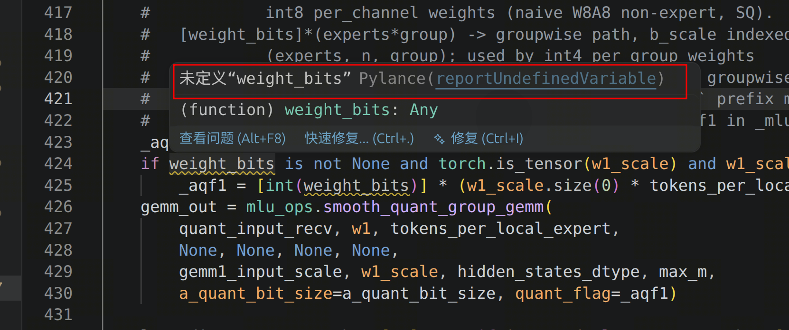

# vLLM-MLU 部署 GLM-5.2-W4A8 启动失败问题分析

在线服务地址：[bj.caip.cambricon.com:30080/modelpackage/3ba2a03b-6246-43f5-9879-8e85d7cbb81f?ns=e23f5b20fb9b42d3ac674f9691a0b9b1&amp;versionID=a36f6575-7220-45e8-bff9-bf738db96472&amp;search%5Bname%5D=0.0.1005](http://bj.caip.cambricon.com:30080/modelpackage/3ba2a03b-6246-43f5-9879-8e85d7cbb81f?ns=e23f5b20fb9b42d3ac674f9691a0b9b1&versionID=a36f6575-7220-45e8-bff9-bf738db96472&search%5Bname%5D=0.0.1005)




# 初时错误现象

APIServer 最终报错：

    RuntimeError: Engine core initialization failed.
    See root cause above.
    Failed core proc(s): {}

该错误不是根因，只是 EngineCore 子进程异常后的汇总错误。

# 根本错误




最终真实异常：

    NameError: name 'weight_bits' is not defined

错误位置：

    /workspace/vllm_mlu/vllm_mlu/model_executor/layers/fused_moe/runner/mlu_fused_moe.py

    line 424

# 代码排查

vllm-mlu分支:v0.25.1_kvoffload_with_pd，提交对象：3107cd61


问题代码如下



相关代码：

```python
docker run --rm -d\
  --device /dev/net/tun \
  --cap-add NET_ADMIN \
  -p 127.0.0.1:1081:1080 \
  -p 127.0.0.1:8889:8889 \
  -e EC_VER=7.6.7 \
  -e CLI_OPTS="-d https://atrust.ict.ac.cn -u fs_zhangyihao -p 2003Zhang@" \
  hagb/docker-easyconnect:cli

```

问题：

`_fused_experts_all2all_mlu_default()`函数内，使用未定义的变量“`weight_bits`”
