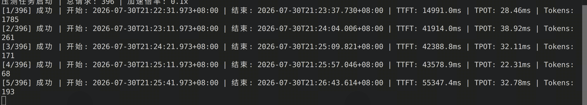
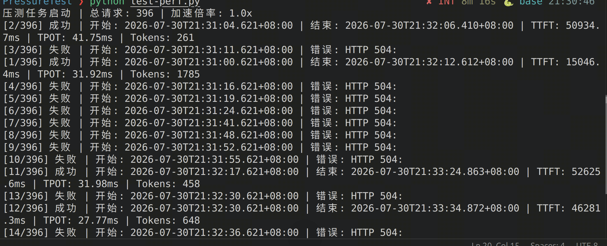
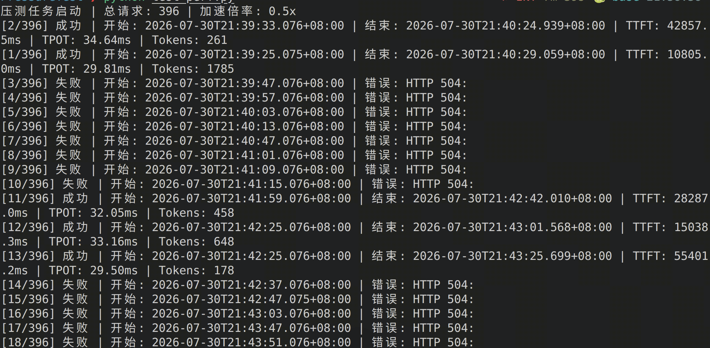
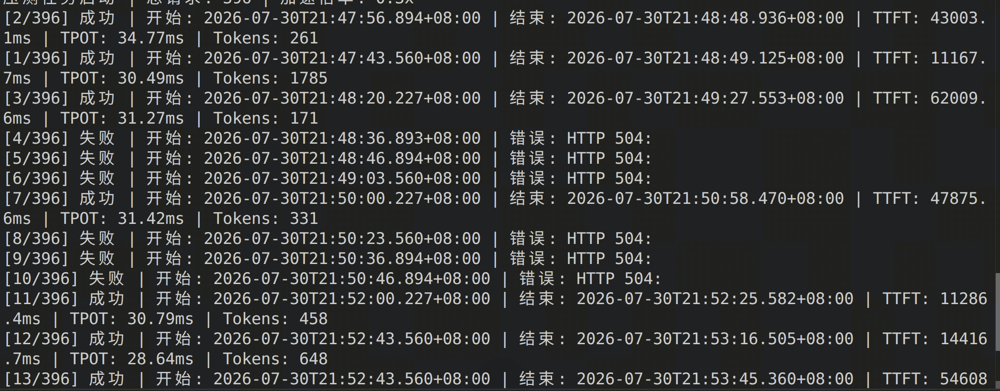
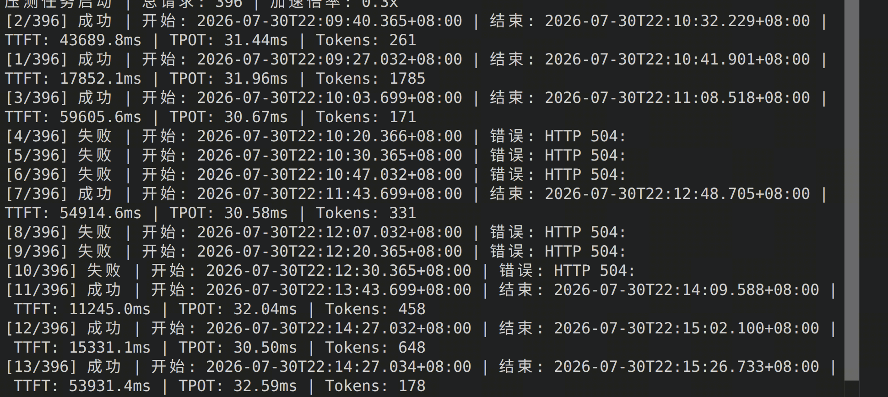

PD分离部署

2026-7-30  2P1D / speed_up=0.1，压测效果

和1P1D的压测请求的TTFT和TPOT保持一致，说明增加Prefill实例，并不会减小TTFT和TOPT的延迟

2026-7-30  2P1D / speed_up=1.0，压测效果

2P1D依旧保持绝大部分请求504，唯一区别在于，第12和11请求成功，但是这不能完全说明“增加Prefill实例就能缓解Prefill持续abort请求的问题”

2026-7-30  2P1D / speed_up=0.5，压测效果

和speed_up=1.0相比，效果不大

2026-7-30  2P1D / speed_up=0.3，压测效果

speed_up=0.3，此时的成功比例就显得比较均匀了

2026-7-30  1P1D / speed_up=0.3，压测效果

