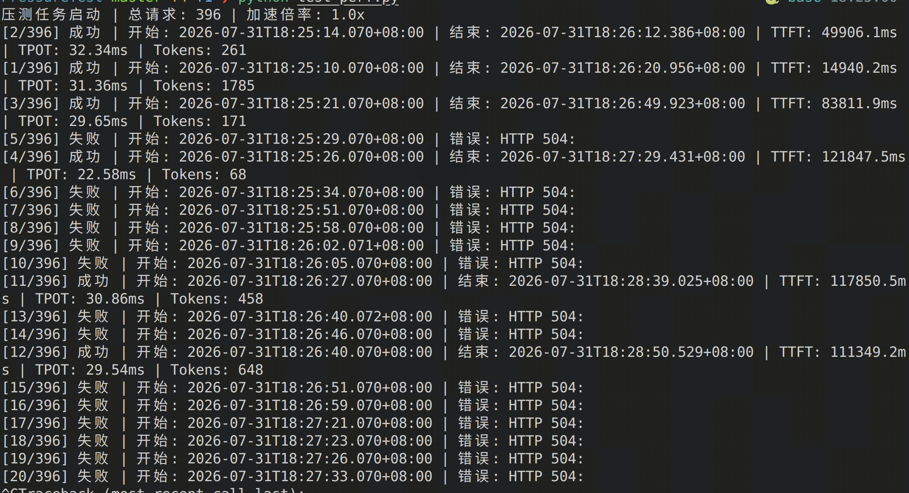
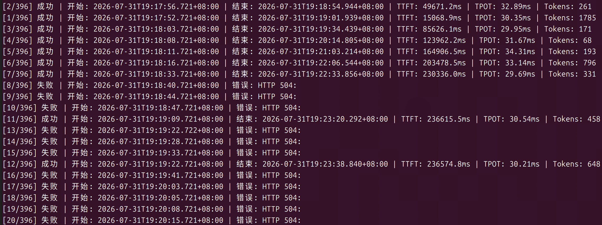
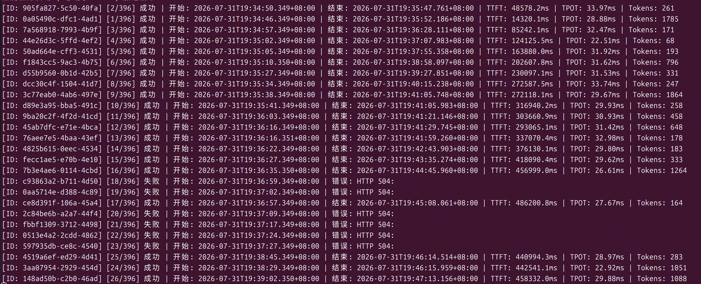
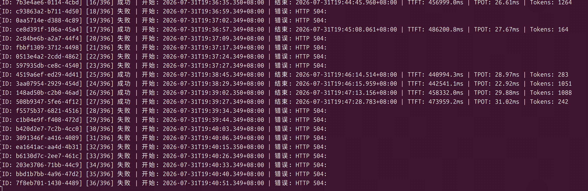
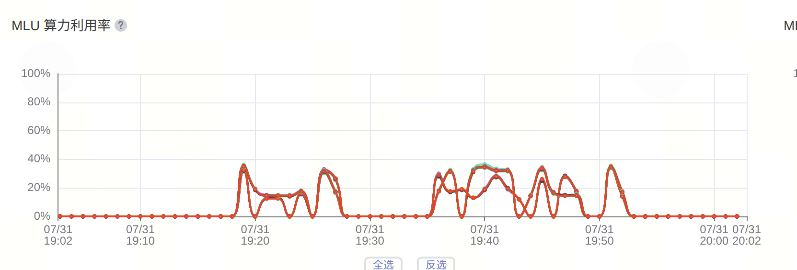

2026-7-31；1P1D；

AIBRIX_PREFILL_REQUEST_TIMEOUT = 120s；messageTimeout=120s

speed_up=1.0

效果：相比1P1D/60s，60s/SpeedUp=1.0，有所好转，其中出现多个TTFT超过10s的请求成功执行

2026-7-31；1P1D；

   = 240s；messageTimeout=240s

speed_up=1.0

效果：调高AIBRIX_PREFILL_REQUEST_TIMEOUT和messageTimeout，有所好转

2026-7-31；1P1D；

AIBRIX_PREFILL_REQUEST_TIMEOUT = 480s；messageTimeout=480s

speed_up=1.0

效果：请求虽然成功执行，但是TTFT持续变长，且维持在较高水平，后续也是开始持续出现504

小结：压测过程中，随着时间的持续，明显看到Prefill节点的压力持续变大，既调高超时时间，无法解决PD分离的问题

后续：

* 增加Prefill实例（下图为decode pod算力利用率，明显不满）
  
* 引入新的架构，解决Prefill节点长期堆积处理请求
