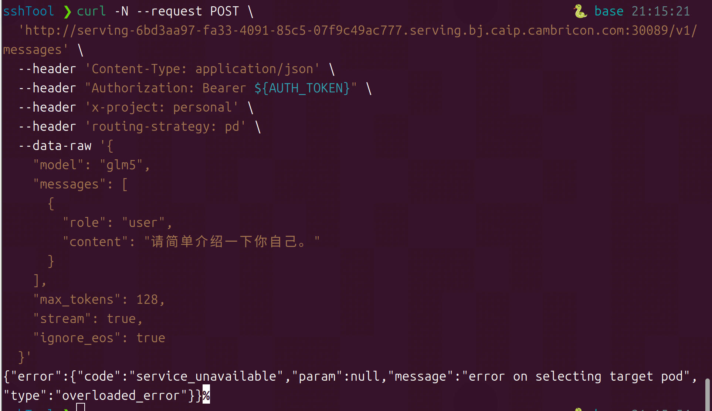

在线服务地址：[bj.caip.cambricon.com:30080/predictor/892002b9-e4a9-45d7-86ff-4446f3e26874/log?ns=e23f5b20fb9b42d3ac674f9691a0b9b1](http://bj.caip.cambricon.com:30080/predictor/892002b9-e4a9-45d7-86ff-4446f3e26874/log?ns=e23f5b20fb9b42d3ac674f9691a0b9b1)


执行单条Curl请求命令，马上报错，完全不足以支持进行压测

curl命令：

```
curl -N --request POST \
  'http://serving-6bd3aa97-fa33-4091-85c5-07f9c49ac777.serving.bj.caip.cambricon.com:30089/v1/messages' \
  --header 'Content-Type: application/json' \
  --header "Authorization: Bearer ${AUTH_TOKEN}" \
  --header 'x-project: personal' \
  --header 'routing-strategy: pd' \
  --data-raw '{
    "model": "glm5",
    "messages": [
      {
        "role": "user",
        "content": "请简单介绍一下你自己。"
      }
    ],
    "max_tokens": 128,
    "stream": true,
    "ignore_eos": true
  }'
```


