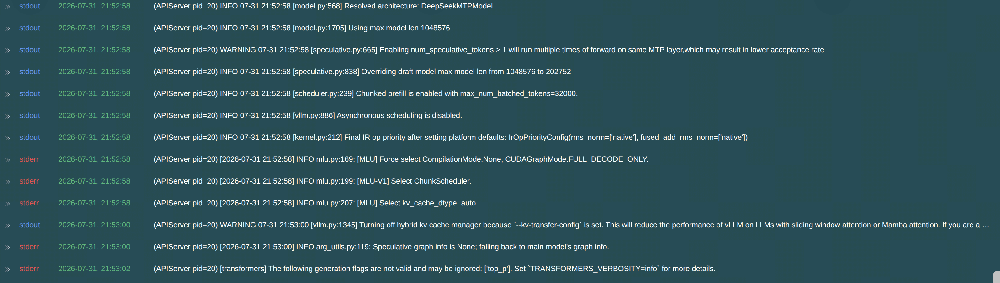
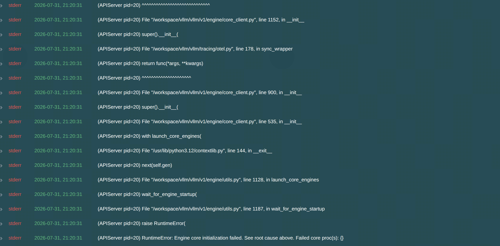
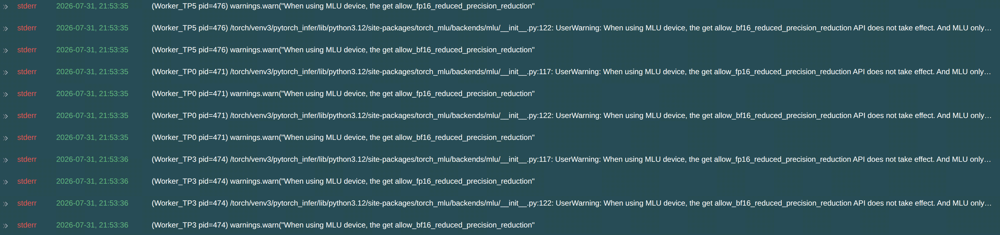

记录时间：2026-8-3

所有相关信息见于，黄区智算平台- cnagent项目 - **prediction-service-0731-211604**在线服务

实验配置：

* 1P1D
* Prefill节点：DP6 + TP8
* Decode节点：DP1 + TP8

服务器规格：M9DK8-ROCE4-DRAIN-0830（8张MLU590+4张共享 RoCE）；总共需要7台服务器

6个Prefill Pod  +  1个Decode Pod


启动失败，部署“错误”，下面是日志分析：

整个服务呈现出的日志有3类

1. 有一个Prefill pod的日志
   
   具体内容见“详细日志”编号1
2. 另外5个 prefill pod的日志
   
   具体内容见“详细日志”编号2
3. decode pod的日志
   
   具体内容见“详细日志”编号3


问题排查出来：

* 和MOE相关，MoE 共享专家层的并行切分维度不合法。
* DP6 + TP8，GLM-5.2 shared expert 4096维，不能被48整除

解决方案：

* 修改DP数量，总 EP world size 必须是 4096 的因数。
* 关闭 shared expert 跨 EP 并行
  * 移除vLLM启动参数additional-config
* 暂时关闭 Expert Parallel
  * 移除vLLM启动参数enable-expert-parallel

我目前对MOE了解比较少，关于MOE专家模型并行，就不清楚了，以上思路都Ai提供的，我的想法是：

1. 按照Ai方法修改，争取成功部署，目标：把decode pod的算力利用率拉满
2. 补齐MOE相关的一些基础知识


详细日志:

1. 

```
stdout
2026-07-31, 21:52:58
(APIServer pid=20) WARNING 07-31 21:52:58 [speculative.py:665] Enabling num_speculative_tokens > 1 will run multiple times of forward on same MTP layer,which may result in lower acceptance rate
stdout
2026-07-31, 21:52:58
(APIServer pid=20) INFO 07-31 21:52:58 [speculative.py:838] Overriding draft model max model len from 1048576 to 202752
stdout
2026-07-31, 21:52:58
(APIServer pid=20) INFO 07-31 21:52:58 [scheduler.py:239] Chunked prefill is enabled with max_num_batched_tokens=32000.
stdout
2026-07-31, 21:52:58
(APIServer pid=20) INFO 07-31 21:52:58 [vllm.py:886] Asynchronous scheduling is disabled.
stdout
2026-07-31, 21:52:58
(APIServer pid=20) INFO 07-31 21:52:58 [kernel.py:212] Final IR op priority after setting platform defaults: IrOpPriorityConfig(rms_norm=['native'], fused_add_rms_norm=['native'])
stderr
2026-07-31, 21:52:58
(APIServer pid=20) [2026-07-31 21:52:58] INFO mlu.py:169: [MLU] Force select CompilationMode.None, CUDAGraphMode.FULL_DECODE_ONLY.
stderr
2026-07-31, 21:52:58
(APIServer pid=20) [2026-07-31 21:52:58] INFO mlu.py:199: [MLU-V1] Select ChunkScheduler.
stderr
2026-07-31, 21:52:58
(APIServer pid=20) [2026-07-31 21:52:58] INFO mlu.py:207: [MLU] Select kv_cache_dtype=auto.
stdout
2026-07-31, 21:53:00
(APIServer pid=20) WARNING 07-31 21:53:00 [vllm.py:1345] Turning off hybrid kv cache manager because `--kv-transfer-config` is set. This will reduce the performance of vLLM on LLMs with sliding window attention or Mamba attention. If you are a developer of kv connector, please consider supporting hybrid kv cache manager for your connector by making sure your connector is a subclass of `SupportsHMA` defined in kv_connector/v1/base.py and use --no-disable-hybrid-kv-cache-manager to start vLLM.
stderr
2026-07-31, 21:53:00
(APIServer pid=20) [2026-07-31 21:53:00] INFO arg_utils.py:119: Speculative graph info is None; falling back to main model's graph info.
stderr
2026-07-31, 21:53:02
(APIServer pid=20) [transformers] The following generation flags are not valid and may be ignored: ['top_p']. Set `TRANSFORMERS_VERBOSITY=info` for more details.
```

2. 

```

2026-07-31, 21:20:31
(APIServer pid=20) File "/workspace/vllm/vllm/entrypoints/openai/api_server.py", line 100, in build_async_engine_client
stderr
2026-07-31, 21:20:31
(APIServer pid=20) async with build_async_engine_client_from_engine_args(
stderr
2026-07-31, 21:20:31
(APIServer pid=20) File "/usr/lib/python3.12/contextlib.py", line 210, in __aenter__
stderr
2026-07-31, 21:20:31
(APIServer pid=20) return await anext(self.gen)
stderr
2026-07-31, 21:20:31
(APIServer pid=20) ^^^^^^^^^^^^^^^^^^^^^
stderr
2026-07-31, 21:20:31
(APIServer pid=20) File "/workspace/vllm/vllm/entrypoints/openai/api_server.py", line 136, in build_async_engine_client_from_engine_args
stderr
2026-07-31, 21:20:31
(APIServer pid=20) async_llm = AsyncLLM.from_vllm_config(
stderr
2026-07-31, 21:20:31
(APIServer pid=20) ^^^^^^^^^^^^^^^^^^^^^^^^^^
stderr
2026-07-31, 21:20:31
(APIServer pid=20) File "/workspace/vllm/vllm/v1/engine/async_llm.py", line 217, in from_vllm_config
stderr
2026-07-31, 21:20:31
(APIServer pid=20) return cls(
stderr
2026-07-31, 21:20:31
(APIServer pid=20) ^^^^
stderr
2026-07-31, 21:20:31
(APIServer pid=20) File "/workspace/vllm/vllm/v1/engine/async_llm.py", line 146, in __init__
stderr
2026-07-31, 21:20:31
(APIServer pid=20) self.engine_core = EngineCoreClient.make_async_mp_client(
stderr
2026-07-31, 21:20:31
(APIServer pid=20) ^^^^^^^^^^^^^^^^^^^^^^^^^^^^^^^^^^^^^^
stderr
2026-07-31, 21:20:31
(APIServer pid=20) File "/workspace/vllm/vllm/tracing/otel.py", line 178, in sync_wrapper
stderr
2026-07-31, 21:20:31
(APIServer pid=20) return func(*args, **kwargs)
stderr
2026-07-31, 21:20:31
(APIServer pid=20) ^^^^^^^^^^^^^^^^^^^^^
stderr
2026-07-31, 21:20:31
(APIServer pid=20) File "/workspace/vllm_mlu/vllm_mlu/v1/engine/core_client.py", line 54, in make_async_mp_client
stderr
2026-07-31, 21:20:31
(APIServer pid=20) return DPAsyncMPClient(*client_args)
stderr
2026-07-31, 21:20:31
(APIServer pid=20) ^^^^^^^^^^^^^^^^^^^^^^^^^^^^^
stderr
2026-07-31, 21:20:31
(APIServer pid=20) File "/workspace/vllm/vllm/v1/engine/core_client.py", line 1152, in __init__
stderr
2026-07-31, 21:20:31
(APIServer pid=20) super().__init__(
stderr
2026-07-31, 21:20:31
(APIServer pid=20) File "/workspace/vllm/vllm/tracing/otel.py", line 178, in sync_wrapper
stderr
2026-07-31, 21:20:31
(APIServer pid=20) return func(*args, **kwargs)
stderr
2026-07-31, 21:20:31
(APIServer pid=20) ^^^^^^^^^^^^^^^^^^^^^
stderr
(APIServer pid=20) File "/workspace/vllm/vllm/v1/engine/core_client.py", line 900, in __init__
stderr
2026-07-31, 21:20:31
(APIServer pid=20) super().__init__(
stderr
2026-07-31, 21:20:31
(APIServer pid=20) File "/workspace/vllm/vllm/v1/engine/core_client.py", line 535, in __init__
stderr
2026-07-31, 21:20:31
(APIServer pid=20) with launch_core_engines(
stderr
2026-07-31, 21:20:31
(APIServer pid=20) File "/usr/lib/python3.12/contextlib.py", line 144, in __exit__
stderr
2026-07-31, 21:20:31
(APIServer pid=20) next(self.gen)
stderr
2026-07-31, 21:20:31
(APIServer pid=20) File "/workspace/vllm/vllm/v1/engine/utils.py", line 1128, in launch_core_engines
stderr
2026-07-31, 21:20:31
(APIServer pid=20) wait_for_engine_startup(
stderr
2026-07-31, 21:20:31
(APIServer pid=20) File "/workspace/vllm/vllm/v1/engine/utils.py", line 1187, in wait_for_engine_startup
stderr
2026-07-31, 21:20:31
(APIServer pid
2026-07-31, 21:20:31
(APIServer pid=20) File "/workspace/vllm/vllm/v1/engine/core_client.py", line 900, in __init__
stderr
2026-07-31, 21:20:31
(APIServer pid=20) super().__init__(
stderr
2026-07-31, 21:20:31
(APIServer pid=20) File "/workspace/vllm/vllm/v1/engine/core_client.py", line 535, in __init__
stderr
2026-07-31, 21:20:31
(APIServer pid=20) with launch_core_engines(
stderr
2026-07-31, 21:20:31
(APIServer pid=20) File "/usr/lib/python3.12/contextlib.py", line 144, in __exit__
stderr
2026-07-31, 21:20:31
(APIServer pid=20) next(self.gen)
stderr
2026-07-31, 21:20:31
(APIServer pid=20) File "/workspace/vllm/vllm/v1/engine/utils.py", line 1128, in launch_core_engines
stderr
2026-07-31, 21:20:31
(APIServer pid=20) wait_for_engine_startup(
stderr
2026-07-31, 21:20:31
(APIServer pid=20) File "/workspace/vllm/vllm/v1/engine/utils.py", line 1187, in wait_for_engine_startup
stderr
2026-07-31, 21:20:31
(APIServer pid=20) raise RuntimeError(
stderr
2026-07-31, 21:20:31
(APIServer pid=20) RuntimeError: Engine core initialization failed. See root cause above. Failed core proc(s): {}
```

3.

```
stderr
2026-07-31, 21:53:35
(Worker_TP4 pid=475) /torch/venv3/pytorch_infer/lib/python3.12/site-packages/torch_mlu/backends/mlu/__init__.py:117: UserWarning: When using MLU device, the get allow_fp16_reduced_precision_reduction API does not take effect. And MLU only support compute type float32.
stderr
2026-07-31, 21:53:35
(Worker_TP4 pid=475) warnings.warn("When using MLU device, the get allow_fp16_reduced_precision_reduction"
stderr
2026-07-31, 21:53:35
(Worker_TP4 pid=475) /torch/venv3/pytorch_infer/lib/python3.12/site-packages/torch_mlu/backends/mlu/__init__.py:122: UserWarning: When using MLU device, the get allow_bf16_reduced_precision_reduction API does not take effect. And MLU only support compute type float32.
stderr
2026-07-31, 21:53:35
(Worker_TP4 pid=475) warnings.warn("When using MLU device, the get allow_bf16_reduced_precision_reduction"
stderr
2026-07-31, 21:53:35
(Worker_TP5 pid=476) /torch/venv3/pytorch_infer/lib/python3.12/site-packages/torch_mlu/backends/mlu/__init__.py:117: UserWarning: When using MLU device, the get allow_fp16_reduced_precision_reduction API does not take effect. And MLU only support compute type float32.
stderr
2026-07-31, 21:53:35
(Worker_TP5 pid=476) warnings.warn("When using MLU device, the get allow_fp16_reduced_precision_reduction"
stderr
2026-07-31, 21:53:35
(Worker_TP5 pid=476) /torch/venv3/pytorch_infer/lib/python3.12/site-packages/torch_mlu/backends/mlu/__init__.py:122: UserWarning: When using MLU device, the get allow_bf16_reduced_precision_reduction API does not take effect. And MLU only support compute type float32.
stderr
2026-07-31, 21:53:35
(Worker_TP5 pid=476) warnings.warn("When using MLU device, the get allow_bf16_reduced_precision_reduction"
stderr
2026-07-31, 21:53:35
(Worker_TP0 pid=471) /torch/venv3/pytorch_infer/lib/python3.12/site-packages/torch_mlu/backends/mlu/__init__.py:117: UserWarning: When using MLU device, the get allow_fp16_reduced_precision_reduction API does not take effect. And MLU only support compute type float32.
stderr
2026-07-31, 21:53:35
(Worker_TP0 pid=471) warnings.warn("When using MLU device, the get allow_fp16_reduced_precision_reduction"
stderr
2026-07-31, 21:53:35
(Worker_TP0 pid=471) /torch/venv3/pytorch_infer/lib/python3.12/site-packages/torch_mlu/backends/mlu/__init__.py:122: UserWarning: When using MLU device, the get allow_bf16_reduced_precision_reduction API does not take effect. And MLU only support compute type float32.
stderr
2026-07-31, 21:53:35
(Worker_TP0 pid=471) warnings.warn("When using MLU device, the get allow_bf16_reduced_precision_reduction"
stderr
2026-07-31, 21:53:36
(Worker_TP3 pid=474) /torch/venv3/pytorch_infer/lib/python3.12/site-packages/torch_mlu/backends/mlu/__init__.py:117: UserWarning: When using MLU device, the get allow_fp16_reduced_precision_reduction API does not take effect. And MLU only support compute type float32.
stderr
2026-07-31, 21:53:36
(Worker_TP3 pid=474) warnings.warn("When using MLU device, the get allow_fp16_reduced_precision_reduction"
stderr
2026-07-31, 21:53:36
(Worker_TP3 pid=474) /torch/venv3/pytorch_infer/lib/python3.12/site-packages/torch_mlu/backends/mlu/__init__.py:122: UserWarning: When using MLU device, the get allow_bf16_reduced_precision_reduction API does not take effect. And MLU only support compute type float32.
stderr
2026-07-31, 21:53:36
(Worker_TP3 pid=474) warnings.warn("When using MLU device, the get allow_bf16_reduced_precision_reduction"
```
