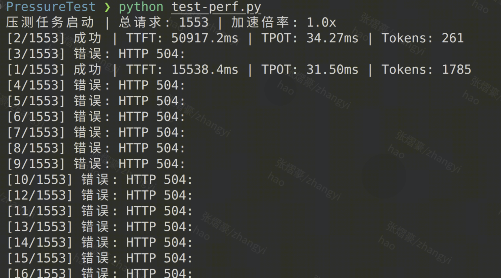
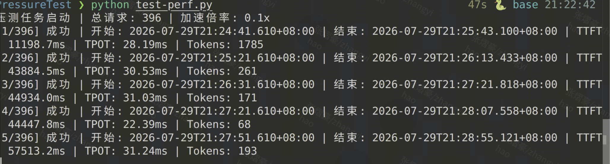
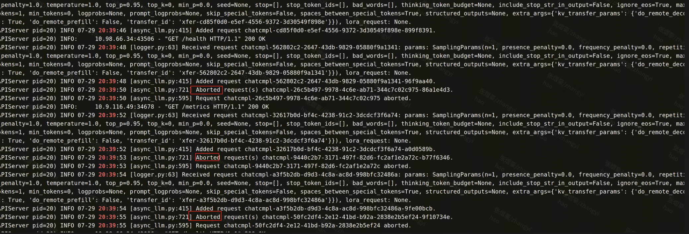

# 1.部署背景

目前在黄区环境中部署了一套 GLM-5 Prefill/Decode（PD）分离推理服务：Prefill 侧包含 2 个实例，Decode 侧包含 2 个实例；每个实例内部使用 TP8，同一角色的两个实例组成 DP2。

## 1.1 实例内部的并行方式

脚本中的关键 DP/TP 配置如下：

```bash
-dp ${DP_SIZE}
-tp ${TP_SIZE}
#DP相关附属配置，对PD分离没有影响
--data-parallel-hybrid-lb
--data-parallel-size-local 1
--data-parallel-start-rank ${DP_START_RANK}
--data-parallel-address ${DP_ADDR}
--data-parallel-rpc-port 13345
```

这里存在两层调度：

1. AiBrix 在集群层面选择承接请求的 Prefill/Decode 实例。
2. vLLM 在实例内部管理 TP Worker 及 DP Rank。

## 1.2 Prefill/Decode 角色与 KVCache 传输

脚本通过 `KV_ROLE` 将服务实例划分为 KVCache 生产者和消费者。

Prefill 实例使用如下配置：

```json
{
  "kv_connector": "MLUMooncakeConnector",
  "kv_role": "kv_producer",
  "kv_connector_extra_config": {
    "num_workers": 64
  }
}
```

Decode 实例使用如下配置：

```json
{
  "kv_connector": "MLUMooncakeConnector",
  "kv_role": "kv_consumer"
}
```

其中：

- `MLUMooncakeConnector` 负责 Prefill 与 Decode 实例之间的 KVCache 传输。
- `num_workers=64` 表示 Prefill 侧配置了 64 个 **KV 传输 Worker**，其对传输并发度、CPU 和网卡负载的影响需要在后续排查中重点关注。

（MooncakeConnector传输相关配置需要重点排查）

## 1.3 AiBrix 上层调度

AiBrix 位于客户端与 vLLM 实例之间，负责集群级的请求接入和路由；vLLM 则负责实际的模型计算。一次 PD 分离请求可以抽象为以下流程：

```text
客户端
  │
  ▼
Envoy / AiBrix Gateway
  │
  ├── 从 Prefill 资源池中选择实例
  │       └── 计算 Prompt 并生成 KVCache
  │
  ├── 从 Decode 资源池中选择实例
  │
  ├── 为该请求建立 KVCache 传输关联
  │
  ▼
Decode 实例通过 MLUMooncakeConnector 获取 KVCache
  │
  └── 继续逐 Token Decode，并将结果返回客户端
```

在这个过程中，KVCache 数据本身由 `MLUMooncakeConnector` 传输；“本次请求由哪个 Prefill 生成 KV、应当交给哪个 Decode”等控制信息则需要由上层路由器进行协调。

真正将请求组织成“先 Prefill、再 Decode”的是 AiBrix 路由逻辑及其传递的 KV 传输关联信息。

# 2.问题现象

（执行压测，效果不理想）

压测方案：拉取单pod的线上数据，连续请求PD分离服务，观察请求相关指标

现象：

* 单请求正常处理，正常返回结果
* speed_up为1（与线上glm5请求负载一致）：绝大部分请求504，少量请求成功执行
  
  * 504：请求**超时**
* speed_up为0.1（增大请求发射间隔）：所有请求成功执行
  

查看Prefill/Decode节点日志，发现

* Decode节点接收的请求极少，没有请求压力
* Prefill节点持续不断abort请求
  

分析：**Prefill节点不断abort新的请AiBrix、求** ----->  请求连续504

什么导致Prefill节点不断abort？（可能原因，后续重点排查KV Connector 传输/握手/匹配异常）

# 3.分析过程

低速请求可以全部成功  -----> **时延积累**导致请求生命周期外部终止

目前，请求处理流程横跨多层

* 单请求阶段：链路慢，尚未超过超时阈值
* 连续请求：排队时间 + PD链路耗时进一步增加
* 导致：超过某层 timeout
* 结果：请求被取消，Prefill abort请求

**直接原因：**Prefill API Server 或 Engine 收到了请求取消信号，于是执行abort()

重点关注：

* Prefill使用MLUMooncakeConnector + num_workers=64
* AIbrix调度请求相关......

从上到下，可探索的方向：

* KV Connector 或 PD 控制链路阻塞，使请求长时间无法从 Prefill 流转到 Decode    ？
* Prefill 自身处理能力不足，请求排队越来越久，最终触发上游超时    ？
* AiBri上游组件发现请求超时并断开连接    ？

## 3.1 KvConnector

当前 PD 服务使用 vLLM V1 的 `MLUMooncakeConnector` 完成 Prefill 与 Decode 之间的 KVCache 传输。

Prefill 侧配置：

```json
{
  "kv_connector": "MLUMooncakeConnector",
  "kv_role": "kv_producer",
  "kv_connector_extra_config": {
    "num_workers": 64
  }
}
```

Decode 侧配置类似

关键配置含义如下：

| 配置项           | 当前值                   | 作用                                                             |
| ---------------- | ------------------------ | ---------------------------------------------------------------- |
| `kv_connector` | `MLUMooncakeConnector` | 指定 Prefill/Decode 之间使用的 KVCache 传输实现                  |
| `num_workers`  | `64`                   | Prefill 侧 KV 传输 Worker 数量，主要影响 KV Block 的并发处理能力 |
| `block-size`   | `${BLOCK_SIZE:-16}`    | vLLM KVCache 的 Block 大小；当前未显式设置时默认为 16 Token      |

### 3.1.1分析可能性


当前的第一个排查假设是：高并发下，`MLUMooncakeConnector` 处理 KV Block 的速度低于 Prefill 产生 KVCache 的速度，导致待传输任务积压，请求长时间无法从 Prefill 流转到 Decode，最终触发上游超时和请求取消，Prefill 随后执行 `abort()`。

该推断目前只是候选原因，还需要结合 KV 传输队列深度、单次传输耗时、Worker 利用率、网卡带宽以及 Prefill/Decode 两端 Connector 日志进一步验证。


# 4.社区相关调研

[github.com/vllm-project/vllm/pull/20139](https://github.com/vllm-project/vllm/pull/20139)

该mr的场景是“Prefill 已经完成，但 Decode 一直没有来读取 KV Cache”；其目标是防止Prefill侧的KV Block永久占用；解决思路为KvCache Block设置TTL，超时后，Prefill节点自动abort；注意：该mr是针对NixlConnector，而非MoonCakeConnector

该mr的场景和解决问题和我们完全不同，但是它可以佐证“Prefill自动abort请求，不是异常现象”。


[github.com/vllm-project/vllm/issues/36948, ](https://github.com/vllm-project/vllm/issues/36948)[github.com/vllm-project/vllm/issues/38474](https://github.com/vllm-project/vllm/issues/38474)
moonCakeConnector相关的issue，关于MoonCakeConnector可以重点研究
