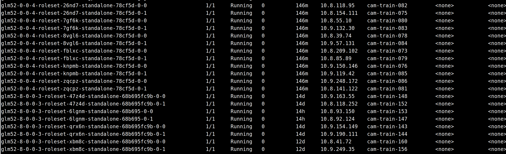

# 2026\.7\.22

- 黄区172\.24\.32\.31，命名空间ns\-e23f5b20fb9b42d3ac674f9691a0b9b1，部署此前由部署脚本构建的模型实例



    - 图中分别是两个推理服务（实例数为6和4的两个服务），每个实例占用两个节点，采用TP8 \+ DP2的并行部署方式，分别对应“黄区智算平台”的[glm52](http://bj.caip.cambricon.com:30080/predictor/d1b8948b-c5b8-4fd0-889b-29f8d9c03d61?ns=e23f5b20fb9b42d3ac674f9691a0b9b1)和[glm52\-8](http://bj.caip.cambricon.com:30080/predictor/ec14e593-bc09-4162-94cb-ead353833355?ns=e23f5b20fb9b42d3ac674f9691a0b9b1)服务

    - 观察glm52\-8\-0\-0\-3\-roleset\-47z4d\-standalone\-xxxx类型pod的环境变量，重点关注以下

        ```CSS
        //DP相关环境变量
        POD_GROUP_INDEX_0_ADDRESS
        POD_GROUP_SIZE
        POD_GROUP_INDEX
        ```

    - DP=2，一个vLLM实例有2个DP rank，每个DP rang对应一个Pod；rank1的Pod会通过POD\_GROUP\_INDEX\_0\_ADDRESS指向rank0所在的节点及其网络端口；因为一个包含多个DP rank的vLLM服务只会有一个DP rank负责启动vLLM中的API server，负责请求流量的转发，故需要POD\_GROUP\_INDEX\_0\_ADDRESS

- 当前Pod的POD\_GROUP\_INDEX\_0\_ADDRESS具体值：Service

    ```CSS
    //指向具体pod，格式：pod名.service名.命名空间名.svc.cluster.local
     POD_GROUP_INDEX_0_ADDRESS: glm52-8-0-0-3-roleset-qrx6n-standalone-68b695fc9b-0-0.glm52-8-0-0-3.ns-e23f5b20fb9b42d3ac674f9691a0b9b1.svc.cluster.local
    ```

    - glm52\-8\-0\-0\-3 service利用内部labelselector匹配了所有8个pod；无头service（Headless）

- Headless Service（无ClusterIp）；CoreDNS

    - 让 Kubernetes 的 CoreDNS 为其覆盖的每一个 Pod 生成一条独立的 DNS A 记录，本身不做任何流量的负载均衡和转发。

    - Headless Service：供稳定、精确的 **Pod 级别** DNS 解析

    - 适合：分布式应用中，rank1服务必须连接到指定的rank0的服务

    - 动机：

        - 云原生环境的动态性：Pod的真实IP在K8s中可能会动态变化，但是这种长域名的表示，一般比较固定

- TP 8 \+ DP 2的vLLM服务中，除了Headless service以外，还有一个service

    ```YAML
    Name:                     glm52-8-0-0-3-serving
    Namespace:                ns-e23f5b20fb9b42d3ac674f9691a0b9b1
    Labels:                   id=ec14e593-bc09-4162-94cb-ead353833355
                              model.aibrix.ai/name=glm5
                              name=glm52-8
                              owner-id=
                              owner-type=
                              serving.cambricon.com/llmserving-name=glm52-8
                              serving.cambricon.com/llmserving-uid=a751349c-c0a1-48a9-a461-602a43ddecfc
                              type=predictor
                              user-id=wangyanzhao
                              version=0.0.3
    Annotations:              <none>
    Selector:                 id=ec14e593-bc09-4162-94cb-ead353833355,version=0.0.3
    Type:                     ClusterIP
    IP Family Policy:         SingleStack
    IP Families:              IPv4
    IP:                       172.26.124.13
    IPs:                      172.26.124.13
    Port:                     serve  7921/TCP
    TargetPort:               7921/TCP
    Endpoints:                10.9.163.55:7921,10.8.118.252:7921,10.9.190.111:7921 + 7 more...
    Session Affinity:         None
    Internal Traffic Policy:  Cluster
    Events:                   <none>
    ```

    - 该Service提供真实的负载均衡，请求转发等功能，其中需要关注的Selector

    - Selector中id并非指代具体的Pod，依旧是匹配所有pod

        - 该id主要是和k8s的灰度发布有关，避免service将路由调度到**新旧不一致**的pod上

        - 也就是说ec14e593\-bc09\-4162\-94cb\-ead353833355指代的是当前这个版本对应的所有pod，

- service和endpoint


晚上等节点资源空闲，开始PD分离服务部署，现在继续TypeScript的基础语法

- Promise

    - 状态机（pending，fulfilled，error）；和Python有一定区别；resolve和reject；链式调用；

    - promise\.then\(\)；主线程，浏览器运行环境外部线程；

    - promise内部：纯JS逻辑和相关异步代码（比如，fetch\(\)，setTimeOut\(\)等）所执行的逻辑是不一样的

- 牢记：TypeScript是单线程，不能像Python那种使用多线程，线程池之类的概念，但是TypeScript在浏览器执行过程中，可以利用浏览器运行环境的外部线程

- Promise\.then\(\)链式调用规则

    - then\(\)回调**“微任务队列”**

    ```TypeScript
    console.log("1");
    
    const promise = new Promise<string>((resolve) => {
        console.log("2");
        resolve("成功");
    });
    
    promise.then((value) => {
        console.log("4:", value);
    });
    
    console.log("3");
    //执行结果：1，2，3，4；“微任务队列”
    
    ```

- async / await：基本概念和Python是一致的，实现方式有所不同

    - 但是TypeScript和Python有一点儿是完全不一样的

        ```JavaScript
        async function task() {
            await delay(1000); // 交出控制权
        }
        
        task(); // 启动任务
        console.log("我会立刻执行，不用等 task！"); // 主线程立刻跑到这里
        ```

        ```Python
        import asyncio
        
        async def task():
            await asyncio.sleep(1) # 交出控制权给 asyncio 结界
        
        # 结界启动！主程序在这里被“阻塞”了，必须等结界里的事全干完
        asyncio.run(task()) 
        
        # 这句话必须等上面 1 秒钟结束后，结界破除，才会执行！
        print("我必须等结界解除才能执行！")
        ```

        - task\(\)：TypeScript天生异步，直接执行即可

        - 区别在于：

            - TypeScript执行task\(\)后，主线程继续执行后续的“console \.\.\.\.\.”

            - Python则会阻塞在asyncio\.run\(\)

- async / await 本质上和Promise差不多，并不会给带来任何超越Promise的能力


如果fetchBurger\(\)是一个需要调用浏览器外部进程的函数，此时（当TypeScript执行到`await`时）

- 引擎会把 `await` **下面的所有代码**打包为一个回调任务

- 主线程退出`orderFoodAsync` 这个函数！，继续执行`orderFoodAsync`后面的代码（这和Python是完全不一样的）

```JavaScript
async function orderFoodAsync() {
    console.log("1. 开始点餐");
    
    // await 直接把异步请求“拉平”了，取代了第一个 .then
    const burger = await fetchBurger(); 
    console.log("2. 拿到汉堡：" + burger);
    
    // 取代了第二个 .then
    const result = await eatBurger(burger); 
    console.log("3. 吃完了：" + result);
}

orderFoodAsync();
console.log("4. 我先去占个座");
// 执行顺序依然是：1 -> 4 -> (不知多久后) 2 -> 3
```


