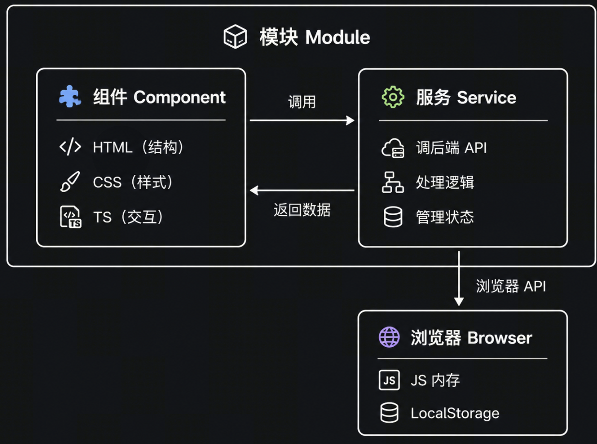

# 2026\.7\.24

- npm和yarn：基本完全一致；包管理工具

- yarn包管理工具通过package\.json的Scripts会执行一些构建命令，其中yarn会调用相关工具

    - 构建工具（vite）：针对前端发版部署构建dist/文件夹

    - 框架CLI：前端框架所提供的构建工具，适用于前端本地开发

- 所以在前端开发过程中，存在两套构建环境production和development

- 组件Component；模块Module

    - 组件：前端平台上可以**看到**的独立渲染单元；

        - 一个标准的组件通常由\.html，\.css，\.ts组成，对应我们之间的梳理逻辑

            - 骨架，装扮，大脑

        - 组件树，万物皆组件

        ```CSS
        App (根组件)
         └── LayoutComponent (整体布局：包含左侧边栏 + 右侧主内容区)
              └── DashboardComponent (页面级组件：仪表盘)
                   ├── HeaderComponent (仪表盘顶部标题区)
                   ├── StatCardComponent (子组件 1：资源总数 6)
                   ├── StatCardComponent (子组件 2：运行中 4)
                   └── StatCardComponent (子组件 3：异常 1)
        ```

        - 这些组件（\.html\+\.css\+\.ts）并不一定会放在统一的文件夹下，它们也会根据“复用范围”和“职责”等因素被开发人员放到不同的文件夹中

        - 页面本质就是一个“比较大”的组件（底层技术）

- 服务Service：不关心任何UI样式和DOM结构，只关注处理数据和提供逻辑能力

    - Service通常会：

        - 发起网络请求调用后端

        - 组件间数据共享

        - 复杂业务逻辑计算

- 问题：组件内部的\.ts文件会定义相关运行逻辑，那么为什么还需要Service服务呢？

    - 回答：直接在组件的\.ts文件写service相关逻辑，程序也能跑，但是\.\.\.\.

        - 关注核心不同：组件\.ts关注界面的变化；service关注数据的获取

        - 生命周期不同：

        - 如果所有逻辑全在组件\.ts中，

            - 代码严重重复（无法复用）

            - 页面一刷新/切换，数据就丢失了

    - **所以，组件\.ts文件会频繁调用Service里的各种方法**

- 为保证数据复用，浏览器提供两种存储机制：

    - 内存（JavaScript堆内存）：只要用户刷新浏览器或关闭标签页，内存里的数据就会被清空。比如订单状态，实时监控数据等

    - 浏览器共享存储空间：其中包含各种存储（localStorage，sessionStorage等等）

- 在前端开发中，service存储数据的流程：

    ```Plain Text
    ┌──> 存入【Service 内存 (RAM)】 ────> 供组件快速读取、共享 (90% 的场景)
                   │
    后端接口数据 ──┤
                   │
                   └──> 存入【localStorage / Cookies】 ─> 仅用于刷新/关浏览器后仍需保留的数据 (如 Token)
    ```

    - service中的相关\.ts代码会去调用浏览器暴露的API接口，以完成数据存储

- 模块Module：开发人员用来管理代码等的逻辑容器，类似后端项目中的service/，DB/等模块，用户是无感知



    - 抽象；开发者自主划分模块

    - 模块包含Service服务和Component组件

前端项目的一个完整框架：


- 路由：

    - 动态构建和切换组件树

    - 树节点的动态挂载/卸载

    - 本身以路由模块module的形式组织在模块体系内；AppRouteModule；实现懒加载constructor\(private userService: UserService\) \{\}

- 组件树的构建依赖路由

    - 路由本身就是树结构\(routeTree\)；route\.module\.js

    - 组件树不是在内存中提前建造好的，而是通过路由蓝图“按需动态渲染”的（懒加载）

对前端项目中的5个核心概念总结一下


- 只有 Component 才会使用这些标签和 HTML 文件

    - 浏览器原生自定义标签；前端框架的伪标签

- Component：自定义html标签；selector；挂载

- 单页应用：不断挂载，不断切换新的页面，懒加载

    - 前端项目的根目录中存在一个\<body\>极其干净的index\.html

    - 前端运行过程中，会一直向index\.html挂载Component的HTML，实现页面的更新

- 现代单页SPA；传统多页


