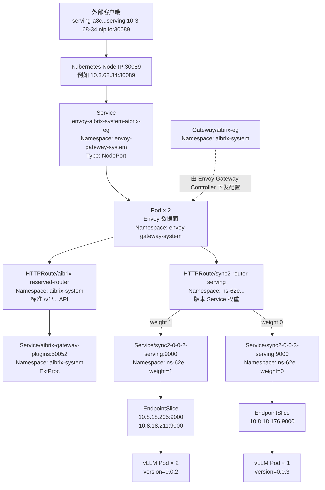

# 寒武纪 PaaS 平台推理服务流量转发

## 1. 文档范围

本文记录 **34 测试环境** 中，PaaS 平台在线推理服务 `sync2` 从外部入口到 vLLM Pod 的 Kubernetes 流量链路。

调查信息：

| 项目                | 值                                       |
| ------------------- | ---------------------------------------- |
| 环境                | 34 测试环境                              |
| Kubernetes 访问节点 | `10.3.68.34`                           |
| 业务 Namespace      | `ns-62e496e4b82341bb99a1f7765bee73ba`  |
| 在线服务            | `LLMServing/sync2`                     |
| 服务 UID            | `a8c636d5-b018-473b-a703-fa0c0693f800` |
| 模型                | `qwen3-4b`，服务模型名为 `qwen`      |

## 2. 核心结论

34 测试环境的 `LLMServing/sync2` 使用以下技术体系提供推理入口：

```text
AiBrix 工作负载编排
    + Kubernetes Gateway API 路由声明
    + Envoy Gateway 控制面
    + Envoy 数据面转发
```

常规版本与金丝雀版本的流量比例声明在 `HTTPRoute/sync2-router-serving` 的 `backendRefs[].weight` 中：

```text
0.0.2 常规版本：weight = 1
0.0.3 金丝雀版本：weight = 0
```

在调查时刻，普通版本权重路由把全部流量分配给 `0.0.2`，不给 `0.0.3` 分配流量。

## 3. 全链路拓扑



需要区分两类路由能力：

1. `sync2-router-serving` 负责声明常规版本和金丝雀版本的 Service 权重；
2. `aibrix-reserved-router` 为标准模型 API 接入 AiBrix Gateway Plugin，实现模型感知和 Pod 级目标选择。包括对话生成 `/v1/chat/completions`、文本补全 `/v1/completions`、向量化 `/v1/embeddings`、重排序 `/v1/rerank`、分类 `/v1/classify`，以及图像、视频生成接口。

两类路由共享同一个 `Gateway/aibrix-eg` 和 Envoy 数据面，但业务职责不同。

**问题-zyh：**客户端地址[serving-a8c636d5-b018-473b-a703-fa0c0693f800.serving.10-3-68-34.nip.io:30089](http://serving-a8c636d5-b018-473b-a703-fa0c0693f800.serving.10-3-68-34.nip.io:30089)，这个地址是怎么生成出来的？来自于哪里？

**答：**这个 URL 由平台的 `LLMServing` 控制链生成并回填到 `LLMServing/sync2.status.url`。从现有字段可以拆成四部分：`serving-a8c...` 使用服务 UID 构造唯一主机前缀；`.serving.10-3-68-34.nip.io` 来自平台/Gateway 的服务域名模板；`nip.io` 会把域名中嵌入的 `10-3-68-34` 解析为 `10.3.68.34`；`:30089` 来自 Gateway Listener 和 Envoy NodePort。也就是说，PaaS/LLMServing Controller 负责拼装并发布该访问地址，`nip.io` 负责 DNS 解析，Gateway 与 NodePort 负责实际接入。

## 4. Kubernetes 资源总表

### 4.1 平台入口与 Envoy 资源

| Kind/API                                            | Name                                                        | Namespace                | 职责                                                         |
| --------------------------------------------------- | ----------------------------------------------------------- | ------------------------ | ------------------------------------------------------------ |
| `GatewayClass` / `gateway.networking.k8s.io/v1` | `aibrix-eg`                                               | 集群级，无 Namespace     | 指定 Envoy Gateway Controller                                |
| `Gateway` / `gateway.networking.k8s.io/v1`      | `aibrix-eg`                                               | `aibrix-system`        | 声明 HTTP/HTTPS Listener，接受业务 HTTPRoute                 |
| `EnvoyProxy` / `gateway.envoyproxy.io/v1alpha1` | `aibrix-custom-proxy-config`                              | `aibrix-system`        | 配置 Envoy 副本、镜像、NodePort Service、日志和调度策略      |
| `Service` / `v1`                                | `envoy-aibrix-system-aibrix-eg`                           | `envoy-gateway-system` | 以 NodePort`30089` 暴露 Envoy HTTP 入口                    |
| `EndpointSlice` / `discovery.k8s.io/v1`         | `envoy-aibrix-system-aibrix-eg-6whr2`                     | `envoy-gateway-system` | 将入口 Service 映射到两个 Envoy Pod                          |
| `Pod` / `v1`                                    | `envoy-aibrix-system-aibrix-eg-903790dc-7fd54b8476-kh7jj` | `envoy-gateway-system` | Envoy 数据面实例，IP`10.8.193.135`                         |
| `Pod` / `v1`                                    | `envoy-aibrix-system-aibrix-eg-903790dc-7fd54b8476-x6pf8` | `envoy-gateway-system` | Envoy 数据面实例，IP`10.8.193.249`                         |
| `Pod` / `v1`                                    | `envoy-gateway-75687c85dc-sskbj`                          | `envoy-gateway-system` | Envoy Gateway 控制面，负责 Gateway API 到 Envoy xDS 配置转换 |

### 4.2 `sync2` 业务路由与版本资源

| Kind/API                                                | Name                          | Namespace                               | 职责                                                       |
| ------------------------------------------------------- | ----------------------------- | --------------------------------------- | ---------------------------------------------------------- |
| `LLMServing` / `serving.cambricon.com/v1alpha1`     | `sync2`                     | `ns-62e496e4b82341bb99a1f7765bee73ba` | 在线服务顶层自定义资源，声明版本、权重和 StormService 模板 |
| `HTTPRoute` / `gateway.networking.k8s.io/v1`        | `sync2-router-serving`      | `ns-62e496e4b82341bb99a1f7765bee73ba` | 将入口请求按权重分配给 0.0.2 和 0.0.3 的 Service           |
| `StormService` / `orchestration.aibrix.ai/v1alpha1` | `sync2-0-0-2`               | `ns-62e496e4b82341bb99a1f7765bee73ba` | 编排常规版本工作负载                                       |
| `StormService` / `orchestration.aibrix.ai/v1alpha1` | `sync2-0-0-3`               | `ns-62e496e4b82341bb99a1f7765bee73ba` | 编排金丝雀版本工作负载                                     |
| `Service` / `v1`                                    | `sync2-0-0-2-serving`       | `ns-62e496e4b82341bb99a1f7765bee73ba` | 常规版本 ClusterIP Service，端口`9000`                   |
| `Service` / `v1`                                    | `sync2-0-0-3-serving`       | `ns-62e496e4b82341bb99a1f7765bee73ba` | 金丝雀版本 ClusterIP Service，端口`9000`                 |
| `EndpointSlice` / `discovery.k8s.io/v1`             | `sync2-0-0-2-serving-n8dtc` | `ns-62e496e4b82341bb99a1f7765bee73ba` | 常规版本 Pod Endpoint 集合                                 |
| `EndpointSlice` / `discovery.k8s.io/v1`             | `sync2-0-0-3-serving-w2h2l` | `ns-62e496e4b82341bb99a1f7765bee73ba` | 金丝雀版本 Pod Endpoint 集合                               |

### 4.3 AiBrix Gateway Plugin 资源

| Kind/API                                                      | Name                                         | Namespace         | 职责                                                            |
| ------------------------------------------------------------- | -------------------------------------------- | ----------------- | --------------------------------------------------------------- |
| `HTTPRoute` / `gateway.networking.k8s.io/v1`              | `aibrix-reserved-router`                   | `aibrix-system` | 捕获标准推理 API，例如`/v1/chat/completions`                  |
| `HTTPRoute` / `gateway.networking.k8s.io/v1`              | `aibrix-reserved-router-metadata-endpoint` | `aibrix-system` | 捕获`/v1/models`、`/v1/files`、`/v1/batches` 等元数据 API |
| `EnvoyExtensionPolicy` / `gateway.envoyproxy.io/v1alpha1` | `aibrix-gateway-plugins-extension-policy`  | `aibrix-system` | 为 reserved route 配置 Envoy ExtProc                            |
| `EnvoyExtensionPolicy` / `gateway.envoyproxy.io/v1alpha1` | `aibrix-skip-ext-proc`                     | `aibrix-system` | 元数据路由的扩展处理策略                                        |
| `EnvoyPatchPolicy` / `gateway.envoyproxy.io/v1alpha1`     | `aibrix-epp`                               | `aibrix-system` | 为 Gateway 注入`ORIGINAL_DST` 等 Envoy 路由能力               |
| `Service` / `v1`                                          | `aibrix-gateway-plugins`                   | `aibrix-system` | ExtProc 后端，端口`50052`                                     |
| `Pod` / `v1`                                              | `aibrix-gateway-plugins-84d8d8d99d-v9578`  | `aibrix-system` | AiBrix Gateway Plugin 运行实例                                  |
| `Service` / `v1`                                          | `aibrix-metadata-service`                  | `aibrix-system` | 模型元数据服务，端口`8090`                                    |

## 5. 外部入口链路

`LLMServing/sync2.status.url`为：

```text
http://serving-a8c636d5-b018-473b-a703-fa0c0693f800.serving.10-3-68-34.nip.io:30089
```

`Gateway/aibrix-eg` 的关键声明可简化为：

```yaml
apiVersion: gateway.networking.k8s.io/v1
kind: Gateway
metadata:
  name: aibrix-eg
  namespace: aibrix-system
spec:
  gatewayClassName: aibrix-eg
  infrastructure:
    parametersRef:
      group: gateway.envoyproxy.io
      kind: EnvoyProxy
      name: aibrix-custom-proxy-config
  listeners:
    - name: http
      hostname: "*.serving.10-3-68-34.nip.io"
      port: 30089
      protocol: HTTP
      allowedRoutes:
        namespaces:
          from: All
```

入口 Service 的关键配置为：

```yaml
apiVersion: v1
kind: Service
metadata:
  name: envoy-aibrix-system-aibrix-eg
  namespace: envoy-gateway-system
spec:
  type: NodePort
  externalTrafficPolicy: Cluster
  ports:
    - name: http-30089
      port: 30089
      nodePort: 30089
      targetPort: 30089
  selector:
    app.kubernetes.io/name: envoy
    gateway.envoyproxy.io/owning-gateway-name: aibrix-eg
    gateway.envoyproxy.io/owning-gateway-namespace: aibrix-system
```

外部访问流程为：

```text
域名中的 10-3-68-34.nip.io
    → 节点地址 10.3.68.34
    → NodePort 30089
    → Service/envoy-aibrix-system-aibrix-eg
    → Envoy Pod:30089
```

该 Service 使用 `externalTrafficPolicy: Cluster`，因此外部请求进入可达节点的 NodePort 后，可以被集群网络转发到实际运行 Envoy 的节点。

## 6. 版本权重路由

`HTTPRoute/sync2-router-serving` 由 `LLMServing/sync2` 控制，其关键配置为：

```yaml
apiVersion: gateway.networking.k8s.io/v1
kind: HTTPRoute
metadata:
  name: sync2-router-serving
  namespace: ns-62e496e4b82341bb99a1f7765bee73ba
  ownerReferences:
    - apiVersion: serving.cambricon.com/v1alpha1
      kind: LLMServing
      name: sync2
      controller: true
spec:
  hostnames:
    - "*.serving.10-3-68-34.nip.io"
  parentRefs:
    - group: gateway.networking.k8s.io
      kind: Gateway
      name: aibrix-eg
      namespace: aibrix-system
  rules:
    - matches:
        - path:
            type: PathPrefix
            value: /
      backendRefs:
        - kind: Service
          name: sync2-0-0-2-serving
          port: 9000
          weight: 1
        - kind: Service
          name: sync2-0-0-3-serving
          port: 9000
          weight: 0
      timeouts:
        request: 3600s
```

该 Route 的状态为：

```text
Accepted=True
ResolvedRefs=True
ControllerName=gateway.envoyproxy.io/gatewayclass-controller
```

这证明 Envoy Gateway Controller 已接受该路由，并成功解析两个后端 Service。

权重由平台的 `LLMServing` 业务模型产生，真正执行请求转发的是 Envoy 数据面：

```text
PaaS 页面调整版本比例
    → 后端更新 LLMServing.spec.versions[].weight
    → LLMServing Controller 更新 HTTPRoute.backendRefs[].weight
    → Envoy Gateway Controller 转换为 xDS 配置
    → Envoy 数据面按权重选择版本 Service
```

需要注意：权重表示长期概率比例，不保证每固定数量请求中严格出现一次金丝雀请求。

## 7. Service、EndpointSlice 与 vLLM Pod

两个版本都通过独立的 ClusterIP Service 暴露 `9000/TCP`，Service 使用相同服务 `id` 与不同 `version` 标签选择对应 Pod：

```text
sync2-0-0-2-serving → 2 个 Ready Pod（常规版本 0.0.2）
sync2-0-0-3-serving → 1 个 Ready Pod（金丝雀版本 0.0.3）
```

EndpointSlice 维护 Service 当前可用的 Pod IP；vLLM 容器在 `9000` 端口提供推理服务，并通过 `/health` 进行存活与就绪检查。

## 8. AiBrix 工作负载所有权

`LLMServing/sync2` 最多包含两个当前在线版本。调查时的工作负载关系为：

```text
LLMServing/sync2
├── version 0.0.2, weight=1
│   └── StormService/sync2-0-0-2
│       ├── RoleSet/sync2-0-0-2-roleset-dln7k
│       │   └── Pod/...-gkks6
│       └── RoleSet/sync2-0-0-2-roleset-pq56n
│           └── Pod/...-v8ht8
└── version 0.0.3, weight=0
    └── StormService/sync2-0-0-3
        └── RoleSet/sync2-0-0-3-roleset-8cmvk
            └── Pod/...-4f852
```

其中：

- `LLMServing` 表达在线推理服务及版本期望状态；
- `StormService` 管理某个版本的整体工作负载；
- `RoleSet` 管理角色及对应 Pod；
- Pod 内运行实际 vLLM 推理容器。

## 9. AiBrix 智能路由链

`HTTPRoute/aibrix-reserved-router` 匹配以下标准推理接口：

```yaml
apiVersion: gateway.networking.k8s.io/v1
kind: HTTPRoute
metadata:
  name: aibrix-reserved-router
  namespace: aibrix-system
spec:
  parentRefs:
    - kind: Gateway
      name: aibrix-eg
  rules:
    - matches:
        - path: { type: PathPrefix, value: /v1/chat/completions }
        - path: { type: PathPrefix, value: /v1/completions }
        - path: { type: PathPrefix, value: /v1/embeddings }
        - path: { type: PathPrefix, value: /v1/rerank }
        - path: { type: PathPrefix, value: /v1/classify }
        - path: { type: PathPrefix, value: /v1/images/generations }
        - path: { type: PathPrefix, value: /v1/video/generations }
      backendRefs:
        - kind: Service
          name: aibrix-gateway-plugins
          port: 50052
```

其 `EnvoyExtensionPolicy` 为 Envoy 配置 ExtProc：

```yaml
apiVersion: gateway.envoyproxy.io/v1alpha1
kind: EnvoyExtensionPolicy
metadata:
  name: aibrix-gateway-plugins-extension-policy
  namespace: aibrix-system
spec:
  targetRef:
    group: gateway.networking.k8s.io
    kind: HTTPRoute
    name: aibrix-reserved-router
  extProc:
    backendRefs:
      - kind: Service
        name: aibrix-gateway-plugins
        port: 50052
    messageTimeout: 60s
    processingMode:
      request:
        body: Buffered
      response:
        body: Streamed
```

另外，`EnvoyPatchPolicy/aibrix-epp` 绑定 `Gateway/aibrix-eg`，创建了基于 `target-pod` Header 的 `ORIGINAL_DST` Cluster。这表明 AiBrix Plugin 可以选择具体目标 Pod，再让 Envoy 把请求直接转发到目标地址。

**问题-zyh：**这个`EnvoyExtensionPolicy`应该为envoyGateway的crd资源，对吗？这里应该是在指定aibrix-gateway和envoy用grpc进行关联，对吗？这应该会和aiBrix中的4阶段handler有密切关系

**答：**对。`EnvoyExtensionPolicy` 属于 Envoy Gateway API（`gateway.envoyproxy.io/v1alpha1`）的 CRD；这里通过 `targetRef` 把策略绑定到 `aibrix-reserved-router`，并通过 `extProc.backendRefs` 指定 `aibrix-gateway-plugins:50052` 作为 Envoy external processing 的 gRPC 服务。它不是把普通 HTTP 后端改成 gRPC，而是让 Envoy 在请求/响应处理过程中与 Plugin 建立 ExtProc 双向 gRPC 流。该机制正对应 AiBrix 的四阶段 Handler：RequestHeaders、RequestBody、ResponseHeaders、ResponseBody；当前 `processingMode` 中 Request Body 为 Buffered、Response Body 为 Streamed，因此 Plugin 能在请求体阶段完成模型/Prompt 解析和目标 Pod 选择，并在响应阶段记录状态与统计。

`aibrix-reserved-router` 与 `sync2-router-serving` 是挂载到同一 Gateway 的两条候选 HTTPRoute。对于 `/v1/chat/completions` 等标准接口，前者的 PathPrefix 比后者的 `/` 更具体，通常会优先匹配；Gateway API 不会在命中前者后再串联执行后者。

```text
标准模型 API（更具体的 /v1/... 路径）
    → Envoy
    → aibrix-reserved-router
    → ExtProc gRPC → aibrix-gateway-plugins
    → Plugin 选择目标 Pod
    → Envoy ORIGINAL_DST 直达目标 Pod

未命中更具体规则的请求
    → Envoy
    → sync2-router-serving（PathPrefix=/）
    → backendRefs.weight 选择版本 Service
    → EndpointSlice → vLLM Pod
```


## 10. 控制面与数据面的职责边界

| 层级           | 组件                                   | 职责                                                     |
| -------------- | -------------------------------------- | -------------------------------------------------------- |
| 业务控制面     | PaaS 前端、compute-server              | 接收用户的在线服务和版本流量配置                         |
| 推理服务控制面 | `LLMServing` Controller              | 将版本配置转换为 StormService、Service、HTTPRoute 等资源 |
| 工作负载控制面 | AiBrix StormService/RoleSet Controller | 创建和维护 vLLM Pod                                      |
| 网关控制面     | Envoy Gateway Controller               | 监听 Gateway API 和 Envoy Policy，生成并下发 xDS 配置    |
| 智能路由扩展   | AiBrix Gateway Plugin                  | 对标准推理请求进行模型感知或 Pod 级目标选择              |
| 入口数据面     | Envoy Pod                              | 接收外部请求并执行 HTTPRoute、权重和扩展处理逻辑         |
| 服务发现       | Service、EndpointSlice                 | 把版本服务映射到当前 Ready Pod Endpoint                  |
| 推理数据面     | vLLM Pod                               | 在`9000/TCP` 接收并执行实际推理请求                    |

必须区分“配置路由”和“执行路由”：

```text
LLMServing/AiBrix/Envoy Gateway Controller：声明、生成、下发规则
Envoy 数据面：真正处理每一个外部请求
Kubernetes Service：在版本内部维护 Pod Endpoint 集合
vLLM：执行模型推理
```

建议-zyh：后续可通过只读核对 AiBrix Gateway Plugin 的候选 Pod 构建逻辑或相关配置，确认标准 `/v1/...` 请求是否实际融合了 `LLMServing` 的版本权重；在确认前，不应把金丝雀权重与智能路由描述为已经自动串联。
