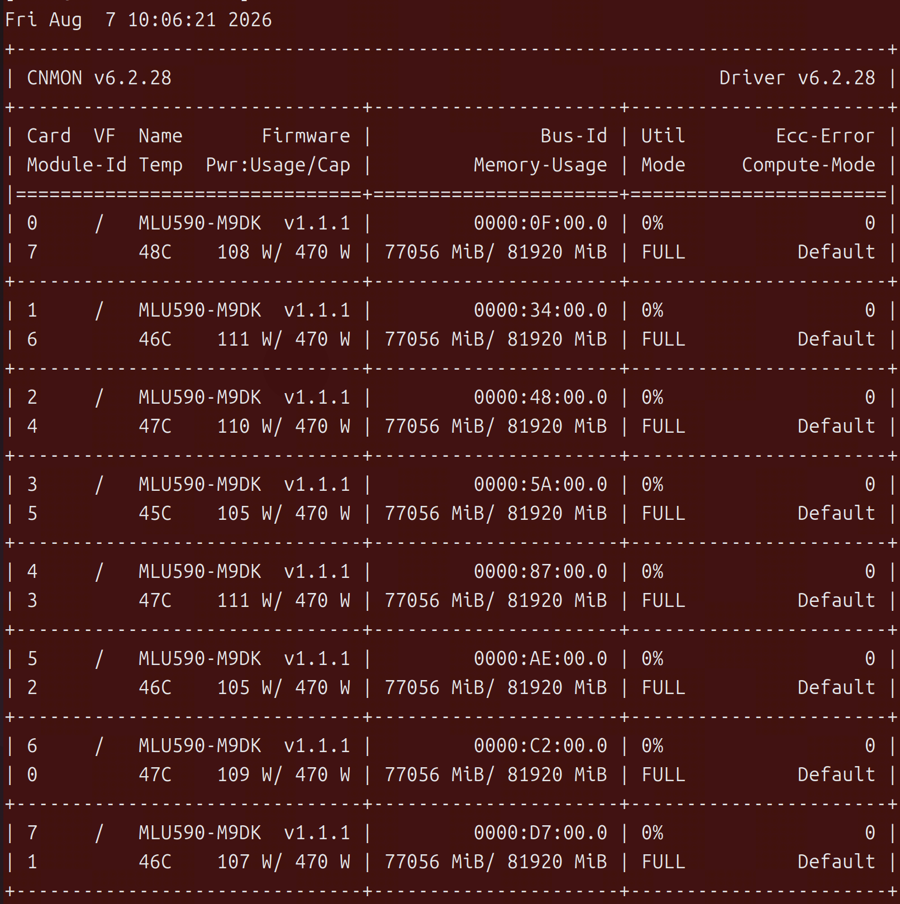

一台八卡MLU（MLU-590, 80G显存）服务器完整加载一个稳定可用，生产级别的模型（GLM-5.2-W4A8，deepseek-v4-flash等），并对外提供服务

也就是说，一台配置够高的GPU服务器就是部署一个目前最顶级的生产模型

# 1.MLU

服务器配置：

MLU型号：MLU-590-M90K，显存80GB；对标A100，综合表现大约达到A100的70% ~ 90%\

MLU软件生态：Neuware，对应NVIDIA的Cuda，但是有难度

# 2.模型配置

**模型参数：**

| 模型              |         总参数 |      激活参数 | 特点                                                                                                                                                                             |
| ----------------- | -------------: | ------------: | -------------------------------------------------------------------------------------------------------------------------------------------------------------------------------- |
| Qwen3-Coder-Next  |  **80B** |  **3B** | 极低激活，Agent/Coding，部署效率很高 ([Hugging Face](https://huggingface.co/Qwen/Qwen3-Coder-Next?utm_source=chatgpt.com "Qwen/Qwen3-Coder-Next · Hugging Face"))                   |
| DeepSeek-V4-Flash | **284B** | **13B** | 高效率 MoE，1M context ([DeepSeek API Docs](https://api-docs.deepseek.com/news/news260424/?utm_source=chatgpt.com "DeepSeek V4 Preview Release                                   |
| GLM-5.2           | **744B** | **40B** | 长程 Agent / Coding，1M context ([GitHub](https://github.com/zai-org/GLM-5/blob/main/README_zh.md?utm_source=chatgpt.com "GLM-5/README_zh.md at main · zai-org/GLM-5 · GitHub"))   |
| Kimi K2.5         |   **1T** | **32B** | MoE，多模态 Agent，256K context ([GitHub](https://github.com/MoonshotAI/Kimi-K2.5?utm_source=chatgpt.com "GitHub - MoonshotAI/Kimi-K2.5: Moonshot's most powerful model · GitHub")) |
| DeepSeek-V4-Pro   | **1.6T** | **49B** | V4 旗舰大模型 ([DeepSeek API Docs](https://api-docs.deepseek.com/news/news260424/?utm_source=chatgpt.com "DeepSeek V4 Preview Release                                            |

已知：750B的模型，表示这个模型的参数量有750B

**激活参数：对于某个 token 的一次前向传播，实际参与主要计算的模型参数总量。**

Dense模型：几乎所有层的参数都会参与，故total params ≈ active params；

MOE模型：每层只选少数 expert，因此 active params 远小于 total params。

由于目前的模型几乎都是MOE架构，故激活参数特别小。

为什么总参数特别大，而激活参数要特别小呢？？？？

* 总参数大，是为了提高模型容量（回答更多不同类型的问题）；激活参数小，是为了避免计算成本随着容量一起线性增长。
* 模型效果和计算成本的trade-off

模型厂商追求的目标：**在保持巨大模型容量的情况下，把每 token 激活参数压得越来越低。**

如何做？稀疏化/条件计算（MOE架构设计）

现在，我们来讨论“一台8卡MLU-590服务是如何部署一个750B的模型的？”

# 3.部署分析

750B 参数，全部用BF16/FP16 保存，每个参数 2 Byte，模型权重：**1500GB**，约1.5TB，显然一张8台服务器无法放下

关键在于：**W4A8**

W4：主要权重使用 4 bit。模型权重从1500GB变为375GB

* 在服务器上使用du -sh . 命令，发现该模型确实为376GB

8卡服务器总显存：640GB，显然足够了，其余空间用于KVCache，Runtime，算子等

MOE：由于MOE的存在，故每生成一个 token，不需要执行完整 750B Dense Model 的计算。

BF16/FP16 ----> 4bit**（量化）**

模型量化：把模型中的数值用更低精度的数据类型来表示，目的为减少显存、内存带宽和计算成本，代价为引入一定数值误差。

所以，对于一个750B的顶级开源模型，经过量化后，一台八卡MLU-590的服务绰绰有余
