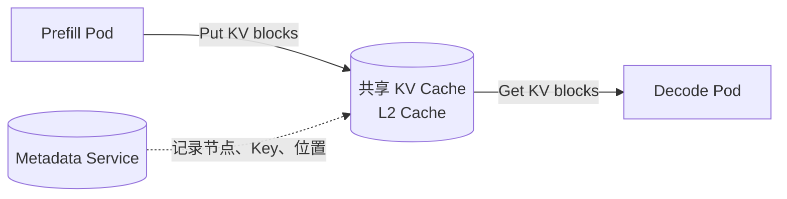
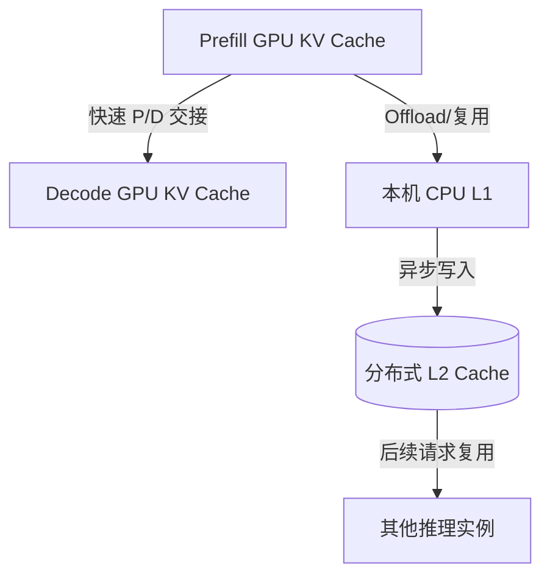

## 1.2 KVCache传输

### 1.2.1 点对点

Pod间直接传输；Prefill Pod  ---- RDMA/高速网络 ----> Decode Pod

* KVCache主要保存在Prefill Pod中
* Decode Pod根据相关信息**拉取** KV 数据（通常）
* 追求单次 P/D 请求的低延迟（优点）

典型实现包括：

* NIXL Connector；
* Mooncake P/D Connector；

**补充：**

点对点的传输，完全可能会加剧Prefill Pod的压力，再加上AiBrix中的一些超时配置（`AIBRIX_PREFILL_REQUEST_TIMEOUT`），极大可能是造成此前实验，请求504的原因

如果是，我感觉解决方案就是：

* 尽一切办法提升Prefill实例比重，因为目前Decode实例算力利用率比较低，无法看到P/D分离在P2P传输中的能力上限
* 探讨Pod间接传输，根据生产环境，考虑混合模式

关于AiBrix：是否可以优化？当检测到Prefill Pod显存压力过大时，降低该Prefill Pod请求接收速度，回压

### 1.2.2 Pod间接传输

中间层可能会负责：

* 跨实例共享；
* Prefix Cache 复用；
* 多级存储；

它可以解决“因decode无法及时获取KV Cache而导致请求超时”的问题

AiBri中也有这部分的内容，后续可以探讨

Mooncake Distributed Store；nfiniStore（AiBrix支持）

### 1.2.3 混合模式

感觉更贴近生产环境
