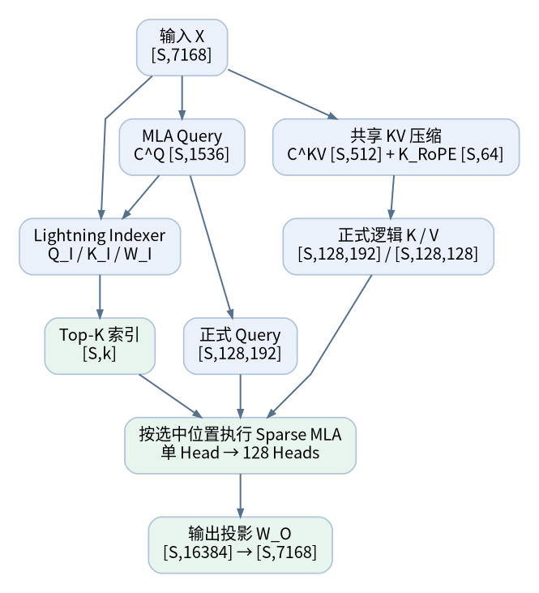
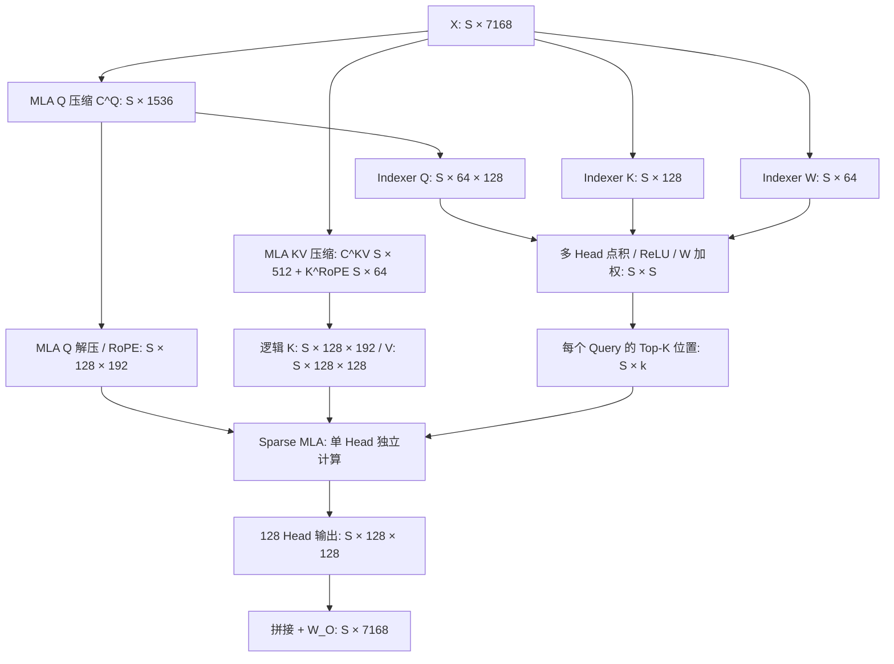
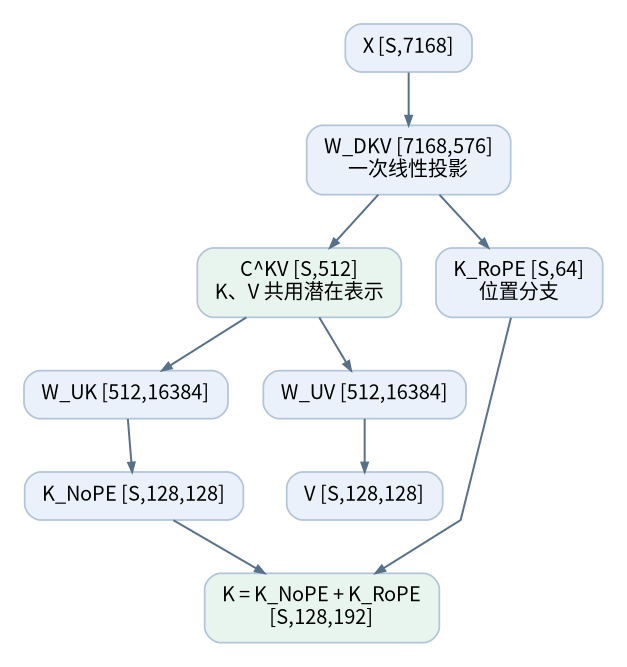
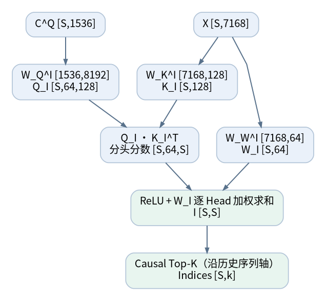
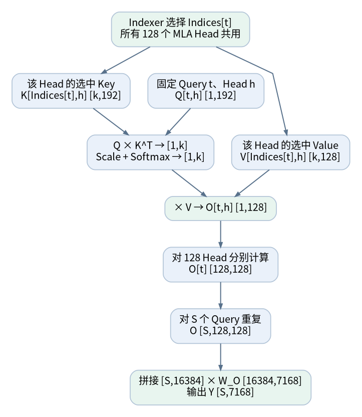
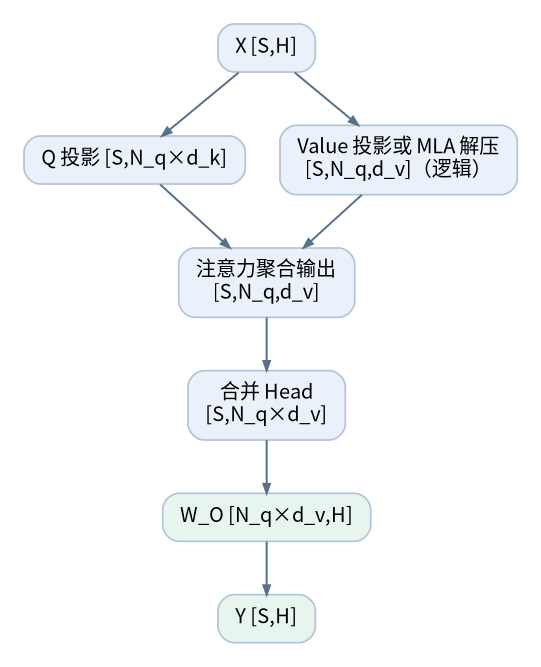

# MLA + DSA：完整张量变换流程、原理图解与单 Head 视角

> 本文覆盖一个 Transformer Attention 模块从输入 `X:[S,H]` 到输出 `Y:[S,H]` 的完整张量流：MLA 的 Q/KV 低秩路径、Lightning Indexer、Top-K 筛选、Sparse MLA 正式注意力及输出投影。原文以 **DeepSeek-V3.2-Exp 671B** 为数值实例（MLA+DSA 与 GLM-5.x 同族机制，GLM 数值代入对照见 §12）。
>
> 数据来源：导入自外部图解文档（2026-10-12），权重维度均采用**右乘行向量的数学约定**：`[S,A] × [A,B] → [S,B]`；PyTorch `nn.Linear.weight` 实际存储通常为 `[B,A]`。省略 Batch、TP、Bias、部分缩放与量化细节；`S` 表示单条序列的 Token 数。图片位于 `source/推理系统/推理算法/自注意力模块/计算轴/MLA_DSA_图解完整版/`。
>
> 与同目录 [DSA](DSA.md) 的分工：DSA.md 是机制篇（GLM 侧超参、anchor 兜底、full/shared 交替、KV Cache 显存账），本文是**逐步张量流图解**（DeepSeek 数值实例 + §12 GLM 代入对照）。两文在索引器 Head 聚合方式上存在口径分歧，见 §6 末尾的冲突标注。

## 1. 核心认知

- **MLA** 决定 Q 如何生成，以及历史 K/V 如何以**共享低秩潜在表示**的形式保存：缓存的是 `C^KV` 和解耦的 `K^RoPE`，而非所有 Head 完整展开的 K、V。
- **DSA / Lightning Indexer** 为每个 Query 对历史位置评分，选出 Top-K；**Indexer 的 64 个评分 Head 与 MLA 的 128 个正式注意力 Head 不存在一一对应关系**。
- **Sparse MLA**：每个 Query 的 128 个 MLA Head 共享 Indexer 的**同一组位置索引**，但分别使用自己的 Q/K/V 表示计算注意力分数和输出。
- `num_heads × head_dim = hidden_size` **不是数学强制约束**；对应维度兼容，且最终用 `W_O` 恢复到 `H` 即可。

## 2. 参数约定

| 参数                      | 符号 |   值 |
| ------------------------- | ---- | ---: |
| 隐藏维度                  | H    | 7168 |
| Token 数量                | S    | 可变 |
| MLA Q 低秩维度            | r_q  | 1536 |
| MLA KV 低秩维度           | r_kv |  512 |
| MLA 正式注意力 Head 数    | N    |  128 |
| 每 Head Q/K NoPE 维度     | d_c  |  128 |
| 每 Head Q/K RoPE 维度     | d_r  |   64 |
| 每 Head Q/K 总维度        | d_qk |  192 |
| 每 Head Value 维度        | d_v  |  128 |
| Indexer Head 数           | G    |   64 |
| Indexer 每 Head 维度      | d_i  |  128 |
| Indexer 每 Head RoPE 维度 | d_ir |   64 |
| 稀疏选择位置数            | k    | 2048 |

来源：DeepSeek 官方配置 [`config_671B_v3.2.json`](https://github.com/deepseek-ai/DeepSeek-V3.2-Exp/blob/main/inference/config_671B_v3.2.json)。

## 3. 整体计算图



**图解：** 输入 `X` 分成 MLA Q、共享 KV 和 Indexer 三条逻辑路径；Indexer 计算的是 Token 位置选择，正式的 Q/K/V 注意力仍由 MLA 完成。图中 `C^Q` 的输出也供 Indexer Q 投影复用。



上图是**逻辑计算图**。高性能实现不一定物化 `S×S`、`S×k×N×d` 或完整展开历史 K/V。

## 4. MLA Query 路径

### Step 1：Q 低秩压缩

输入：`X:[S,7168]`。权重：

$$
W_{DQ}:[7168,1536]
$$

$$
X[S,7168]W_{DQ}[7168,1536]\rightarrow C^Q[S,1536]
$$

对 `C^Q` 进行 RMSNorm（形状不变）；后续 **MLA Q 解压**与 **Indexer Q 投影**复用这个中间表示。

### Step 2：Q 解压与 RoPE

$$
W_{UQ}:[1536,128(128+64)]=[1536,24576]
$$

$$
C^Q[S,1536]W_{UQ}[1536,24576]\rightarrow[S,24576]
$$

重塑为 `[S,128,192]`；每个 Head 的 192 维分成：

- `Q^NoPE:[S,128,128]`；
- `Q^RoPE:[S,128,64]`，仅此部分执行 RoPE。

拼接得到正式注意力 `Q:[S,128,192]`。RoPE 改变数值、不改变形状。

## 5. MLA Key/Value 路径

### Step 3：共享 KV 压缩及解耦位置 Key



**图解：** `W_DKV` 的输出被切分为 `C^KV:[S,512]` 与 `K^RoPE:[S,64]`，**不是**把压缩 K 与压缩 V 各占一半拼接。`C^KV` 再通过两组不同的解压投影生成 `K^NoPE` 和 `V`。`W_UK`、`W_UV` 仅是 `W_UKV` 按输出维度拆分的等价数学视图。

$$
W_{DKV}:[7168,512+64]=[7168,576]
$$

$$
X[S,7168]W_{DKV}[7168,576]\rightarrow[S,576]
$$

拆分成：

- `C^KV:[S,512]`，经过 RMSNorm；
- `K^RoPE:[S,64]`，经过 RoPE。

**重要：** `C^KV` 不是 `C^K` 与 `C^V` 两段拼接，更不是其中一半为 K、另一半为 V。它是 K 和 V **共同使用的潜在表示**。联合产生 `[512]+[64]` 只是投影的组织方式；压缩的根本原因是低秩瓶颈及 K/V 共享潜在表示。等价地，也可把 `W_DKV` 按列分成 `[7168,512]` 与 `[7168,64]` 两个投影。

### Step 4：K/V 逻辑解压

合并实现的权重为：

$$
W_{UKV}:[512,128(128+128)]=[512,32768]
$$

$$
C^{KV}[S,512]W_{UKV}[512,32768]\rightarrow[S,32768]
$$

重塑并切分：

- `K^NoPE:[S,128,128]`；
- `V:[S,128,128]`。

也可以**等价地**将解压权重按列拆分：

$$
W_{UK}:[512,16384],\qquad W_{UV}:[512,16384]
$$

$$
K^{NoPE}=C^{KV}W_{UK},\qquad V=C^{KV}W_{UV}
$$

将共享 `K^RoPE:[S,64]` 沿 Head 维广播成 `[S,128,64]`，与 `K^NoPE` 拼接：

$$
K:[S,128,192],\quad V:[S,128,128]
$$

**逻辑展开 ≠ 实际缓存。** 这里是为了理解权重和注意力运算而展开的形式；优化 Decode 可直接使用压缩 KV 和权重吸收技巧（吸收机制详见 [MLA](../存储轴/MLA.md)）。MLA 每个 Token 每层核心 KV Cache 是 `C^KV:512` 加 `K^RoPE:64`，共 **576 个元素**（不包括量化、对齐及元信息）。

## 6. Lightning Indexer：Q、K、W 到 Top-K



**图解：** 64 个 Indexer Head 共用一套 `K^I`，分别形成 Token 相关性分数 `[S,64,S]`。ReLU 后由动态 `W^I:[S,64]` 沿 Head 维度加权求和，将 **G 维消去**，得到逻辑评分 `[S,S]`。最终 Top-K 选择的是历史 **Token 位置**，不是 128 个正式 MLA Head。

Indexer 的任务是为每个 Query 产生**一份共享给所有 MLA Head 的历史位置索引**。

### Step 5：Indexer Q

复用 `C^Q:[S,1536]`（不是完全独立地重新从 X 做 Q 投影）：

$$
W_Q^I:[1536,64\times128]=[1536,8192]
$$

$$
[S,1536]\times[1536,8192]\rightarrow[S,8192]\rightarrow Q^I:[S,64,128]
$$

Indexer 的每 Head 128 维分为 **64 维 RoPE + 64 维 NoPE**；RoPE 后拼接回 `[S,64,128]`。

### Step 6：Indexer K

$$
W_K^I:[7168,128]
$$

$$
X[S,7168]W_K^I[7168,128]\rightarrow K^I[S,128]
$$

执行 LayerNorm；对其中 64 维加 RoPE，剩余 64 维不加。最终仍为 `[S,128]`。**64 个 Indexer Q Head 共享一套 K**。

### Step 7：Indexer 动态 Head 权重 W

$$
W_W^I:[7168,64]
$$

$$
X[S,7168]W_W^I[7168,64]\rightarrow W^I[S,64]
$$

`W_W^I` 是可训练投影矩阵，而 `W^I[t,g]` 是第 t 个 Query 在当前输入下为第 g 个 Indexer Head 生成的**动态评分系数**。它不是 Value，也不是 Softmax 概率；不要求正数或总和为 1。

### Step 8：多 Head 评分

每个 Query t：

- `Q_t^I:[64,128]`；
- 历史 `K^I:[S,128]`；
- 点积 `[64,128] × [128,S] → [64,S]`。

所有 Query 的**逻辑**结果：

$$
A:[S,64,S],\qquad A[t,g,s]=q^I_{t,g}\cdot k^I_s
$$

不同 Indexer Head 学习不同的评分表示，但 Head 不必具有固定、可解释的语义职责。

### Step 9：ReLU、W 加权和 Head 聚合

$$
A'=\operatorname{ReLU}(A),\quad [S,64,S]
$$

将 `W^I:[S,64]` 扩成 `[S,64,1]` 并广播乘法，沿 `G=64` 求和：

$$
I[t,s]=\sum_{g=1}^{64}W^I[t,g]\operatorname{ReLU}(A[t,g,s])
$$

$$
[S,64,S]\rightarrow I:[S,S]
$$

`I[t,s]` 是 Indexer 对 **Query t 与历史 Token s** 的综合排名分数，不是正式 MLA 的注意力权重。ReLU 将各 Head 的负点积截为零，并引入非线性：没有非线性时，Head 加权点积可先合并为一个 Query 点积；有 ReLU 后一般不能如此合并。

### Step 10：因果约束和 Top-K

对未来位置应用因果屏蔽，按最后一维 Top-K：

$$
\operatorname{TopK}(I,k)\rightarrow Indices:[S,k]
$$

这里 `[S,k]` 是**带有效性约束的概念形状**。当 t 位置可见 Token 少于 k 时只能选择可见位置，具体实现可以返回较短数量或对无效槽位屏蔽。Indexer 输出的是**位置编号**，不是那部分评分值。

> 工程补充：官方实现还采用 Hadamard 变换、FP8 量化和缩放来优化 Indexer 的打分；逻辑维度不变。Indexer 维护自己的 Key Cache（不同于 MLA 的压缩 KV Cache）。

> ⚠️ 与 [DSA](DSA.md) §3.1 的口径分歧：DSA.md 将 Head 聚合写成**头间求均值**（GLM 侧、标注为合理推断），且称 DeepSeek 原版索引器「复用主注意力 Q/K 投影权重、不引入新参数」；本文按 DeepSeek-V3.2 **官方参考实现**口径写成「ReLU + 动态 `W^I` 加权求和」，且 `W_Q^I/W_K^I/W_W^I` 是独立可训练投影（`W_Q^I` 仅复用压缩中间量 `C^Q`）。两种说法都承认「多 Head 聚合成一套全局索引、G 与主头数解耦」这一共同点，分歧在聚合算子与参数量。GLM 引擎侧实际实现尚待确认，存疑保留。

## 7. Sparse MLA：先对齐单个 Head，再扩展到 128 Head



**图解：** 固定当前 Query `t` 和 MLA Head `h`：用共享索引 `Indices[t]` 找出该 Head 对应的 K/V，执行 `[1,192]×[192,k]→[1,k]`，Softmax 后与 `[k,128]` 的 V 相乘得到 `[1,128]`。接着才对 128 Head、S 个 Token 推广。**各 Head 的选中位置相同，但 Q/K/V 的数值不同。**

这一节采用最容易理解的顺序：**固定 Query Token t → 固定 MLA Head h → 计算单 Head → 扩展全部 Token、全部 Head**。

### Step 11：固定第 h 个 Head

原始 MLA 逻辑张量：

$$
Q:[S,128,192],\quad K:[S,128,192],\quad V:[S,128,128]
$$

固定某个 Head `h`，单独抽取：

$$
Q_h:[S,192],\quad K_h:[S,192],\quad V_h:[S,128]
$$

**这三个张量按同一个 MLA Head 编号 h 对齐。** 每个 Head 有自己投影生成的 Q/K/V；不同 Head 重复相同的计算流程，但不是共享同一份 Q/K/V 数值。

### Step 12：固定 Query Token t，按 Indexer 的位置选择 K/V

当前 Query：

$$
Q_{t,h}:[1,192]
$$

Indexer 已经提供 `Indices[t]`，其选择作用于**历史 Token 的序列维度**，不是选择 MLA Head。

于是对该 Head 提取：

$$
K^{selected}_{t,h}:[k,192],\qquad V^{selected}_{t,h}:[k,128]
$$

该 Query 的 **128 个 MLA Head 使用相同的 `Indices[t]`**。举例：若 `Indices[t]=[2,15,38,...]`，Head 0、Head 1、……、Head 127 均访问自己的 K/V 在这些序列位置上的表示。

### Step 13：单 Query、单 Head 的完整注意力运算

1. **QK 点积（加缩放）：**

   $$
   [1,192]\times[192,k]\rightarrow Scores_{t,h}:[1,k]
   $$
2. **仅对选中的有效历史位置 Softmax：**

   $$
   P_{t,h}=\operatorname{Softmax}(Scores_{t,h}):[1,k]
   $$
3. **与选中的 V 加权求和：**

   $$
   [1,k]\times[k,128]\rightarrow O_{t,h}:[1,128]
   $$

**重要区别：** Indexer 的 W 是"筛选评分的 Head 权重"；`P_{t,h}` 才是这个 MLA Head 用于 Value 聚合的真正注意力权重。

### Step 14：扩展到 S 个 Token，再扩展到 128 个 MLA Head

先固定 h，让所有 Query Token 执行上面相同流程：

$$
O_h:[S,128]
$$

对全部 128 个 Head：

$$
O:[S,128,128]
$$

Head 输出合并：

$$
[S,128,128]\rightarrow[S,16384]
$$

### Step 15：输出投影恢复 Hidden Size



**图解：** `N_q × d_v` 决定 Attention 的多 Head 拼接宽度，`H` 决定 Transformer 主干维度。因此 `W_O:[N_q×d_v,H]` 可以是非方阵；DeepSeek 示例即 `[16384,7168]`。

$$
W_O:[128\times128,7168]=[16384,7168]
$$

$$
[S,16384]\times[16384,7168]\rightarrow Y:[S,7168]
$$

因此 `128 × 128 = 16384` **大于** `H=7168` 完全正常。输出投影 `W_O` 将 Attention 内部表征映射回 Transformer 主干维度。完整 Transformer Block 还包含残差连接、Norm、FFN/MoE 等；本文到 Attention 输出为止。

### 直观总结：为什么"先单 Head 再扩展"更清晰？

```text
对 Query t：Indexer 先选位置 Indices[t]  ← 所有 MLA Head 共享

Head 0:   Q[t,0] × K[Indices[t],0]ᵀ → Softmax → × V[Indices[t],0] → [128]
Head 1:   Q[t,1] × K[Indices[t],1]ᵀ → Softmax → × V[Indices[t],1] → [128]
...
Head 127: Q[t,127] × K[Indices[t],127]ᵀ → Softmax → × V[Indices[t],127] → [128]

拼接 128 Head → [16384] → W_O [16384,7168] → [7168]
对 t=0,...,S-1 重复 → [S,7168]
```

## 8. 所有主要可训练投影矩阵汇总

| 模块                   | 权重      | 数学形状         | 作用                      |
| ---------------------- | --------- | ---------------- | ------------------------- |
| MLA Q 压缩             | `W_DQ`  | `[7168,1536]`  | X → 共享 Q 低秩表示      |
| MLA Q 解压             | `W_UQ`  | `[1536,24576]` | C^Q → 128 Head Q         |
| MLA KV 压缩 + 位置 Key | `W_DKV` | `[7168,576]`   | X → C^KV + K^RoPE        |
| MLA KV 解压            | `W_UKV` | `[512,32768]`  | C^KV → K^NoPE + V        |
| ↳ K 解压（概念拆分）  | `W_UK`  | `[512,16384]`  | C^KV → K^NoPE            |
| ↳ V 解压（概念拆分）  | `W_UV`  | `[512,16384]`  | C^KV → V                 |
| Indexer Q              | `W_Q^I` | `[1536,8192]`  | 复用 C^Q → 多 Head Query |
| Indexer K              | `W_K^I` | `[7168,128]`   | X → Head 共享 Key        |
| Indexer W              | `W_W^I` | `[7168,64]`    | X → 动态 Head 加权系数   |
| MLA 输出               | `W_O`   | `[16384,7168]` | 多 Head 输出 → H         |

`W_UK` 和 `W_UV` 是 `W_UKV` **按列拆出的数学视图**，不是在原矩阵之外又增加了两套额外参数。Norm 层的可训练参数没有在表中单独列出。

## 9. 极简维度速查

```text
X [S,7168]
├─ MLA Q: W_DQ [7168,1536] → C^Q [S,1536]
│         W_UQ [1536,24576] → Q [S,128,192]
├─ MLA KV: W_DKV [7168,576] → C^KV [S,512] + K^RoPE [S,64]
│          W_UKV [512,32768] → K^NoPE [S,128,128] + V [S,128,128]
│          K^NoPE + broadcast(K^RoPE) → K [S,128,192]
└─ Indexer: C^Q × W_Q^I [1536,8192] → Q^I [S,64,128]
            X × W_K^I [7168,128] → K^I [S,128]
            X × W_W^I [7168,64] → W^I [S,64]
            Q^I K^{I,T} → [S,64,S] → ReLU + W^I sum_G → [S,S]
            causal Top-K → Indices [S,k]

Sparse MLA（固定 t、h）:
Q[t,h] [1,192] × K[Indices[t],h]^T [192,k] → [1,k]
  → Softmax × V[Indices[t],h] [k,128] → O[t,h] [1,128]
S Token × 128 Head → [S,128,128]
  → reshape [S,16384] × W_O [16384,7168] → Y [S,7168]
```

## 10. 数学流程与实际工程实现的边界

1. **索引评分的 `S×S` 是逻辑形状**：Indexer 可采用专用 Kernel，避免完整保存所有中间值。
2. **Top-K 选择的是历史序列位置**：其粒度是 Query Token，而不是对 MLA 128 个 Head 分别选择不同位置。
3. **MLA KV Cache 不能等同于展开后的 K/V**：真正长期保存的主要是 `C^KV` 与 `K^RoPE`；DSA 还会增加独立 Indexer Key Cache。
4. **稀疏选择不等于删除历史 KV**：后续 Query 可能选择其他较早位置，因此不能仅因当前没选中就永久删除相应历史缓存。
5. **Prefill / Decode 实现可能不同**：参考代码中的部分 Prefill 路径可使用稠密 Scores + 稀疏 Mask 表达选中关系；工程优化的 Kernel 可以直接在选中位置计算，Decode 则常用权重吸收与压缩 KV。
6. **复杂度需拆开统计**：主注意力每个 Query 从最多 S 个 KV 缩到 k 个 KV，但 Indexer 对可见历史仍要评分，还存在 Top-K 与非连续访存开销。

## 11. 总结

**MLA 负责"怎样表示与缓存 KV"，DSA 负责"选择哪些历史位置"，Sparse MLA 负责"128 个正式注意力 Head 各自按选中的位置计算输出"。**

最值得长期记住的三个形状变化：

$$
[S,7168]\rightarrow [S,512]+[S,64]\qquad(\text{MLA 共享低秩 KV 缓存})
$$

$$
[S,64,S]\rightarrow[S,S]\rightarrow[S,k]\qquad(\text{Lightning Indexer 动态筛选})
$$

$$
[1,192]\times[192,k]\rightarrow[1,k]\times[k,128]\rightarrow[1,128]\qquad(\text{单 Query、单 MLA Head 的 Sparse Attention})
$$

最后 128 Head 拼接，再经 `[16384,7168]` 输出投影恢复主干维度。

## 12. GLM-5.x 数值代入对照

GLM-5.2/5.3 使用同族机制（`GlmMoeDsaForCausalLM`），把本文流程的数值按下表替换即可（值均**已确认**，来自 [GLM-5.3 config](../../../模型结构/GLM-5.3/config.json)，逐字段含义见 [config字段逐项梳理](../../../模型结构/GLM-5.3/config字段逐项梳理.md)）：

| 符号                         | DeepSeek-V3.2（本文数值） |                     GLM-5.2/5.3 | 说明                                                      |
| ---------------------------- | ------------------------: | ------------------------------: | --------------------------------------------------------- |
| H                            |                      7168 |                            6144 |                                                           |
| r_q（`q_lora_rank`）       |                      1536 |                            2048 |                                                           |
| r_kv（`kv_lora_rank`）     |                       512 |                             512 | **相同**：每 token 每层缓存主体同为 512+64=576 元素 |
| N（`num_attention_heads`） |                       128 |                              64 |                                                           |
| d_c（`qk_nope_head_dim`）  |                       128 |                             192 |                                                           |
| d_r（`qk_rope_head_dim`）  |                        64 |                              64 | 相同                                                      |
| d_qk（`qk_head_dim`）      |                       192 |                             256 | d_c + d_r                                                 |
| d_v（`v_head_dim`）        |                       128 |                             256 |                                                           |
| G（`index_n_heads`）       |                        64 |                              32 |                                                           |
| d_i（`index_head_dim`）    |                       128 |                             128 | 相同                                                      |
| k（`index_topk`）          |                      2048 |                            2048 | **相同**                                            |
| W_O                          |          `[16384,7168]` | `[64×256,6144]=[16384,6144]` | N×d_v 恰好同为 16384                                     |

与 DeepSeek 版的两点结构差异（GLM 侧已确认、DeepSeek 侧无对应）：

- **层间索引编排**：GLM 用 `indexer_types` 按 full/shared 每 4 层复用索引（IndexShare，官方已确认），DeepSeek-V3.2 无此层间共享机制——该维度见 [计算轴概述](计算轴概述.md) 路线②与 [局部与全局层交替](局部与全局层交替.md) 的层间编排思想。
- **索引跨 MTP 轮次共享**：GLM 的 `index_share_for_mtp_iteration=true` 允许索引在推测解码迭代间复用。

Indexer 每 Head 的 64+64（RoPE+NoPE）切分在 GLM config 中无对应字段（仅 `indexer_rope_interleave=true`），具体切分比例**存疑**，需查引擎实现。

## 参考资料

- DeepSeek-V3.2-Exp 官方配置：[https://github.com/deepseek-ai/DeepSeek-V3.2-Exp/blob/main/inference/config_671B_v3.2.json](https://github.com/deepseek-ai/DeepSeek-V3.2-Exp/blob/main/inference/config_671B_v3.2.json)
- DeepSeek-V3.2-Exp 官方参考实现：[https://github.com/deepseek-ai/DeepSeek-V3.2-Exp/blob/main/inference/model.py](https://github.com/deepseek-ai/DeepSeek-V3.2-Exp/blob/main/inference/model.py)
- DeepSeek-V3.2 技术报告：[https://arxiv.org/abs/2512.02556](https://arxiv.org/abs/2512.02556)
- 本库关联：[DSA](DSA.md)（机制篇：anchor、full/shared 交替、索引缓存显存账）、[MLA](../存储轴/MLA.md)（存储轴张量流与吸收）、[计算轴概述](计算轴概述.md)（DSA 属路线②学习型稀疏）、[GLM-5.3 架构拆解](../../../模型结构/GLM-5.3/GLM-5.3.md)
