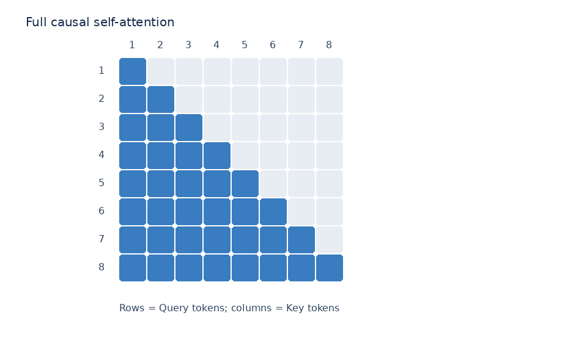
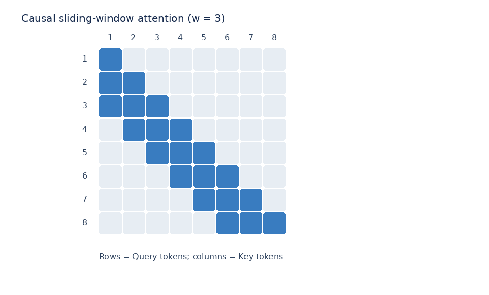
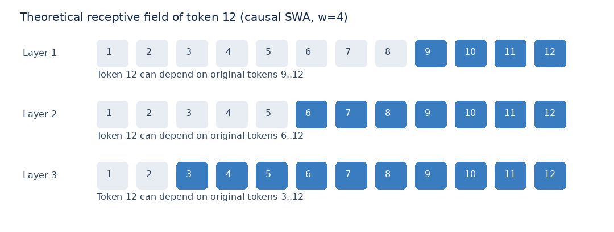
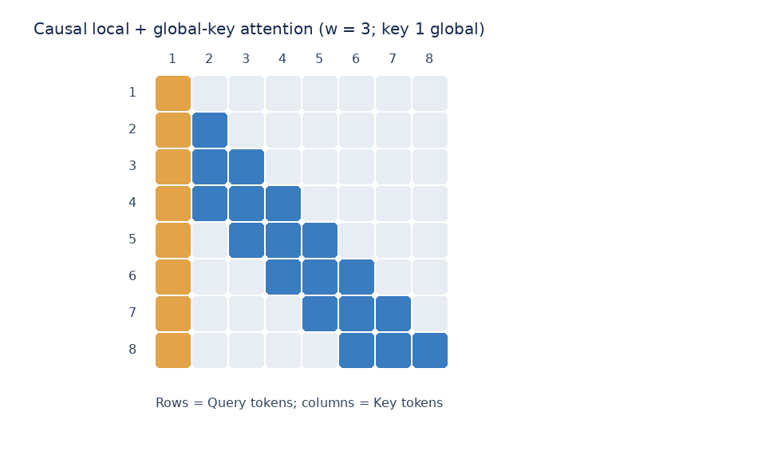

# 滑动窗口注意力（Sliding Window Attention, SWA）

> 主题：固定模式稀疏注意力中的滑动窗口注意力。重点梳理 **QKV 张量变化、Attention Score 的具体优化位置、Mask 与 Kernel 实现的区别、Prefill/Decode、KV Cache，以及精度与多层传播的权衡**。
>
> 阅读前提：已理解 [MHA](../存储轴/MHA.md)、[GQA](../存储轴/GQA.md)、Self-Attention、Softmax、Transformer 的逐层计算与自回归生成。

## 1. SWA 的定位与核心结论

**SWA 是固定模式稀疏注意力（Fixed-Pattern Sparse Attention）的一种。**它保留标准 Self-Attention 的 Q、K、V 投影、Softmax 和 Value 加权求和，但规定每个 Query 只允许关注邻近的一部分 Key/Value。对于因果语言模型，通常是“自身与最近的历史 Token”。

- **目的**：把长序列注意力的计算量从约 $O(S^2 d)$ 降到 $O(S w d)$，其中 $S$ 为序列长度、$w$ 为窗口内的 Token 数量、$d$ 为单头维度。这里省略注意力头数等系数。
- **主要变化点**：注意力配对范围，即哪些 $Q_i$ 与哪些 $K_j$ 计算分数；**不是** QKV 特征维度、Softmax 公式或输出特征维度。
- **工程前提**：只有真正跳过窗口外 Q–K 运算的局部注意力 Kernel 才能获得计算量上的下降；仅在完整 $S\times S$ 分数矩阵上做 Mask **不减少原始 QKᵀ 的乘法量**。
- **能力代价**：远距离位置不能在单层内直接交互；可能损失长程检索、精确依赖建模能力，多层传播和针对 SWA 的训练能够缓解但无法保证等价于全注意力。



上图中蓝色块为可参与计算的 Q–K 位置；行是 Query、列是 Key，因果掩码禁止读取未来 Token。

## 2. 从标准 MHA 的张量流程出发

设：

| 符号      | 含义                                         | 示例 |
| --------- | -------------------------------------------- | ---- |
| $S$     | Prompt Token 数量                            | 8    |
| $H$     | Hidden Size                                  | 512  |
| $N$     | Query/Key/Value Head 数量（本节以 MHA 为例） | 8    |
| $d=H/N$ | 单个 Head 的维度                             | 64   |
| $w$     | 因果窗口大小，**包含当前 Token**       | 3    |

省略 batch 维度，一层 MHA 的张量计算为：

```text
输入 Hidden States: X                 [S,H] = [8,512]
     │ Wq, Wk, Wv
     ├── Q                           [N,S,d] = [8,8,64]
     ├── K                           [N,S,d] = [8,8,64]
     └── V                           [N,S,d] = [8,8,64]
Q @ Kᵀ / sqrt(d)                      [N,S,S] = [8,8,8]
加 Causal Mask + Softmax              [N,S,S]
Attention Weights @ V                 [N,S,d] = [8,8,64]
Concat Heads + Wo                     [S,H] = [8,512]
```

对应公式：

$$
\operatorname{Attention}(Q,K,V)=\operatorname{Softmax}\!\left(\frac{QK^\top}{\sqrt d}+M\right)V.
$$

对于标准因果注意力，$M_{ij}=0$（当 $j\le i$），否则为 $-\infty$。

### 2.1 真实滑窗模型几乎都是 GQA

上文的 MHA 记法（Q/K/V 同为 `[N,S,d]`）是教学简化。实际采用滑窗的开放权重模型——Mistral-7B（32 Query 头 / 8 KV 组）、Gemma 系列、gpt-oss——全部使用 GQA：Q 有 $H_q$ 个头，K/V 只有 $H_{kv}$ 组：

$$
Q:[H_q,S,d],\qquad K/V:[H_{kv},S,d],\qquad g=\frac{H_q}{H_{kv}}
$$

第 $h$ 个 Query 头使用的 KV 组为 $k(h)=\lfloor h/g\rfloor$，点积与加权公式不变，只是每个 Q 头配对的是自己组的 K/V。后文所有 `[N,·,·]` 记法在 GQA 下把 Q 侧读作 $H_q$、K/V 侧读作 $H_{kv}$ 即可。另外，注意力子层两端还有 Pre-Norm 与残差相加（$X_{\text{next}} = X + \Delta X$），整层闭环 $[S,H]\to[S,H]$；本文聚焦注意力核心，省略这两环。

## 3. SWA 具体改动了什么？

SWA 仅允许 Query $i$ 访问下列 Key：

$$
\boxed{\max(1,i-w+1)\le j\le i}
$$

例如 $S=8,w=3$：

| Query   | 可访问 Key |
| ------- | ---------- |
| Token 1 | 1          |
| Token 2 | 1, 2       |
| Token 3 | 1, 2, 3    |
| Token 4 | 2, 3, 4    |
| Token 5 | 3, 4, 5    |
| Token 8 | 6, 7, 8    |



**请特别注意**：原始 $Q,K,V$ 在 Prefill 阶段依然各自是 $[N,S,d]$。不能把整个 K 张量直接裁剪成统一的 $[N,w,d]$，因为不同 Query 要读取的窗口位置不同。

对于某个具体的 $Q_i$：

$$
Q_i:[1,d],\qquad K_{\mathrm{window}(i)}:[m_i,d],\quad m_i=\min(i,w)
$$

$$
Q_i K_{\mathrm{window}(i)}^\top:[1,m_i],\qquad
\operatorname{Softmax}:[1,m_i],\qquad O_i:[1,d].
$$

若从全部头和全部 Query 的**逻辑紧凑表示**来看，有效分数最多是 $[N,S,w]$；序列起点不足一个窗口的部分需要填充或采用变长表示。**实际高性能 Kernel 通常分块执行，不一定显式创建该三维矩阵。**

### 3.1 Mask 为什么用负无穷？

SWA 的数学定义可写成：

$$
M_{ij}=\begin{cases}
0,& 0\le i-j<w\\
-\infty,&\text{其他位置}
\end{cases}
$$

例如某 Query 的原始分数为 $[2,1,3,1]$，只允许第 3、4 个 Key：

```text
原始 Score:  [  2,   1, 3, 1]
SWA Mask:    [-∞, -∞, 0, 0]
相加后:      [-∞, -∞, 3, 1]
Softmax:     [  0,   0, 0.881, 0.119]
```

因为 $e^{-\infty}=0$，被 Mask 的位置经过 Softmax 后权重为 0。**Score 为 0 不代表权重为 0**，因为 $e^0=1$。必须保证每个 Query 至少有一个可访问 Key，避免整行均被 Mask 的 Softmax 数值问题。

### 3.2 两种实现：完整 Mask 与真正稀疏计算

| 实现方式                               | 分数矩阵的概念性形状       | 是否减少 QKᵀ 的乘法 | 特点                                       |
| -------------------------------------- | -------------------------- | -------------------- | ------------------------------------------ |
| **完整 QKᵀ + SWA Mask**         | `[N,S,S]`                | **否**         | 数学上实现窗口限制，但仍计算大量无效分数   |
| **专用 SWA / 局部注意力 Kernel** | 最多`[N,S,w]` 的有效配对 | **是**         | 只处理窗口内配对，可减少计算与中间结果读写 |

因此，“SWA 降低复杂度”描述的是**采用稀疏实现之后**的收益，而不只是逻辑上放置一个 Mask。

## 4. 复杂度、显存与访存

对于一个 Head 的 Prefill 注意力核心计算：

- Full causal attention：数量级 $O(S^2d)$。
- SWA：数量级 $O(Swd)$，假定窗口大小 $w$ 固定且 $w\ll S$。

对于显式物化的注意力权重：

- Full attention：$O(S^2)$ 个分数/权重（每头）。
- SWA 的紧凑表示：$O(Sw)$ 个有效分数/权重（每头）。

**重要区别**：FlashAttention 等 IO-aware 实现可以不显式物化完整 $S\times S$ 分数矩阵，所以不能笼统说“所有标准 Self-Attention 实际上都占用 $O(S^2)$ 中间显存”。SWA 的主要算法收益是减少需要计算的配对；实际峰值显存需结合 Kernel、临时缓冲区及框架实现分析。

## 5. Prefill 和 Decode 的具体变化

以下讨论使用**纯因果 SWA**，不引入全局 Token，且以 MHA 为例。

### 5.1 Prefill：所有 Token 同时建立当前层的表示

```text
Full Attention:
Q = [N,S,d], K = [N,S,d], V = [N,S,d]
QKᵀ 的完整形状 = [N,S,S]

SWA:
Q = [N,S,d], K = [N,S,d], V = [N,S,d]
每一行 Query 只与最近 w 个 Key 计算
逻辑上最多 N × S × w 个有效分数
输出仍然 [N,S,d] → [S,H]
```

由于 Prefill 要生成当前序列各位置在各层的 Hidden States/KV，SWA 不意味着只处理 Prompt 最后的 $w$ 个 Token；它仍然处理整个 Prompt，只是**每个位置读取的上下文范围变小**。

### 5.2 Decode：当前 Query 读取历史窗口

假设当前已生成到第 $t$ 个 Token：

| 张量                       | Full causal MHA | 纯 SWA             |
| -------------------------- | --------------- | ------------------ |
| 当前 Q                     | `[N,1,d]`     | `[N,1,d]`        |
| 当前步参与注意力的 K/V     | `[N,t,d]`     | `[N,min(t,w),d]` |
| 当前步有效 Attention Score | `[N,1,t]`     | `[N,1,min(t,w)]` |
| 输出                       | `[N,1,d]`     | `[N,1,d]`        |

上表 $t$ 表示**包含当前 Token 的可见序列长度**，并忽略其他请求、batch 和缓存物理布局。

### 5.3 KV Cache：什么时候能降到 O(w)？

- 如果模型每层都是固定窗口的**因果 SWA**，而且注意力不会再读取已离开窗口的 KV，推理系统就有机会回收过期 KV，单层每序列长期保留的缓存量约随 $w$ 而不是 $S$ 增长。
- **不能仅凭使用 SWA 就断定缓存一定被淘汰**。有的实现为方便管理仍保留更多历史 KV；有的模型混有 Full Attention 层或全局 Token，相关层可能需要保留更长的历史。
- SWA 与 GQA/MQA 可组合：SWA 决定**读哪些位置**，GQA/MQA 决定**KV 有多少组 Head**，两者分别优化缓存长度与每 Token 的 KV 规模。

若真正实现淘汰，常用**环形 slot**：逻辑位置 $t$ 写入物理槽 $t \bmod w$，窗口跨越环形边界时被拆成一或两段连续区间，物理下标与序列位置不再相等，需要维护槽位到位置的映射。注意 RoPE 在 K 写入 cache **之前**已按逻辑位置旋转，位置信息烘焙在 K 的数值里，物理槽复用不会改变位置语义——rolling cache 是纯粹的存储布局变化。混合模型的 cache 按**层**管理：滑窗层 $O(w)$，全局层仍需 $O(S)$。

### 5.4 Attention sink：流式淘汰的稳定性扩展

对纯滑窗训练的模型，窗口滑动本身就淘汰了带外 KV。但对原本按全注意力训练的模型做流式淘汰时，简单丢弃旧 KV 可能破坏注意力分布。StreamingLLM（2023）观察到：保留序列开头少量 attention-sink token（约 4 个），再加上最近窗口，可显著稳定这类流式推理：

$$
A_t = \{\text{开头 } s \text{ 个 sink token}\} \cup \{\text{最近 } w \text{ 个 token}\}
$$

可见位置数从最多 $w$ 变为最多 $w+s$。注意 sink 不是滑窗的定义组成部分：原生滑窗模型是否使用 sink，应以模型架构与推理实现为准，不能从 `sliding_window` 字段自动推出。

## 6. 效果问题：减少配对会不会损失远距离依赖？

**不能保证与 Full Attention 效果相同。**单层 SWA 不允许 Query 与窗口外 Key 直接计算相关性，远距离信息可能无法被精确检索。SWA 有效的常见原因是许多任务中存在局部依赖结构，而且深层网络可传播信息。

### 6.1 多层 SWA 扩大理论感受野

假设 $S=12,w=4$，观察末尾 Token 12。每层允许当前位置看自己和前面 3 个位置：

- 第 1 层 Token 12 可直接访问原始 Token 9–12。
- 第 2 层 Token 12 通过第 1 层 Token 9–12 的表示，可间接依赖原始 Token 6–12。
- 第 3 层可间接依赖原始 Token 3–12。



对于连续 $L$ 个具有相同窗口大小 $w$ 的因果 SWA 层，忽略其他跨位置机制，末尾位置的理论最大感受野是：

$$
\boxed{R=\min(S,1+L(w-1))}.
$$

这里的“可间接依赖”是**跨层信息传递**：上层 Query 读取的是前一层已经融合上下文的 Hidden States 所生成的 K/V，而不是在当前层直接访问窗口外的原始 Token。

### 6.2 理论可达性 ≠ 信息保真度

- **Full Attention**：远端 Token 可以在同一层通过直接 Q–K 配对被访问。
- **多层 SWA**：远端信息必须经由中间位置和多层 Hidden States 逐步传递。
- 在传播中，信息可能被混合、压缩、减弱或丢失。因此理论感受野很大，不等于长距离事实检索和 Full Attention 一样可靠。

还要注意：**多层 SWA 不能无条件突破任何长度限制**。如果所有层窗口与层数固定，理论感受野仍是有限的；超过这个距离的原始信息不能通过这些局部路径抵达当前 Token。

### 6.3 训练为什么重要？

从头采用 SWA 训练的模型，可以学习在窗口内提取有用信息，并适应跨层传递路径。相反，若把原本采用 Full Attention 训练的模型直接改成很小的 SWA 窗口，可能破坏既有注意力分布与远距离依赖，导致性能下降。

训练有助于**缓解**精度损失，但不能从理论上保证 SWA 与 Full Attention 完全等价。任务性质、窗口大小、层数、训练数据与模型结构都会影响最终效果。

## 7. SWA 与其他注意力优化技术的位置关系

| 技术                     | 主要优化维度              | 与 SWA 的区别                                            |
| ------------------------ | ------------------------- | -------------------------------------------------------- |
| MQA / GQA                | KV Head 的共享与数量      | 优化每个 Token 的 KV 规模，而不是哪些历史 Token 可被关注 |
| MLA                      | KV 的低秩压缩表示         | 优化 KV 的表示方式；SWA 优化访问的序列位置范围           |
| FlashAttention           | GPU Kernel 与数据搬运     | 精确注意力也能通过 IO-aware 方式加速；并不依赖缩小窗口   |
| Local + Global Attention | 局部窗口 + 特定全局位置   | 允许少数特殊位置建立远距离通道，不是纯 SWA               |
| 动态稀疏注意力           | 根据输入/相关性选远端 Key | 选择范围不是固定的最近$w$ 个 Token                     |

以下是**因果局部 + 全局 Key** 的示意（橙色为额外允许的全局 Key 位置），用于说明它和纯 SWA 的区别，**不是**对双向 Longformer 全局注意力的完整复现：



「少数全局层兜底局部层」的多层编排细节——局部:全局比例、长程信息通道、按层 KV Cache——见 [局部与全局层交替](局部与全局层交替.md)。

## 8. 如何从 config.json 识别

Mistral-7B-v0.1 是最直接的形态：

```json
{
  "sliding_window": 4096
}
```

`sliding_window` 表示窗口大小。但字段存在**不能**单独证明「所有层都是滑窗」：混合模型还会用 `layer_types`（Gemma-3，约 5 局部 : 1 全局）或 `sliding_window_pattern`（gpt-oss）指定哪些层是局部层，全局层的窗口字段可能取 `-1`。识别流程：先查 `sliding_window`，再查 `layer_types` / `sliding_window_pattern`，最后核对模型代码中 mask 的实际构造。

## 9. 常见误区与快速自检

1. **“SWA 不改变任何中间张量维度”**：QKV 特征维度和输出维度不变；有效 Score 的紧凑逻辑表示从 $S\times S$ 变为约 $S\times w$。
2. **“加上窗口 Mask 就减少 QKᵀ 运算”**：不一定。完整矩阵后 Mask 不能减少已经执行的矩阵乘法；需要专门稀疏/局部 Kernel。
3. **“Prefill 只算最后 w 个 Token”**：错误。整个 Prompt 的各位置仍须计算，只是每个 Query 的注意力访问范围受限。
4. **“多层 SWA 等价于 Full Attention”**：错误。多层扩展理论感受野，但无法保证信息完整传递。
5. **“采用 SWA 的模型 KV Cache 永远只有 w”**：不一定。需按层判断模型是否有其他注意力模式，以及框架是否真正释放过期 KV。
6. **“窗口外 Token 的 Attention Score 设为 0”**：应是被 Mask 后的**权重**为 0；在 Softmax 前通常设置加性 Mask 为 $-\infty$。
7. **“config 里有 `sliding_window` 就代表所有层都是滑窗”**：不一定，需再查 `layer_types` / `sliding_window_pattern`（见 §8）。

## 10. 一句话总结

> **SWA 保留标准 Self-Attention 的 QKV、Softmax 与输出形式，只让每个 Query 访问固定的局部 Token 窗口；通过真正的局部计算把 $O(S^2d)$ 的注意力配对代价降为 $O(Swd)$，并有机会降低 Decode 阶段 KV Cache 的长期占用。代价是远距离信息不能在单层直接读取，依赖多层传递与针对性训练进行补偿，但无法保证与 Full Attention 的效果相同。**
