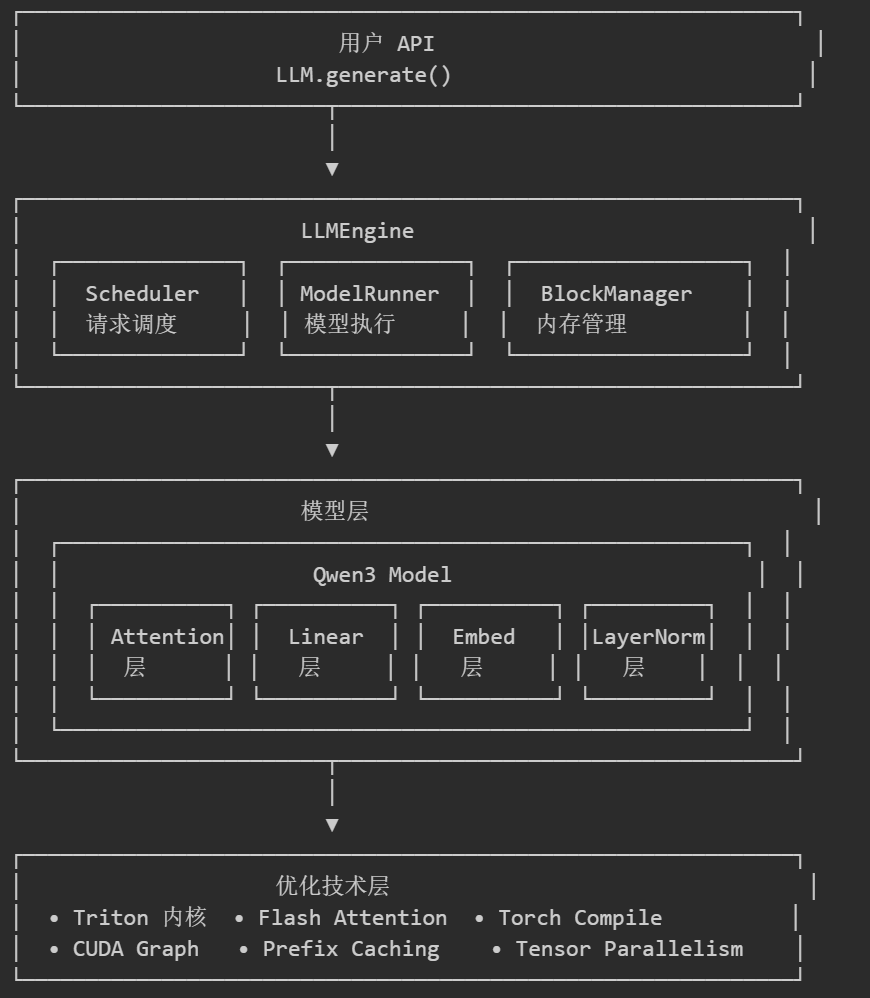

# nanoVllm

### 项目介绍

#### 基础结构

1. nanoVllm的大致架构：

\.png" />

#### SamplingParams\(采样参数\)

1. 采样参数：从概率分布中采样
2. LLM生成的本质是概率采样

   1. 模型输出概率分布：对词汇表中的每个token，模型计算出一个分数（logits）
   2. 转换为概率：通过softmax函数将logits转换为概率分布
   3. 从分布中采样：根据概率分布随机选择下一个token
3. 所以SamplingParams控制的是在这个概率分布中如何选择token进行输出的行为

##### 基本组成

1. temperature:\(0 \-\-\- 1e\-10\)

   1. 控制生成文本的随机性 / 多样性。
   2. 原理：

      $P(x_i) = \frac{\exp(\mathrm{logits}_i / T)}{\sum_j \exp(\mathrm{logits}_j / T)}$

      在使用以上公式进行softmax归一化时，观察公式。
2. max\_tokens：最大生成长度；在nano\-vllm中，注意当前参数和conffig\.max\_model\_len的区别
3. ignore\_eos：是否忽略 EOS（End\-of\-Sequence）Token；EOS Token（特殊token）

#### config参数

##### 基本组成

1. **批处理参数**

   1. max\_num\_batched\_tokens：单次批处理的最大 token 数量；
   2. max\_num\_seqs：单次批处理的最大序列数量；一个序列指一次独立的用户请求，一次用户输入的prompt
   3. max\_model\_len：控制模型在推理（或生成）过程中单个序列的最大允许长度（prompt \+ 生成的输出）

      1. 这个参数通常会与模型的原生能力进行对齐

      ```Python
      self.max_model_len = min(self.max_model_len, self.hf_config.max_position_embeddings)
      ```
2. **显存管理参数**

   1. gpu\_memory\_utilization：GPU显存利用率（0\.0\-1\.0）;用于计算KV Cache可分配的块数量

      1. 在nano\-vllm中，默认为0\.9：其含义是控制推理引擎最多可以使用多少比例的 GPU 显存（VRAM）用于模型权重、KV Cache 和其他运行时内存分配。
      2. 当然在vllm推理引擎，该参数主要还是用于分配KV Cache内存，会参与计算KV Cache块数量的过程；
   2. kvcache\_block\_size：KV Cache 块的大小（每个块存储的 token 数）;用于将 KV Cache 划分为固定大小的块，便于内存管理和复用

      1. 每一个block就是一个固定大小的内存单元
      2. kvcache\_block\_size = 256表示一个 block 可以容纳最多 256 个 token 的 KV 数据。
      3. 使用“块式”管理的原因：（PagedAttention 的核心思想）

         1. 类比操作系统中的“虚拟内存分页”，将KV Cache划分为固定大小的块\(block\)，像操作内存页一样进行分配和回收
         2. 解决内存浪费和内存碎片的问题
         3. PagedAttention的精髓：按需分配，灵活复用
      4. 约束：必须是256的倍数
      5. 拓展：块式管理支持PageAttention，提高内存利用率
      6. 补充：

         1. `kvcache_block_size` 是以 token 数为单位的，但它对显存的实际占用取决于模型的 KV 向量大小（如隐藏层维度、数据类型等）
         2. 所以这里是否可以按模型去调整block size？是否可使用更小的block size提高灵活性？结合显存预算自动计算block\_size？
   3. num\_kvcache\_blocks：KV Cache 块的总数量；当为\-1时，表示自动计算（根据显存和 gpu\_memory\_utilization 自动计算）

      1. 计算时机：在 ModelRunner\.allocate\_kv\_cache\(\) 中动态计算
3. **并行化参数：**

   1. tensor\_parallel\_size：张量并行度（使用的GPU数量）

      1. 用于将模型参数分片到多个GPU上
      2. 大模型推理时，单卡显存不足时使用多卡
4. **执行模式参数**

   1. enforce\_eager：是否强制使用 Eager 模式（禁用 CUDA Graph 优化）
5. **其他参数：**

   1. hf\_config：该参数属于模型自带的，可以从模型中加载，存储了模型本身的一些元数据信息（比如模型架构信息等）

### Engine层

#### block\_manager\.py

##### 基本结构

1. Block

   1. block\_id：Cache块的唯一标识符
   2. ref\_count：引用计数，表示当前有多少序列在使用这块 block。

      1. 0 表示空闲可回收；\>0 表示正在使用，不能释放
   3. hash：前缀内容指纹（xxhash64），用于 prefix cache 查找复用

      1. \-1 表示当前 block 尚未形成可缓存的完整块
   4. token\_ids：该 block 对应的 token 内容快照

      1. 主要用于校验哈希命中是否真一致

#### model\_runner\.py

##### 概述

1. ModelRunner 是连接调度器（Scheduler）和模型层的桥梁，负责将序列请求转换为实际的GPU计算，并管理推理所需的内存和计算资源。
2. 核心流程：

```Python
Sequence列表 → prepare_prefill/prepare_decode → run_model → sampler → 返回token IDs
```

3. 主要负责：

   1. 模型初始化与管理：加载模型和权重；预热模型；创建采样器等等
   2. KV缓存管理：

      1. 根据GPU内存利用率动态分配KV缓存快
      2. 为每个注意力层分配K V缓存张量
      3. 管理缓存内存，支持PagedAttention
   3. 推理执行：

      1. 预填充（prefill）
      2. 解码（Decode）
      3. 准备输入数据
      4. 调用模型前向传播并计算logits
   4. 性能优化：CUDA图捕获等等
   5. 多GPU协调

##### 初始化

1. 在nanoVllm中，一个 ModelRunner 实例 ≈ 一个进程 ≈ 绑定到一块 GPU 的推理工作单元
2. 初始化，ModelRunner接受两个参数：rank和event
3. rank：这个ModelRunner进程在分布式（张量并行，多GPU）中的编号

   1. 在张量并行（tensor\_parallel\_size \!= 1）的情况下，每一个ModelRunner都会绑定一块GPU
   2. Rank == 0：主进程 / 控制进程，负责写共享内存、广播指令、采样输出等。
   3. Rank \> 0：worker 进程，只负责在各自 GPU 上跑模型、响应主进程下发的调用。
4. event：同步原语；控制主进程和worker进程之间的执行顺序
5. 共享内存SharedMemory
6. load\_module\(\)：将本地模型目录的\.safetensors权重，按当前nano\-vllm自己定义的模型结构，逐个加载进nn\.Module实例中

   ```Python
   def load_model(model: nn.Module, path: str):
       packed_modules_mapping = getattr(model, "packed_modules_mapping", {})
       for file in glob(os.path.join(path, "*.safetensors")):
           with safe_open(file, "pt", "cpu") as f:
               for weight_name in f.keys():
                   for k in packed_modules_mapping:
                       if k in weight_name:
                           v, shard_id = packed_modules_mapping[k]
                           param_name = weight_name.replace(k, v)
                           param = model.get_parameter(param_name)
                           weight_loader = getattr(param, "weight_loader")
                           weight_loader(param, f.get_tensor(weight_name), shard_id)
                           break
                   else:
                       param = model.get_parameter(weight_name)
                       weight_loader = getattr(param, "weight_loader", default_weight_loader)
                       weight_loader(param, f.get_tensor(weight_name))
   ```

   1. 从本地模型目录中读取配置 self\.hf\_config = AutoConfig\.from\_pretrained\(self\.model\)

      1. transformers\.AutoConfig读取config\.json内容
   2. nano\-vllm自己搭建模型骨架

      ```Python
      torch.set_default_dtype(hf_config.torch_dtype)
      torch.set_default_device("cuda")
      self.model = Qwen3ForCausalLM(hf_config)
      load_model(self.model, config.model)
      ```

      1. 先根据hf\_config创建一个空的Qwen3模型实例
      2. 再调用load\_model\(\)把磁盘的权重灌进去
   3. load\_model\(\)开始扫描本地目录里的\.safetensors文件，并使用safe\_open\(\)读取权重文件
   4. 获取文件中所有tensor的名字    for weight\_name in f\.keys\(\):

      1. 其中 f\.get\_tensor\(weight\_name\) 才是真正把tensor读出来
   5. 每个参数自己的weight\_loader会对\.safetensors文件对应的权重决定如何切分，拼接，分配到对应rank
   6. 最近自定义模型Qwen3ForCausalLM中所有torch\.empty\(\)参数被真实权重填满
7. warmup\_model\(\)：预热操作

   1. 流程：

      1. 先warmup
      2. 通过warmup触发真实前向开销
      3. 记录peak/current显存
      4. 再根据这些统计量计算num\_kvcache\_blocks
   2. 双重职责：

      1. 提前支付首次执行成本
      2. 帮助估算KV cache可分配空间
8. allocate\_kv\_cache\(\)：

   1. 概括：

      1. 先估算当前 GPU 还能拿出多少显存给 KV cache
      2. 根据单个 block 需要多少字节，反推出最多能分多少 block
      3. 一次性申请一整块 KV cache，并挂到每层 attention 上
   2. 流程：

      1. 先拿当前显存状态   torch\.cuda\.mem\_get\_info\(\)和torch\.cuda\.memory\_stats\(\)
      2. 算每个block要多少字节

         1. 单 block 显存 = K/V × 层数 × token数 × KV头数 × head维度 × dtype字节数
      3. 反推最多能分多少 block

         1. 关注其中的used，current，peak参数
      4. 真正申请 KV cache 大张量，使用torch\.empty\(\)
      5. 把每层attention的 k\_cache/v\_cache 指向这块大内存

##### prepare\_prefill\(\)函数

1. 提取经过Schduler调度出来的，需要Prefill的reqs请求序列（List\[req\]）的数据，整理为以下几类数据

   - input\_ids / positions：模型前向真正要算的新 token

     - input\_ids：本轮 prefill 真正要送进模型计算的 token ids。格式：\[\[1,3,4,5\], \[0,3,42,5\] \.\.\.\.\]
     - positions：对应token在当前req中的位置编号。格式：\[\[6, 7, 8, 9\],\[3,4,5,6\] \.\.\.\.\.\.\]
   - cu\_seqlens\_q / cu\_seqlens\_k：告诉变长 attention，每条序列在扁平张量里的边界

     - cu\_seqlens\_q：扁平化后的 query 张量里，每条序列的起止边界；格式为\[0, 3, 8, 10\]，其中可以表示seq1: \[0,3\)，seq2: \[3,8\)，seq3:\[8,10\)
     - cu\_seqlens\_k：因为 prefill 时，即使本轮只新算后半截 query，它做 attention 时仍然要看完整上下文 key/value。（这个与模型注意力计算有关，后续了解模型具体构成时可回顾）；格式与cu\_seqlens\_q保持一致
   - max\_seqlen\_q / max\_seqlen\_k：这一批里最长 query/key 长度
   - slot\_mapping：新算出的 K/V 要写回 KV cache 的哪些物理槽位

     - 举例分析：

       - slot：将KV Cache某一层\[num\_blocks, block\_size, num\_kv\_heads, head\_dim\]的前两维展开而得线性的slot编号（slot = block\_id \* block\_size \+ offset）
       - block\_size=4;当前token落在block 7的offset 2 \-\-\-\> slot = 7\*4 \+2 =30
   - block\_tables：如果用了prefix cache\(req不需要对所有token进行prefill计算\)，attention 需要知道req序列对应哪些 block

     - 原因：只有在 prefix cache 场景下才需要，因为这时 attention 不能只看本轮新算出来的 k/v，还要从已有 cache 里拼出完整上下文。
2. 在这个过程中，将能够匹配前缀的，不需要重复prefill计算的token拔除

##### prepare\_decode\(\)函数

1. 和prepare\_prefill\(\)的作用类似，都是整理本批次需要decode的req请求序列，为后续的decode计算做准备

##### 小结

1. 模型处理：

   1. 通过自定义的Qwen3ForCausalLM类型加载模型结构到GPU，所有数据使用torch\.empty\(\)填充
   2. 读取模型本地目录\.safetensor文件，将模型张量数据加载到模型结构中
   3. 利用假数据预热模型，记录显存占用峰值peak
   4. 计算当前GPU最大可分配的KV Cache数，并使用torch\.empty\(\)进行初始化
2. 通信层面：（vllm并行推理）

   1. SharedMemory \+ Event：主进程将“命令”发给其他worker进程

      1. 使用同步事件原语控制主进程对共享缓冲区的写入和worker进程对共享缓冲区的读取
   2. NCCL \+ torch\.distributed\(dist\)：多张GPU在张量计算时进行通信

      1. 本质上使用“通信组”
      2. dist\.init\_process\_group\(\.\.\.\)；dist\.barrier\(\)；dist\.destroy\_process\_group\(\)
3. 初始化allocate\_kv\_cache\(\)函数所分配的KV Cache区域其实是一个使用torch\.empty\(\)填充的巨大张量

   1. 维度：\[2, num\_layers, num\_blocks, block\_size, num\_kv\_heads, head\_dim\]

      - 第 0 维 2：K 和 V
      - 第 1 维 num\_layers：模型有多少层 attention
      - 第 2 维 num\_blocks：总共能分多少个 KV block
      - 第 3 维 block\_size：每个 block 存多少个 token
      - 第 4 维 num\_kv\_heads：每层每个 token 需要存多少个 KV heads
      - 第 5 维 head\_dim：每个 head 的维度
   2. 一次性申请显存；避免decode过程中频繁torch\.empty

#### Scheduler

##### 基本结构

1. block\_manager：负责操作当前GPU的KV Cache块的分配和释放
2. waiting \(deque\[Sequence\]\)：等待队列
3. running\(deque\[Sequence\]\)：运行队列
4. 其他限制参数（边界条件）

##### 小结

1. Scheduler 本质上是“请求级调度器”，站在 Sequence 和 BlockManager 之上

   1. 决定哪些请求现在能跑、跑 prefill 还是 decode、内存不够时抢占谁；
   2. 不做任何模型数值计算；真正的前向/采样执行在 ModelRunner
2. 它负责把Sequence和BlockManager组织起来，对多请求做调度

   1. 新请求先进waiting
   2. 能做prefill的先做prefill
   3. prefill做不了时切到decode
   4. decode 时判断哪些序列还能继续
   5. 不够空间就 preempt 别的序列

#### Sequence

##### 概述

1. 在Vllm推理框架中，一个推理请求基本上对应一个Sequence实例，它表示一条请求在引擎里的整条生命周期状态载体
2. 其中包含seq\_id，status，token\_ids，采样参数等
3. 总之，Sequence在nano\-vllm中的设计思想还是比较简单明了的，并不复杂

#### LLMEngine

##### 概述

1. LLMEngine在整个nano\-vllm系统中，作为最上层的控制组件，

   1. 负责整个系统的初始化，ModelRunner，Scheduler，tokenizer
   2. 设计系统运行逻辑，执行Prefill，Decode的主要流程的设计
2. LLMEngine生成的具体逻辑为：

   1. 利用Scheduler对底层Sequence的管理，判断是否达到finished状态
   2. 一直循环，在循环过程中

      1. 利用Schduler不断调度，获取当前执行的操作和具体的序列请求
      2. 根据Schduler的调度结果，调用ModelRunner执行具体的注意力计算流程
      3. ModelRunner执行注意力计算流程后，继续由Scheduler将计算结果通过Schduler中的blockMananger写回KVCache中
3. 通过观察以下代码，你会发现

   ```Python
   #llm_engine.py
   class LLMEngine:
       def __init__(self, model, **kwargs):
           config_fields = {field.name for field in fields(Config)}
           config_kwargs = {k: v for k, v in kwargs.items() if k in config_fields}
           config = Config(model, **config_kwargs)
           self.ps = []
           self.events = []
           ctx = mp.get_context("spawn")
           for i in range(1, config.tensor_parallel_size):
               event = ctx.Event()
               process = ctx.Process(target=ModelRunner, args=(config, i, event))
               process.start()
               self.ps.append(process)
               self.events.append(event)
           self.model_runner = ModelRunner(config, 0, self.events)
           self.tokenizer = AutoTokenizer.from_pretrained(config.model, use_fast=True)
           config.eos = self.tokenizer.eos_token_id
           self.scheduler = Scheduler(config)
           atexit.register(self.exit)
   #model_ruuner.py
   class ModelRunner:
       def __init__(self, config: Config, rank: int, event: Event | list[Event]):
           self.config = config
           hf_config = config.hf_config
           self.block_size = config.kvcache_block_size
           self.enforce_eager = config.enforce_eager
           self.world_size = config.tensor_parallel_size
           self.rank = rank
           self.event = event
           dist.init_process_group("nccl", "tcp://localhost:2333", world_size=self.world_size, rank=rank)
           torch.cuda.set_device(rank)
   ```

   1. 在LLMEngine的初始化过程中，会给本机的每个GPU启动一个ModelRunner进程，关键代码为torch\.cuda\.set\_device\(rank\)，所以这个系统本质上针对“单机多GPU”环境，而非“多服务器多节点”环境

### Layer层

1. 这一层包含了许多张量计算操作和transfomer注意力计算流程和概念，

   1. 该层主要给自定义模型（Qwen3ForCausalLM，Qwen3Model等）提供张量计算支持。
   2. 最终供上层组件ModelRunner进行权重加载（self\.model\.modules\(\)），注意力分数计算（self\.model\.compute\_logits\(self\.model\(input\_ids, positions\)\)）等操作
2. 模型在推理过程中的所有输入其实在ModelRunner中的prepare\_prefill\(\)和prepare\_decode\(\)函数中所进行的构造

   1. prefill：每条序列本轮可能输入多个 token，只包含“此前没有算过”的token，前缀匹配的token被排除
   2. decode：每条序列本轮只输入一个 token（序列的最后一个token）
3. 确定模型主要输入input\_ids，positions

   1. 大致格式：input\_ids \-\-\-  \[1, 3, 4, 5, 0, 3, 42, 5, \.\.\.\]；positions \-\-\-\[6, 7, 8, 9, 3, 4, 5, 6, \.\.\.\]
   2. 在经过modelRunner的prepare\_prefill\(\)和prepare\_decode\(\)函数后，input\_ids和positions其实都是一维，后续在计算时，会有其他参数才区分不同推理序列对应的数据，但是为便于理解，其实际格式为\[\[1,3,4,5\], \[0,3,42,5\] \.\.\.\.\]，\[\[6, 7, 8, 9\],\[3,4,5,6\] \.\.\.\.\.\.\]
   3. 参考b\.中的格式，len\(input\_ids\) == len\(positions\)，表示本轮模型计算的推理请求数量
   4. 其中input\_ids中的每个元素都代表一个token，只不过经过tokenizer的处理，使用数字进行标识；positions则关注input\_ids中的每一个元素在原始序列中的位置，故len\(input\_ids\) == len\(positions\)
   5. 模型是一批一批地接受输入，并非一个一个推理序列进行计算
4. 参考“理解”中关于模型推理流程的介绍，下面模型推理过程的数据全过程**（核心）**

   1. 文本输入：用户输入一句话    （我喜欢吃苹果）
   2. Tokenizer：把文本切成 token，并转成 token id      \-\-\>\["我", "喜欢", "吃", "苹果"\]\-\-\>\[101, 256, 789, 1320\]
   3. Embedding：把 token id 变成向量；Embedding表\[vocab\_size, d\]   \-\-\-\> 张量X\[n,d\]；n为序列token长度

      1. vocab\_size = 词表大小; d = 隐藏层维度
   4. 加入**位置信息**：让模型知道 token 的顺序，使用位置编码，RoPE等方式，在每个token向量中融合位置信息      \-\-\-\>张量X1\[n, d\]
   5. （核心）进入多层Transformer block堆叠，进入注意力计算模块，MLP模块等，不断提取序列token间的关联性      \-\-\-\>张量X\_final\[n,d\]

      1. 此步骤为模型推理的核心步骤，transfomer block不会改变张量形状，它会不断向张量数据中添加新的相关信息，具体可参考[理解](https://bvb1vt2cr9.feishu.cn/docx/FyhLdaf38ojBqSxL6DiczXQ5nnc)文档相关介绍
      2. 张量X\_final已经不是简单的词向量了，而是经过多层上下文融合的隐藏状态
   6. 取最后一个 token 的隐藏状态        \-\-\-\>张量h\_last\[1,d\]
   7. lm\_head, 把隐藏向量映射到词表大小    \-\-\-\>原始分数logits\[1,vocab\_size\]

      1. lm\_head本质为线性层\[1, vocab\_szie\]
      2. lm为“language modeling”，它和“多头注意力”中的head没有直接关系
   8. Softmax, 把 logits 转成概率分布          \-\-\-\>概率分布
   9. 采样，选择下一个 token
5. 以上流程的核心其实是

   1. 多层 Transformer Block 反复加工上下文信息
   2. 取最后一个 token 的最终隐藏状态

#### Models

\.png" />

1. nano\-vLLM 自己实现一套 Qwen3 模型结构，然后用 HuggingFace 目录中的 `config.json` 读取模型结构参数，再按这些参数构建 PyTorch 模型骨架。

   1. 从模型目录中的config\.json读取模型结构参数（self\.hf\_config = AutoConfig\.from\_pretrained\(self\.model\)）
   2. 它决定模型有多少层、隐藏维度是多少、注意力头数是多少、MLP 中间层维度是多少等
2. **（核心）**解析config\.json中的部分参数

   1. 结构参数

      1. vocab\_size：词表大小。
      2. hidden\_size：模型隐藏状态维度
      3. num\_hidden\_layers：Transformer block 的层数，表示模型会堆叠多少层Transformer block
      4. intermediate\_size：MLP 中间层维度，它表示MLP “放大后的宽度”
      5. hidden\_act：MLP 使用的激活函数类型（非线性）
      6. tie\_word\_embeddings：是否让输入 embedding 和输出 lm head 共享同一份权重。
   2. 注意力参数：

      1. num\_attention\_heads：Query 头总数
      2. num\_key\_value\_heads：Key/Value 头总数。它可以小于 query 头数，这就是Grouped\-Query Attention（分组查询注意力） \-\-\-\- GQA
      3. head\_dim：每个 attention head 的维度
      4. attention\_bias：QKV 投影和输出投影是否带 bias。
   3. 归一化和数值参数：

      1. rms\_norm\_eps：RMSNorm 里的 epsilon
      2. torch\_dtype：权重和默认计算 dtype
   4. KV cache / 推理资源相关：（这其中不是新字段，而是对资源影响较大的字段）

      1. num\_hidden\_layers：决定要缓存多少层的 K/V
      2. num\_key\_value\_heads：决定每层 K/V 有多少组头
      3. head\_dim：决定每个头每个 token 需要缓存多少数值
      4. torch\_dtype：决定每个缓存元素占多少字节
3. Qwen3ForCausalLM：最上层语言模型

   1. **主体模型Qwen3Model（后续重点介绍）**

      1. 模型Embedding层 VocabParallelEmbedding
      2. 模型Transformer block堆叠层 Qwen3DecoderLayer

         1. 这是核心，其中使用到了许多参数
      3. norm层 RMSNorm
   2. 输出头lm\_head：

      1. config\.hidden\_size：hidden states（模型隐藏特征维度）
      2. config\.vocab\_size：模型词汇表大小
   3. 注意：以上组件和模型依旧是上层，实际的张量计算其实发生在底层的各种组件上
4. 下面我会一个一个的拆解每个组件的执行逻辑，比如VocabParallelEmbedding，ParallelLMHead等
5. **Qwen3Model**

   1. 核心参数：

      1. query 头数， KV 头数
      2. head\_dim单个头的维度
      3. q\_size总宽度，kv\_size总宽度

#### 底层组件

##### 词嵌入\(token Embedding\)

1. VocabParallelEmbedding：对应token Embedding操作，将token映射为hidden\_size的词向量

   1. 普通的embedding的形状为\[vocab\_size, hidden\_szie\]，但是在张量并行的场景下，不会让每张卡存完整的emebedding张量，而是会按照vocab\_size进行拆分；

      1. 比如当vocab\_size = 151936时，rank0存token\_di为\[0, 75968\)半段词表，rank1存\[75968, 151936\) 这半段词表
   2. 注意：在\_\_init\_\_\(\)初始化函数中，Embedding矩阵其实是一个使用torch\.empty\(\)，用0填充的矩阵，在后续过程中，会使用\.safetensor文件中的权重数据进行填充
   3. weight\_loader\(\)：权重加载过程，对应rank序号的GPU应该只加载自己负责的那一部分

      1. 这是一种“参数自定义加载钩子”的方法
   4. **forward\(\)：**

      1. 入参：\[1, n\]Tensor
      2. 普通embedding（tp\_size=1）: 直接调用F\.embedding完事；F\.embedding\(x, y\)查表操作
      3. tp\_size\>1：

         1. 判断当前token是否位于当前rank GPU负责的部分
         2. 提取对应的词向量
         3. 使用dist\.all\_reduce\(y\)对所有rank上的结果逐元素求和，默认为SUM操作
   5. 补充：在当前组件中，出现了许多具体的torch操作，这部分可以边看边积累，只要了解组件内部执行逻辑即可

##### 线性变换矩阵\(linear\) \-\-\- layers/linear

1. 这部分对应transformer block中自注意力模块和MLP模块中的多个线性变换矩阵，比如W\_O,W\_K,W\_V等

   1. 在nano\-vllm中，该部分还针对“张量并行”设计了“行切分”矩阵和“列切分”矩阵的初始化和权重加载逻辑
2. ReplicatedLinear（普通矩阵）

   1. 没有张量并行的相关概念
3. ColumnParallelLinear\(列并行矩阵\)

   1. 张量并行，利用“行切分概念”将W\_Q，W\_K，W\_V 三个线性变换矩阵切分到不同的GPU上，每个GPU只计算自己的部分
   2. 该类在nano\-vllm中，自动使用output\_size / tp\_size 计算每个GPU的存储部分
4. RowParallelLinear\(行并行矩阵\)

   1. 张量并行，利用“列切分概念”将W\_O 线性变换矩阵切分到不同的GPU上，每个GPU只计算自己的部分
   2. RowParallelLinear在forward\(\)过程中，增加dist\.all\_reduce\(\)这一步，具体可参考“张量并行\-注意力计算流程图”
5. MergedColumnParallelLinear

   1. 继承ColumnParallelLinear\(列并行矩阵\)
   2. 该类在nano\-vllm中，实际对应Transformer block MLP模块

      1. Qwen模型的MLP模块采用SwiGLU门控结构，具体可以参考[理解](https://bvb1vt2cr9.feishu.cn/docx/FyhLdaf38ojBqSxL6DiczXQ5nnc)文档的相关介绍，其中存在3个线性变换矩阵gate，up，down
      2. 该类存在的目的就是将gate和up权重矩阵融合到**一轮线性变换计算过程**中，同时又采取了“张量并行”的能力
6. QKVParallelLinear

   1. 继承ColumnParallelLinear\(列并行矩阵\)
   2. 同MergedColumnParallelLinear类似，将W\_Q，W\_V，W\_K一起处理，融合到**一轮线性变换计算过程**中
7. 这两个类都是在做“把多个线性变换融合成一次大矩阵乘法”，但是为什么使用列并行矩阵，采用“行切分”概念呢？

   1. 各个GPU使用ColumnParallelLinear计算的结果，直接拼接即可

### 多头注意力\-张量并行

多头注意力的“分头”和张量并行的“切分权重”看起来都在拆 Q/K/V，但它们的目的和层次不同。


1. 多头注意力是为了提取序列token间的多种关联而对Q/K/V张量进行切分
3. 张量并行则是为了减少单GPU的存储压力，而将模型权重均匀分布在各个GPU上


1. 举例：在传统MHA中

   1. hidden\_size = 4096；num\_heads = 32；head\_dim = 128；tp\_size = 4
   2. 在MHA中，总共执行32次attention\(\)；每个GPU只负责8 次注意力计算
   3. 故**\(核心\)**

   ```Plain
   GPU0 负责 Q0~Q7,    K0~K7,    V0~V7
   GPU1 负责 Q8~Q15,   K8~K15,   V8~V15
   GPU2 负责 Q16~Q23,  K16~K23,  V16~V23
   GPU3 负责 Q24~Q31,  K24~K31,  V24~V31
   ```

   4. 每张GPU依旧拿到完整输入X：\[n, 4096\]
   5. 但每张 GPU 只保存自己那部分 Q/K/V 权重，依旧是按照tp\_size=4均匀分配W\_Q,W\_K,W\_V权重
3. 在张量并行和多头注意力的场景下，本质上，每个GPU依旧只负责存储部分权重，比如W\_Q：\[d, d\]，tp\_size = 4，那么单个GPU只会存储\[d/4, d\]部分W\_Q张量
4. 在这个过程中，多头注意力和张量并行天然契合的地方。

### 总结

1. nano\-vllm的核心分层思路

   1. engine层负责“怎么跑”，组织推理流程

      - Sequence表示一个生成任务（推理请求）
      - Scheduler 如何决定先 prefill 还是 decode、哪些序列先跑
      - BlockManager 如何做 KV cache block 的分配、回收、抢占
      - LLMEngine 如何把调度、执行、输出串起来
   2. ModelRunner \+ layers负责“具体怎么算”，更接近执行面

      - 模型权重加载
      - device / distributed 初始化
      - prefill / decode 时输入张量的整理
      - 调用具体 layer 完成前向
      - logits 计算和采样
      - CUDA Graph、KV cache 张量绑定这些偏底层优化
2. 关键主线：

   1. KV Cache的管理，尤其是block的分配和前缀缓存复用
   2. 调度器对请求生命周期的控制
3. 在观察layers中的VocabParallelEmbedding模块\(token embedding\)，我发现初始化会利用torch\.empty\(\)，天聪0申请一块张量，此时并未填充具体权重数据；同时会构造一个weoght\_loader\(\)函数，解释后续利用\.safetensor权重填充空张量的具体逻辑

   def weight\_loader\(self, param: nn\.Parameter, loaded\_weight: torch\.Tensor\):

   1. 这是一种“参数自定义加载钩子”的方法
   2. param\(nn\.Parameter\)：**目标**参数，表示模型中需要被保存、加载、训练或推理使用的参数张量。
   3. loaded\_weight\(torch\.Tensor\)：从 checkpoint 文件\(\.safetensor文件\)中读出来的权重张量。
   4. 在后续权重加载的过程中

      ```Python
      for name, loaded_weight in checkpoint_weights:
          param = model.get_parameter(name)

          if hasattr(param, "weight_loader"):
              param.weight_loader(param, loaded_weight)
          else:
              param.data.copy_(loaded_weight)
      ```
      1. 如果有自定义钩子weight\_loader，则使用weight\_loader，如果没有则直接填充！！！牛逼
   5. 在大模型部署框架中，尤其适用于checkpoint 权重形状和当前运行时参数（提前申请的张量）形状不一致
