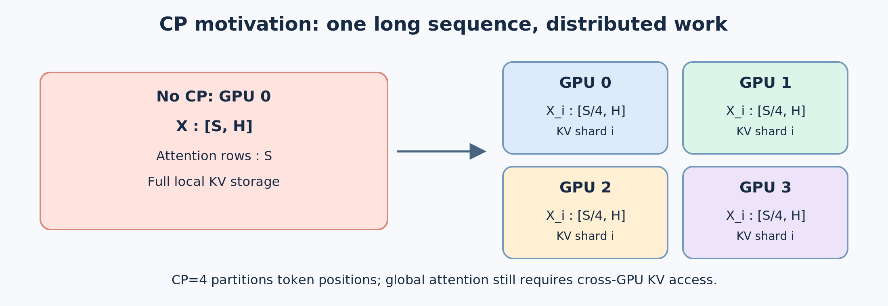
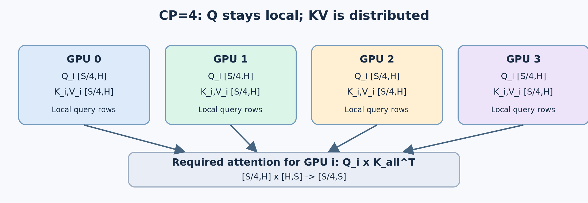
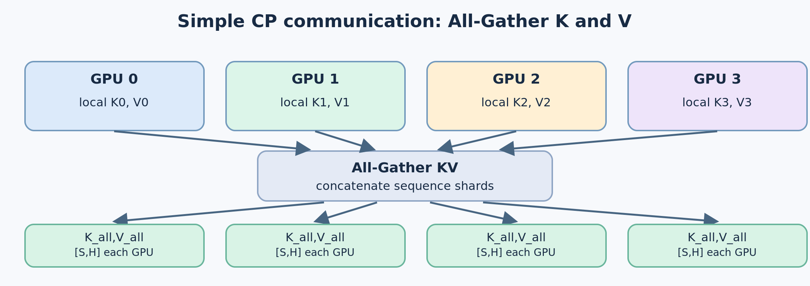
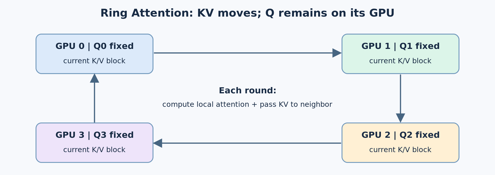
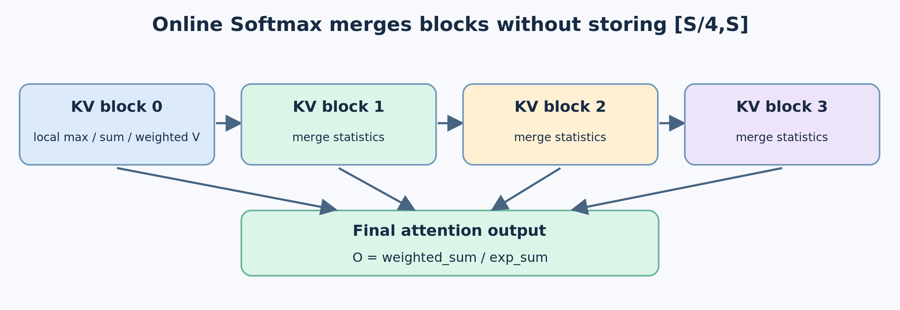
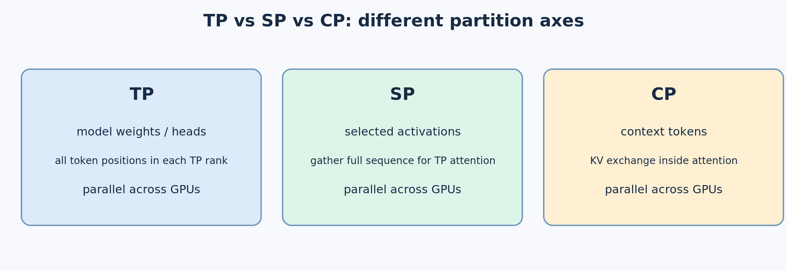

# CP：上下文并行（Context Parallelism）——原理、张量流程与 KV 通信策略

> 本文是「模型并行」系列的一篇（系列顺序见 [TP](TP.md) 导航：TP / PP / EP / CP / SPTP，其中 PP、EP、SPTP 尚为占位）。CP 沿**同一条序列的 Token 维**切分：把长上下文分摊到多卡，代价是跨设备的 KV 协同。以 `CP=4, TP=1` 为主线，先讲最直观的 **All-Gather KV**，再讲 **Ring Attention + Online Softmax**，最后对比 CP 与 DP/TP/SP 的切分维度差异。系列其余各篇：[TP](TP.md)（层内切分）、[PP](PP.md)（层间切分）、[EP](EP.md)（专家切分）、[SPTP](SPTP.md)（序列维补充）。
>
> 数据来源：导入自外部图解报告（2026-10-13），示例沿用普通全量自注意力（`X:[S,H]`，省略多头与 Batch 维）以突出序列切分本身——本文讨论的是 CP，不是 DP。图片位于 `source/推理系统/模型并行/CP/`。

## 1. CP 为什么出现？要解决什么问题？

常规全量自注意力中（为突出序列切分，先省略多头维度）：

$$
X\in\mathbb{R}^{S\times H},\quad Q=XW_Q,\ K=XW_K,\ V=XW_V
$$

$$
\mathrm{Attention}(Q,K,V)=\mathrm{Softmax}\left(\frac{QK^\mathsf{T}}{\sqrt{H}}+M\right)V
$$

`QKᵀ` 的逻辑维度是 `[S,S]`。全量注意力计算量随序列长度近似呈二次增长：`O(S²H)`。与此同时，在长序列训练中，逐 Token 的激活保存带来很大显存压力；推理过程中，历史 KV Cache 随上下文长度线性增长。

**CP 的主要目标**：把**同一条长序列**的 Token 分配到多张 GPU，降低每卡需要承载的激活、KV 和注意力计算负担，支持更长的上下文，并有机会加快长 Prompt 的处理。



> 图 1：无 CP 时，一个设备处理完整序列；CP=4 时，四个设备分别处理不同的序列片段。这是工作分配示意，**不是**说每张 GPU 只对本地 KV 计算 Attention。

**必须区分**：CP 通常不会改变全量注意力算法的总体 `O(S²H)` 复杂度；它把工作分摊到设备，代价是 GPU 间 KV 通信。FlashAttention 可以避免物化整张 `[S,S]` 注意力矩阵，但不自动解决单 GPU 上长序列激活与 KV 的全部压力。

## 2. CP=4：从 X:[S,H] 开始的张量流程

### 2.1 沿 Sequence 维切分输入

假设 `S` 可被 4 整除，四张 GPU 组成同一个 CP Group。完整输入被按 Token 位置切分：

$$
X=\begin{bmatrix}X_0\\X_1\\X_2\\X_3\end{bmatrix},\quad X_i:[S/4,H]
$$

这里假定 **CP=4，TP=1**，各 GPU 都持有相同的完整模型权重：

$$
W_Q,W_K,W_V:[H,H]
$$

### 2.2 每张 GPU 本地投影 QKV

$$
Q_i=X_iW_Q,\quad K_i=X_iW_K,\quad V_i=X_iW_V
$$

$$
[S/4,H]\times[H,H]\longrightarrow[S/4,H]
$$

所以每个 GPU 产生 `Q_i,K_i,V_i:[S/4,H]`。**CP 没有要求对 `W_Q/W_K/W_V` 进行 TP 式列切分**（TP 的切分数学见 [TP](TP.md) §2-§3——两种并行对权重的作用维度完全不同）。

### 2.3 为什么必须通信 KV？

本地 `Q_i` 需要关注全序列内因果允许的历史 Token，而不只是本地段。正确的逻辑计算是：

$$
K_{all}=\mathrm{Concat}(K_0,K_1,K_2,K_3):[S,H]
$$

$$
Q_iK_{all}^{\mathsf T}:[S/4,H]\times[H,S]\rightarrow[S/4,S]
$$



> 图 2：每张 GPU 只负责自己的 **Query 行**，但这些 Query 的历史 Key/Value 可能分散在其他 GPU。因此 **Q 可以始终留本地，KV 必须被获取或与远端联合计算**。

对 causal attention，还需 Mask 掉未来位置。以上 `[S/4,S]` 是逻辑评分矩阵，不代表真实实现必须将其完整写入显存。

## 3. 通信策略一：最简单的 All-Gather KV

思路非常直接：每张 GPU 保留自己的 `Q_i`，把别的设备的 KV 收集起来。

**步骤：**

1. 初始每张 GPU：`Q_i,K_i,V_i:[S/4,H]`。
2. All-Gather KV，所有 GPU 都获得 `K_all,V_all:[S,H]`。
3. GPU i 计算 `Q_i K_allᵀ → [S/4,S]`，应用因果 Mask、Softmax。
4. 用对应 `V_all` 加权，得到本地 `O_i:[S/4,H]`。
5. 本地输出投影 `O_i W_O → Y_i:[S/4,H]`，其中 `W_O:[H,H]`。



> 图 3：All-Gather **拼接** KV，不是求和。与 TP 的 All-Reduce 不同，它将每个设备的 KV 分片都复制到每张 GPU 供 Attention 使用。

**优点**：概念简单、容易实现与验证；既有 QKV 计算和 Softmax 流程基本无需改变。

**缺点**：计算 Attention 时每卡持有完整的 K/V（哪怕只是临时缓冲），额外显存和通信量都较大；KV 聚齐完成前后，通信与计算的重叠空间可能有限。

> 注：All-Gather 是合法 CP 方案，并不意味着 KV 必须永久复制；可以在 Attention 结束后释放临时副本。训练中的反向传播还需要对应 KV 梯度的归约（例如 Reduce-Scatter）。

## 4. 通信策略二：Ring Attention（环形分块交换）

相比「一次性 All-Gather 全部 KV」，Ring Attention 的经典思路是：

**每个 GPU 的 Q 固定不动；K/V 分成块，沿着 GPU 环形流动。每获得一个 KV 块，就进行一次局部 Attention，并更新在线 Softmax 统计量。**

### 4.1 CP=4 的环形流程

设 4 张 GPU 初始分别拥有 `(Q_0,K_0,V_0)` 至 `(Q_3,K_3,V_3)`。



> 图 4：环形箭头表示 KV 的逐轮 P2P（Send/Recv）传递方向；Q 始终位于原设备。实际 Ring 通信方向、计算跳过规则、异步重叠安排可由具体实现决定。

以 GPU 3 为例（它位于序列最后一段，允许关注所有此前 Token）：

| 轮次 | 固定 Query | 使用的 KV | 局部逻辑 Scores |
|---|---|---|---|
| 初始 | `Q_3:[S/4,H]` | `K_3,V_3` | `[S/4,S/4]` |
| 下一轮 | `Q_3` | `K_2,V_2` | `[S/4,S/4]` |
| 再下一轮 | `Q_3` | `K_1,V_1` | `[S/4,S/4]` |
| 最后一轮 | `Q_3` | `K_0,V_0` | `[S/4,S/4]` |

**关键点**：同一个 `Q_3` 先后匹配不同序列位置的 K。算完所有允许访问的 KV 后，数学上应等价于使用完整 `K_all,V_all` 一次性 Attention。

### 4.2 为什么不能分别 Softmax，再把输出相加？

因为 Softmax 的分母覆盖当前 Query 可见的**全部**历史 Key。

假设 Scores 分成两个块 `[a,b]` 和 `[c,d]`。正确的是 `Softmax([a,b,c,d])`；分别执行 `Softmax([a,b])` 与 `Softmax([c,d])` 后，直接把两个 Value 聚合结果相加或平均，通常**不等价**。

### 4.3 Online Softmax：保持全局归一化

对每条 Query 行，维护以下统计量：

- `m`：目前所有已处理 Score 的最大值；
- `l`：以 `m` 为基准的指数和；
- `u`：同一基准下的非归一化 Value 加权和。

对于新 KV 块得到的 Scores `z_j` 和对应 Value `v_j`：

$$
m_b=\max_j z_j,\quad l_b=\sum_j e^{z_j-m_b},\quad u_b=\sum_j e^{z_j-m_b}v_j
$$

已有统计量为 `(m,l,u)`，合并时：

$$
m'=\max(m,m_b)
$$

$$
l'=e^{m-m'}l+e^{m_b-m'}l_b
$$

$$
u'=e^{m-m'}u+e^{m_b-m'}u_b
$$

处理完所有允许的 KV 块：

$$
\boxed{O=u/l}
$$

这里 `l` 为标量（每条 Query/每个 Head 各自一个），`u` 与 Value Head 的特征维度相同。因果 Mask 掉的未来位置不能参与指数求和。



> 图 5：每个 KV 块贡献自己的 Score 和 Value 统计量；持续在线合并，最终得到全局一致的 Softmax 输出。避免保存完整的 `[S/4,S]` Scores 矩阵是其重要优势。

### 4.4 Ring 的收益与代价

**收益**：局部只需缓冲当前 KV 块及必要的计算状态；KV 通信可以与当前块的 Attention 运算异步重叠；对于长序列减少峰值临时显存需求。

**代价**：存在约 `CP-1` 轮块交换，通信延迟、带宽、负载均衡和因果 Mask 对可扩展性有显著影响。连续切分时早期位置只允许看更短的前缀，容易造成不均衡；真实实现可采用交错或 Zigzag 分块，并裁剪无效计算。

**重要区别**：Ring Attention 是 CP 的一种重要实现思路，不是所有 CP 都必须使用 Ring。实际框架还可能选择 All-Gather、All-to-All 或层级混合通信。

## 5. 完整输出：仍然得到 [S,H]

对单个 CP Rank：

$$
O_i:[S/4,H],\quad W_O:[H,H]
$$

$$
Y_i=O_iW_O:[S/4,H]
$$

四张 GPU 的 `Y_i` 在**逻辑上**按 Token 顺序拼接：

$$
Y=\mathrm{Concat}(Y_0,Y_1,Y_2,Y_3):[S,H]
$$

对于下一个 CP Transformer Layer，通常直接保持 `Y_i:[S/4,H]` 的分布式表示，并不需要真的 All-Gather 输出。

## 6. CP 与 TP / SP / DP 有何区别？



| 方案 | 核心切分维度 | 典型主要目标 | Attention 中典型通信 |
|---|---|---|---|
| DP | Batch / 请求样本 | 数据吞吐扩展；训练梯度同步 | 单份样本的 Attention 通常不跨 DP Rank；训练时同步梯度 |
| TP | 权重矩阵输出/输入、Head | 分摊模型参数与层计算 | All-Reduce、All-Gather 等 |
| SP（典型 TP+SP） | 部分激活的 Sequence | 减少重复激活显存 | Attention 前 All-Gather，行并行输出后 Reduce-Scatter |
| **CP** | **完整上下文的 Sequence** | **分摊长上下文 Attention/激活/KV** | **KV All-Gather 或 Ring P2P 等** |

CP 和 SP 都出现 Sequence 切分，关键差别在于：**典型 SP 会在 Attention 前恢复完整序列以执行 TP Attention；CP 则将 Attention 的上下文数据分布在各 GPU，需要真正的跨设备 KV 协同。**

## 7. CP 的性能边界与使用场景

- **最典型场景**：超长 Prompt 的训练 / Prefill，尤其是长序列激活显存成为瓶颈时。
- **单卡计算**：理想负载均衡下，约分担 `1/CP` 的全量注意力工作，但端到端时间不一定按该比例降低。
- **总计算复杂度**：全量注意力总体仍近似 `O(S²H)`；通信和边界 Mask 会引入额外实际成本。
- **KV 存储**：可使 CP Rank 长期仅持有局部序列 KV；All-Gather 方案在计算期间仍可能有完整 KV 的临时副本。
- **Decode 与 DCP**：Decode 的 Query 通常只有少量新 Token、历史 KV 很长；DCP 是面向这一不对称场景的专门 KV 分布和计算优化，不等同于这里以 Prefill 为例的 Ring CP。

## 8. 从计算到通信的完整速记

```text
输入 X [S,H]
  ├─ GPU0: X0 [S/4,H]
  ├─ GPU1: X1 [S/4,H]
  ├─ GPU2: X2 [S/4,H]
  └─ GPU3: X3 [S/4,H]

每张 GPU：
  Xi × WQ/WK/WV [H,H]
    → Qi,Ki,Vi [S/4,H]

Attention 需要：
  Qi [S/4,H] + 全部允许访问的历史 KV [S,H]

通信方案 A：All-Gather KV → 每 GPU 获得 K_all,V_all
通信方案 B：Ring P2P → Q 不动，KV 分块轮转
                         → Online Softmax 合并

得到 Oi [S/4,H]
  × WO [H,H]
得到 Yi [S/4,H]

逻辑整体输出 Y [S,H]
```

## 9. 最终结论

1. **CP 的动机**：长上下文造成单 GPU 激活、KV 和注意力计算压力过大。沿序列并行处理能够降低单卡负担。
2. **CP 的难点**：Query 本地分片不代表只需本地 KV；为了保持完整注意力语义，需要跨 GPU 协作。
3. **从易到难的通信理解顺序**：先用 **All-Gather KV** 理解“每卡 Q、全序列 KV”，再用 **Ring Attention + Online Softmax** 理解“KV 流动、边算边归一化”。

## 参考资料

- [NVIDIA Megatron Core：Context Parallel Package](https://docs.nvidia.com/megatron-core/developer-guide/latest/user-guide/features/context_parallel.html)
- [NVIDIA Megatron Core：Parallelism Strategies](https://docs.nvidia.com/megatron-core/developer-guide/latest/user-guide/parallelism-guide.html)
- [NVIDIA Megatron Bridge：CP Communication Backends](https://docs.nvidia.com/nemo/megatron-bridge/nightly/training/hierarchical-context-parallel.html)
- [Ring Attention with Blockwise Transformers for Near-Infinite Context](https://arxiv.org/abs/2310.01889)
- 本库关联：[TP](TP.md)（层内切分的权重列/行并行，与 CP 对权重的作用维度互补）、[prefill 与 decode 的张量差异](../推理算法/prefill_decode_kv_cache.md)（Prefill/Decode 两阶段口径）

---

*说明：文中 `[S,H]` 是单个逻辑注意力表示，省略了多头与 Batch 维度。用于建立 CP 通信直觉；具体项目实现还会受到 TP、Head 布局、通信后端及因果分块策略影响。*
