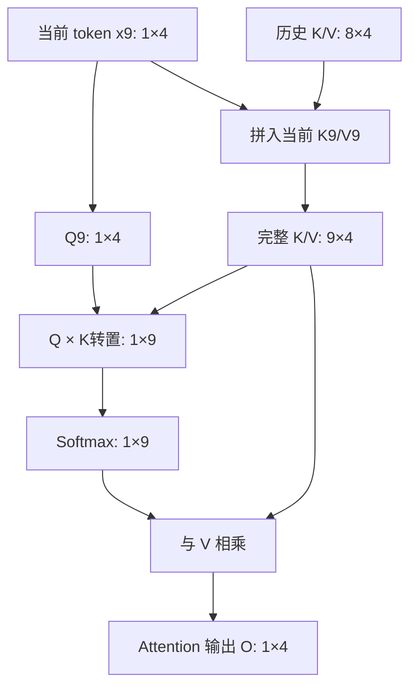
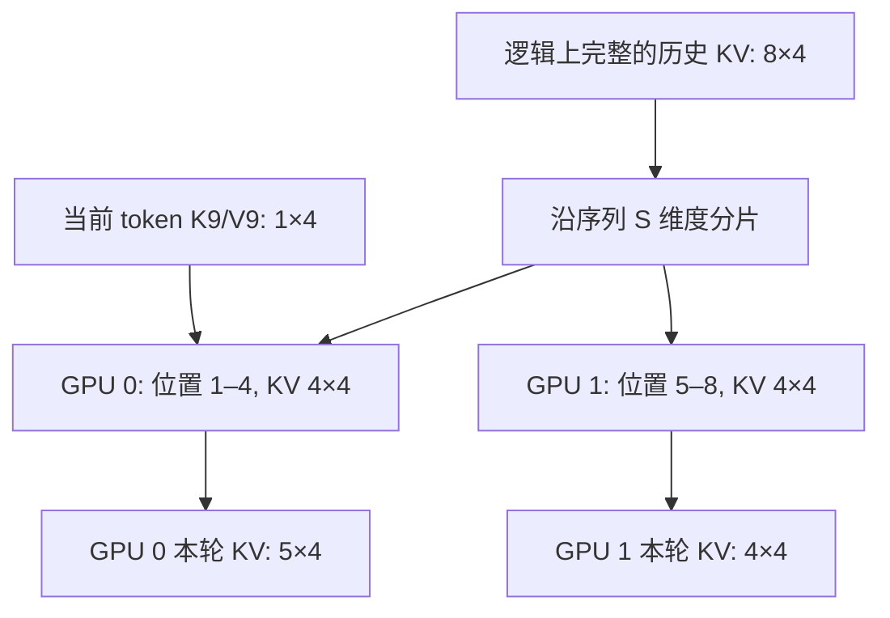
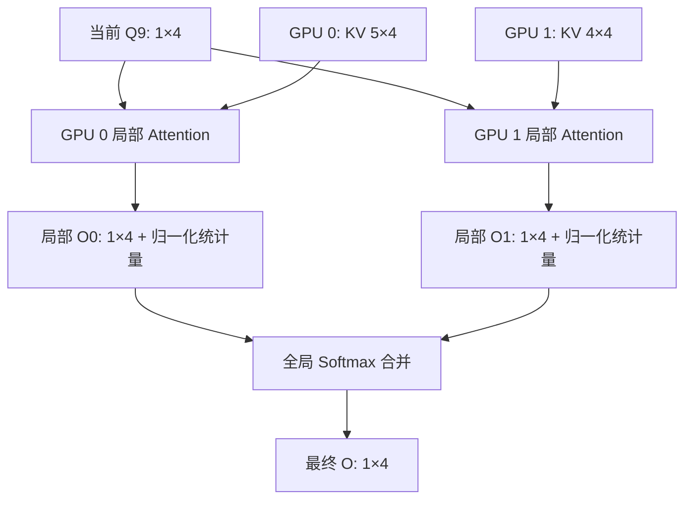

# DCP（Decode Context Parallelism）：从 Decode 张量变化理解上下文并行

> 本文从普通单头 Self-Attention 出发，不引入 Attention Head 切分、TP 或 MLA 的具体实现，逐步解释 DCP 如何在 Decode 阶段切分 KV Cache、计算局部 Attention，并恢复全局输出。文中的 GPU 分片为**教学用逻辑示意**，不代表所有推理框架的实际 KV 布局或通信实现。

## 1. DCP 是什么？与 CP 有何关系？

**DCP（Decode Context Parallelism）** 是应用于自回归 **Decode 阶段**的上下文并行方法：沿历史上下文的序列维度，将一个请求的 KV Cache 分布到多个 GPU；各 GPU 分别处理一部分键值，再合并局部 Attention 结果。

- **CP（Context Parallelism）**：上下文并行的广义思想，沿序列维度划分计算和数据。
- **DCP**：将这一思想专门应用于 Decode，重点是**分布式 KV Cache 和单步 Query 的全局 Attention**。
- **两者不必作为两个独立功能同时开启**：DCP 本身属于上下文并行范畴；在提供单独 DCP/PCP 配置的实现中，可以只开启 DCP，而不启用 Prefill Context Parallelism（PCP）。

DCP 不要求必须配合多头注意力来讲解。单头注意力中的 `[S,H]` 表示就足以说明其核心数学原理。

## 2. Decode 阶段的初始状态

假设我们只研究一个请求、Transformer 的某一层，并忽略 Batch 维度。令：

| 符号 | 数值 | 含义 |
|---|---:|---|
| `S` | 8 | 已缓存的历史 token 数量 |
| `H` | 4 | 单头注意力的特征维度（此例也等于 hidden size） |
| `DCP` | 2 | 分片设备数（GPU 0 与 GPU 1） |

Prefill 及此前处理已经留下历史 KV Cache：

```text
K_cache: [8, 4]
V_cache: [8, 4]
```

现在假设当前 Decode 步需要处理 token `x9`，通过本层投影产生：

```text
x9: [1, 4]
Q9 = x9 W_Q: [1, 4]
K9 = x9 W_K: [1, 4]
V9 = x9 W_V: [1, 4]
```

在包含当前 token 自身的因果注意力中，逻辑 KV 长度是 `8+1=9`：

```text
K = concat(K_cache, K9): [9, 4]
V = concat(V_cache, V9): [9, 4]
```

> **时间步提示**：`x9` 是“当前被 Transformer 处理的输入 token”，不是这一次前向传播最终经 LM Head 新预测出来的 token；下一 token 的预测发生在当前 Transformer 前向传播之后。不同框架对 Prefill 首 token 与 Decode 首步的划分可能不同，不影响这里的张量推导。

## 3. 基线：不使用 DCP 时的普通 Decode

先计算注意力分数（缩放因子不改变形状）：

\[
Z=\frac{Q_9 K^T}{\sqrt H},\qquad [1,4]\times[4,9]\longrightarrow[1,9]
\]

再对 9 个位置进行 Softmax：

\[
A=\operatorname{Softmax}(Z),\qquad [1,9]\longrightarrow[1,9]
\]

最后对 V 加权求和：

\[
O=AV,\qquad [1,9]\times[9,4]\longrightarrow[1,4]
\]



**基线结论**：普通 Decode 的 Q 只有一行，但要与当前可见的全部 KV（9 行）做 Attention。

## 4. 引入 DCP=2：沿序列维度切分 KV Cache

先将历史 8 个 KV 划分成两份：

- GPU 0：`K0,V0:[4,4]`，包含历史位置 1–4；
- GPU 1：`K1,V1:[4,4]`，包含历史位置 5–8。

为了把第 9 个 token 一起纳入当前计算，**在本例中**假定其 K9/V9 分配到 GPU 0：

- GPU 0：`K0,V0:[5,4]`；
- GPU 1：`K1,V1:[4,4]`。



> **重要**：这里采用连续位置切分，是为了使 `[S,H]→[S_i,H]` 一目了然。实际系统可能交错放置、按块映射，且存在固定 block size、padding 等细节。DCP 并不保证每步恰好均匀切分。

## 5. 同一个 Q 如何在两个 GPU 上计算局部 Attention？

当前 Query 为：

```text
Q9: [1,4]
```

从数学角度，每个 KV 分片都需要用到这个 Q。因此可以先抽象为两个设备都可使用 Q（实际系统可通过复制或集合通信提供所需 Q 分片）。

### GPU 0

```text
Q9:          [1,4]
K0:          [5,4]
Q9 × K0^T:   [1,5]
Softmax:     [1,5]  （仅局部分片归一化）
V0:          [5,4]
O0:          [1,4]
```

### GPU 1

```text
Q9:          [1,4]
K1:          [4,4]
Q9 × K1^T:   [1,4]
Softmax:     [1,4]  （仅局部分片归一化）
V1:          [4,4]
O1:          [1,4]
```



**局部计算的输出维度没有变化**，但每个 GPU 只扫描了本地一部分 KV。

## 6. 为什么不能直接相加两个局部输出？

注意：

\[
O_0=\operatorname{Softmax}(Z_0)V_0,\quad
O_1=\operatorname{Softmax}(Z_1)V_1
\]

这里的 Softmax 分别只在各自的序列片段上归一化。若直接计算 `O0+O1` 或取平均，**一般不等于**在 9 个 token 上一次性做 Softmax 的全局 Attention 输出。

需要跨设备合并归一化统计量。对于 GPU `i`，定义：

\[
m_i=\max_j z_{ij},\qquad
l_i=\sum_j e^{z_{ij}-m_i}
\]

其中 `z_ij` 是该 GPU 内的**已缩放**注意力分数，局部输出：

\[
O_i=\frac{\sum_j e^{z_{ij}-m_i}V_{ij}}{l_i}
\]

再计算全局最大值及归一化分母：

\[
m=\max(m_0,m_1)
\]

\[
l=e^{m_0-m}l_0+e^{m_1-m}l_1
\]

最终结果：

\[
\boxed{
O=\frac{e^{m_0-m}l_0O_0+e^{m_1-m}l_1O_1}{l}
}
\]

由此恢复出与普通 Attention **数学上等价**的 `[1,4]` 输出（浮点误差除外）。实现时也常用 LogSumExp（LSE）来高效且数值稳定地合并。

## 7. 完整张量变化对照

| 阶段 | 普通 Decode | DCP=2：GPU 0 | DCP=2：GPU 1 |
|---|---|---|---|
| 当前 Q | `[1,4]` | `[1,4]` | `[1,4]` |
| 历史 K/V | `[8,4]` | `[4,4]` | `[4,4]` |
| 拼入当前 K/V 后 | `[9,4]` | `[5,4]` | `[4,4]` |
| QKᵀ | `[1,9]` | `[1,5]` | `[1,4]` |
| 局部 Softmax | `[1,9]` | `[1,5]` | `[1,4]` |
| 局部 Attention 输出 | `[1,4]` | `[1,4]` | `[1,4]` |
| 全局合并 | 不需要跨设备合并 | **合并两端统计量与输出 → `[1,4]`** | 同左 |

一般化地说，若逻辑总上下文长度为 `T`，分成 `P` 个序列片段，则：

\[
K_i,V_i:[T_i,H],\quad \sum_{i=0}^{P-1}T_i=T
\]

\[
Q:[1,H],\quad QK_i^T:[1,T_i],\quad O_i:[1,H],\quad O:[1,H]
\]

当能完全均匀切分时，`T_i=T/P`；不能整除时可以不等长。

## 8. 与 CP、PCP、Attention Head、TP、MLA 的关系

**与 CP / PCP**：DCP 是 Decode 阶段的上下文并行，和 CP 的序列切分思想相通，但不需要先部署某个独立的 Prefill CP 才能使用。常见的 Prefill 上下文并行还要处理一段 Query 序列，而 Decode 单请求每步通常只有一个待处理的 Query。

**与 Attention Head**：上面的单头案例已能完整解释 DCP；增加 Head 只是在形状上再加入 Head 维度。例如 MHA 的每层 KV 可以写成 `[T,N_h,D_h]`，DCP 主要沿 `T` 切分，**不是**沿 `N_h` 切分。

**与 TP**：在 vLLM 等具体实现中，DCP 可以复用已有的 TP 设备组，Query 的复制/重排、输出的归并也可能用 AllGather、ReduceScatter 等集合通信实现。因此这里的“每张 GPU 都有 `[1,H]` 的完整 Q”属于方便教学的数学抽象，不应当理解为对所有生产配置的精确陈述。

**与 MLA**：MLA 可能把 KV 表示压缩为较低维的潜在表示，DCP 仍可以针对其**序列维度**分片。MLA 的特殊投影和 RoPE 路径不影响本文要说明的序列切分核心思想。

## 9. 适用性与代价

DCP 的主要价值是**分散每张 GPU 上的 KV Cache 存储压力**，并让各设备分摊长历史 KV 的读取和 Attention 计算；但它引入 Query / 输出 / Softmax 统计量的跨设备通信，所以不保证所有模型、序列长度和负载下都更快。实际收益取决于 KV 长度、批处理规模、硬件互联、Attention 内核、调度和 TP 组合方式。

## 10. 一句话总结

**普通 Decode：一个 Q 访问完整 KV → 一次 Attention → 一个输出。**

**DCP Decode：一个 Q 访问多张 GPU 上的 KV 分片 → 分别计算局部 Attention → 利用全局 Softmax 统计量精确合并 → 恢复同样形状的输出。**

核心张量规律：

```text
普通 Decode:
Q [1,H] × K^T [H,T] -> Score [1,T] -> O [1,H]

DCP（每个分片 i）:
Q [1,H] × Ki^T [H,Ti] -> Score_i [1,Ti] -> O_i [1,H]
全部局部 O_i + Softmax 统计量 -> 全局 O [1,H]
```

---

### 参考阅读

- vLLM 官方文档：Context Parallel Deployment — https://docs.vllm.ai/en/latest/serving/context_parallel_deployment/
- FlashAttention 相关工作中采用的在线 Softmax / 分块合并思想，可用于理解上述数学合并机制。
