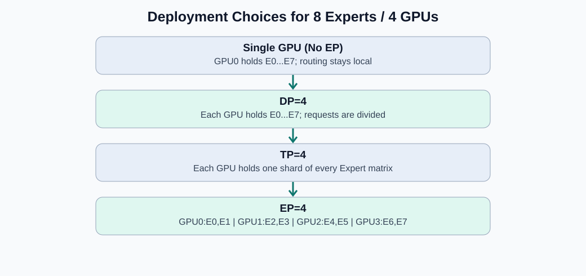
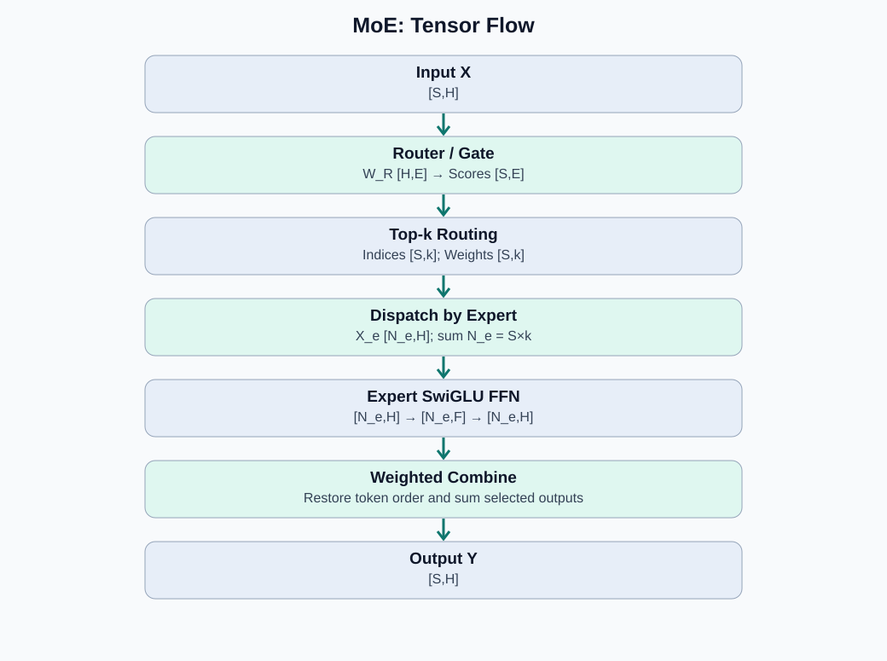
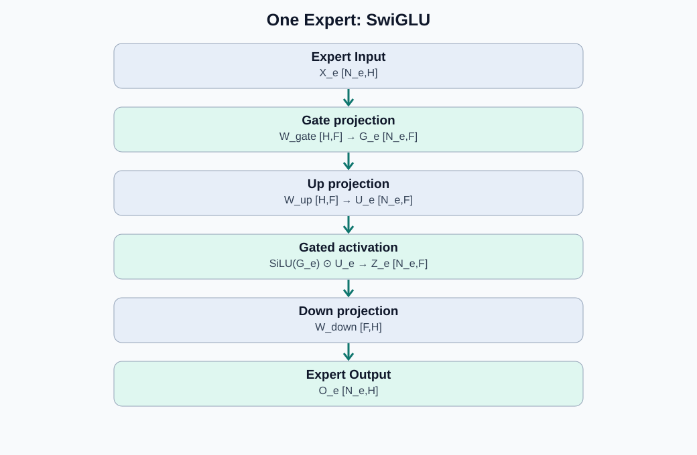
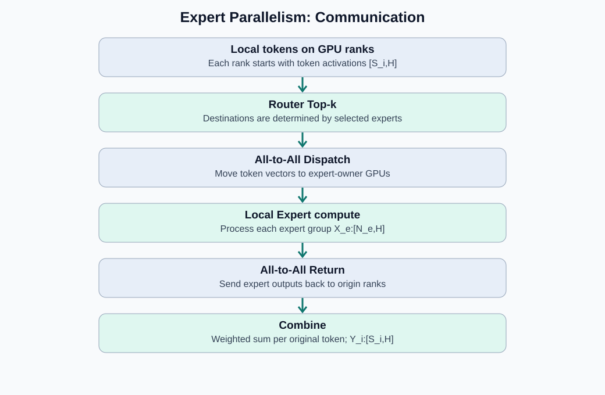
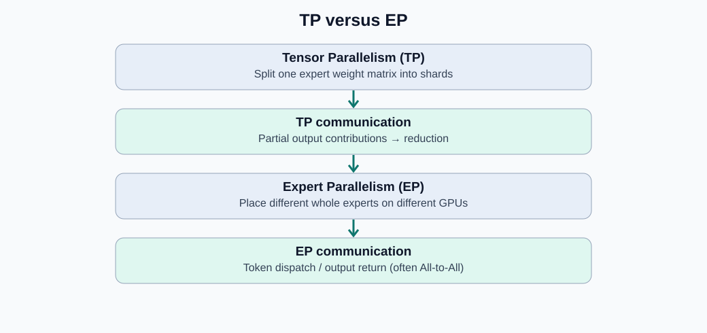

# MoE 与 EP：原始张量变换、部署演进及通信机制（图解）

> 本文是「模型并行」系列的一篇（系列顺序见 [TP](TP.md) 导航：TP / PP / EP / CP / SPTP，其中 PP、SPTP 尚为占位），补上其中 **EP（专家切分）** 一位。主线：先理解 **MoE 是什么、为何不依赖 EP**，再理解 **EP 为什么出现、改变了什么**。全文采用行向量右乘权重的约定，省略 Batch 维、Bias 和残差/归一化细节，重点解释 MoE 子层而非整个 Transformer Block。MoE 层的模块构成与机制细节见 [MoE](../推理算法/MLP模块/MoE/MoE.md)（本文的部署/通信视角与它互补）；Attention 侧的并行对照见 [TP](TP.md) 与 [CP](CP.md)。
>
> 数据来源：导入自外部图解报告（2026-10-13）。图片位于 `source/推理系统/模型并行/EP/`。

## 1. MoE 与 EP 的关系

**MoE（Mixture of Experts）是一种模型架构**：由 Router 决定每个 Token 应该进入哪些 FFN Expert。**EP（Expert Parallelism）是一种部署和并行策略**：将不同 Expert 的权重放在不同 GPU 上，并把 Token 发往拥有相应 Expert 的 GPU。

- TP：切分*同一个权重矩阵*，用多 GPU 协同计算。
- SP/CP：围绕 Token 的序列维度划分激活或上下文处理。
- EP：切分 *Expert 的归属*；最简单的 EP 中一个 Expert 可以完整放在一张 GPU 上。

需要注意，EP 不一定“每 GPU 恰好一个 Expert”：同一 GPU 可以有多个 Expert，也可以结合 TP 将单个 Expert 跨 GPU 切分。

MoE 概念早于 Transformer 和现代 GPU 专家并行：经典 *Adaptive Mixtures of Local Experts* 可追溯到 1991 年；2017 年的稀疏门控 MoE、2020 年 GShard、2021 年 Switch Transformer 推动了大规模跨设备专家路由。因而不能认为 MoE 与 EP 同时诞生。

## 2. 为什么需要 MoE？为什么后来需要 EP？

Dense FFN 对所有 Token 使用同一套权重。MoE 使用多个专家 FFN，但每个 Token 只激活其中 k 个（通常 k 远小于专家总数 E），在提高模型总参数容量的同时，避免每个 Token 运行所有 Expert。

**没有 EP 也可以正常执行 MoE**：单 GPU 保存 Router 与全部 Expert，Token 本地路由、本地计算。随着专家总参数量增大，一张 GPU 可能容纳不下全部专家参数；DP 会复制整套模型，TP 则可以把每个 Expert 的矩阵再切分。EP 使用另一种策略：不同 GPU 保存不同 Expert，跨 GPU 转发 Token，**分摊专家权重显存与计算**，但引入 Token Dispatch / Combine 通信和负载不均衡问题。

## 3. MoE 原始张量变换：从 X:[S,H] 到 Y:[S,H]

设：

| 符号 | 含义 | 示例 |
|---|---|---:|
| S | 当前输入 Token 数 | 1024 |
| H | Hidden Size | 4096 |
| E | Expert 总数 | 8 |
| k | 每个 Token 选中的 Expert 数 | 2 |
| F | 每个 Expert 的 FFN 中间维度 | 11008 |

此处使用 **Top-2 路由 + SwiGLU Expert**。这是教学示例；不同 MoE 模型的 Router 可以使用 Softmax、Sigmoid 或带偏置的分数，且可能包含 Shared Expert、容量控制等机制（真实实例见 [MoE](../推理算法/MLP模块/MoE/MoE.md) 的路由变体与 [GLM-5.3](../模型结构/GLM-5.3/GLM-5.3.md)：sigmoid + noaux_tc + 共享专家）。

### 3.1 Router：计算每个 Token 的 Expert 分数

输入：

$$
X\in\mathbb{R}^{S\times H}
$$

可训练 Router 权重：

$$
W_R\in\mathbb{R}^{H\times E}
$$

计算：

$$
R=XW_R:\quad [S,H]\times[H,E]\rightarrow[S,E]
$$

因此 `R[t,e]` 是 Token t 对 Expert e 的路由分数。对每行进行所选的路由归一化（例如 Softmax），再做 Top-k，得到：

$$
Indices:[S,k],\qquad Weights:[S,k].
$$

`Indices[t,j]` 是第 t 个 Token 选中的第 j 个 Expert 编号；`Weights[t,j]` 是该 Expert 输出用于合并的路由权重。不同模型可能对选中权重再次归一化。

### 3.2 Dispatch：按 Expert 对 Token 分组

对每个 Expert e，将所有选择了 e 的 Token 原始隐藏向量收集起来：

$$
X_e:[N_e,H]
$$

其中 `N_e` 是 Expert e 接收的 Token 数，**不同 Expert 的 N_e 可以不同**。如果每个 Token 恰好选中 k 个不同 Expert，并且没有丢弃 Token：

$$
\sum_{e=0}^{E-1}N_e=S\cdot k.
$$

例如：T0→E1,E3；T1→E0,E3；T2→E2,E5。每次路由发送的是**完整 `[1,H]` Token 向量**，不是把 H 切成 k 份。

### 3.3 单个 Expert 的 SwiGLU FFN

对 Expert e，权重分别为：

$$
W_{gate}^{(e)}:[H,F],\quad W_{up}^{(e)}:[H,F],\quad W_{down}^{(e)}:[F,H].
$$

Gate、Up 两条投影：

$$
G_e=X_eW_{gate}^{(e)}:[N_e,F],\quad U_e=X_eW_{up}^{(e)}:[N_e,F].
$$

逐元素门控：

$$
Z_e=\mathrm{SiLU}(G_e)\odot U_e:[N_e,F].
$$

Down 投影：

$$
O_e=Z_eW_{down}^{(e)}:[N_e,F]\times[F,H]\rightarrow[N_e,H].
$$

所有 Expert**结构可以相同，但拥有不同的可训练权重值**，因此同一 Token 经不同 Expert 处理会产生不同的结果。

### 3.4 Combine：按原始 Token 与路由权重合并

设第 t 个 Token 选择专家 `e_{t,1},...,e_{t,k}`，则：

$$
y_t=\sum_{j=1}^{k}w_{t,j}\,Expert_{e_{t,j}}(x_t),\qquad y_t:[1,H].
$$

例如 T0 选择 E1 和 E3，对应权重 0.7、0.3：

$$
y_0=0.7\,Expert_1(x_0)+0.3\,Expert_3(x_0).
$$

重新排列回输入 Token 顺序，最终得到：

$$
\boxed{Y:[S,H]}
$$

这份 `Y` 是 **MoE 子层的输出**；完整 Transformer Block 还包含残差、Norm、Attention 等部分。

### 3.5 一张表总结权重与张量

| 计算阶段 | 权重矩阵 | 输入 | 输出 |
|---|---|---|---|
| Router | `[H,E]` | `[S,H]` | `[S,E]` |
| Top-k | 无可训练矩阵 | `[S,E]` | `Indices/Weights:[S,k]` |
| Dispatch | 无可训练矩阵 | `[S,H]` + 索引 | 各 `X_e:[N_e,H]` |
| Expert Gate | `[H,F]` | `[N_e,H]` | `[N_e,F]` |
| Expert Up | `[H,F]` | `[N_e,H]` | `[N_e,F]` |
| SwiGLU | 无 | 两个 `[N_e,F]` | `[N_e,F]` |
| Expert Down | `[F,H]` | `[N_e,F]` | `[N_e,H]` |
| Combine | 无 | 多 Expert 输出及权重 | `[S,H]` |

## 4. 没有 EP：MoE 的不同部署方式

**方案 A：单 GPU，无并行。** Router 与 E 个 Expert 权重都在一张 GPU；本地完成 Dispatch 和 Combine。前提是模型能放入单卡。

**方案 B：DP=4。** 每张 GPU 都有 Router 和所有 Expert 的完整副本，不同 GPU 处理不同请求/批次；利于扩展吞吐，但单卡专家权重显存并未下降。

**方案 C：TP=4。** 每个 Expert 的线性矩阵按列/行并行切成 4 份，各 GPU 保存*所有 Expert 的部分权重*；一个 Expert 的输出需要跨卡协作与适当归约（切分数学见 [TP](TP.md) §2-§3）。

**方案 D：EP=4。** 8 个 Expert 平均放在 4 张 GPU，每卡两个*完整 Expert*；每张卡不需要持有全部专家参数，但必须按照路由结果跨 GPU 发送 Token。

## 5. EP=4：从 MoE 计算到跨 GPU 通信

假设 E=8、k=2、EP=4：

| GPU | 持有专家 |
|---|---|
| GPU 0 | E0、E1 |
| GPU 1 | E2、E3 |
| GPU 2 | E4、E5 |
| GPU 3 | E6、E7 |

各 GPU 初始持有不同输入 Token 批次：`X_i:[S_i,H]`（总 Token 数 `Σ S_i = S`）。Router 在 Token 的来源侧计算：

$$
X_i[S_i,H]\;W_R[H,E]\rightarrow R_i[S_i,E]\rightarrow Indices_i,Weights_i[S_i,k].
$$

根据 Expert 所属 GPU，把选中的 Token 向量打包分发。典型实现用 **All-to-All Dispatch**，它搬运的是 Token 激活值 `[1,H]` 及恢复顺序所需的元数据，**不是发送 Expert 的权重矩阵**。

各目标 GPU 按收到的专家编号分组，执行本地完整 Expert FFN；产生 `[N_e,H]` 的结果后，通过 **All-to-All Return** 送回对应的来源 GPU。来源 GPU 根据原始 Token 位置和路由权重聚合，恢复 `Y_i:[S_i,H]`。

**为什么不直接 All-Reduce？** 因为 GPU 上的 Expert 通常处理不同 Token、计算不同函数，并非对同一个矩阵乘法输出计算可直接求和的对应分片；需要先把 Token 送到正确 Expert，再把多份结果送回原 Token 位置进行加权合并。某些系统会融合 Dispatch/Combine 或使用其他通信原语，但语义不变。

## 6. EP 主要解决什么，代价是什么？

- **收益**：将专家参数分散到设备；利用 Top-k 的稀疏激活让不同专家并行处理不同 Token；不要求每 GPU 保存全部专家。
- **挑战**：All-to-All 的网络带宽和延迟；不同 Expert 收到的 Token 数不均，容易出现负载倾斜；小批量 Decode 的通信占比可能较高。
- **边界**：EP 不会自动切分 Self-Attention 权重或 KV Cache；Attention 仍需结合 TP、DP、CP/DCP 等适用策略（CP 的 KV 协同见 [CP](CP.md)）。

## 7. 与 TP、SP、CP 的联系

| 并行方式 | 分配单元 | 典型通信 | 直接目的 |
|---|---|---|---|
| TP | 单个权重矩阵的行/列或 Head | All-Reduce / All-Gather 等 | 分摊权重与矩阵计算 |
| SP | Token 序列分片上的部分激活 | All-Gather / Reduce-Scatter | 减少冗余激活 |
| CP | 上下文 Token/KV 分片 | KV All-Gather / Ring P2P 等 | 长序列注意力的计算与存储分摊 |
| EP | 不同完整 Expert | All-to-All Dispatch/Return | 分摊专家权重与专家计算 |

## 8. 关键结论

1. **MoE 是模型结构，EP 是部署策略**，前者并不依赖后者存在。
2. **原始 MoE 核心公式**：`X[S,H] → Router[S,E] → Top-k[S,k] → Dispatch X_e[N_e,H] → Expert FFN[N_e,H] → 加权 Combine Y[S,H]`。
3. **EP 的本质**：在保持专家网络计算定义不变的情况下，改变 Expert 的设备归属和 Token 的流动方式。
4. **与 TP 最大的不同**：TP 分散一个矩阵的计算；EP 分散不同 Expert 的计算。因此典型通信从 TP 的归约变成 EP 的按路由 All-to-All。

## 9. 推荐原始参考资料

- Jacobs et al. (1991), *Adaptive Mixtures of Local Experts*: https://doi.org/10.1162/neco.1991.3.1.79
- Shazeer et al. (2017), *Outrageously Large Neural Networks: The Sparsely-Gated Mixture-of-Experts Layer*: https://arxiv.org/abs/1701.06538
- Lepikhin et al. (2020), *GShard*: https://arxiv.org/abs/2006.16668
- Fedus et al. (2021), *Switch Transformers*: https://arxiv.org/abs/2101.03961
- NVIDIA Megatron Core Expert Parallelism: https://docs.nvidia.com/megatron-core/developer-guide/latest/api-guide/moe.html
- 本库关联：[MoE](../推理算法/MLP模块/MoE/MoE.md)（机制篇）、[TP](TP.md)（权重切分对照）、[CP](CP.md)（序列切分对照）、[GLM-5.3](../模型结构/GLM-5.3/GLM-5.3.md)（256 专家 + EP 落地实例）
