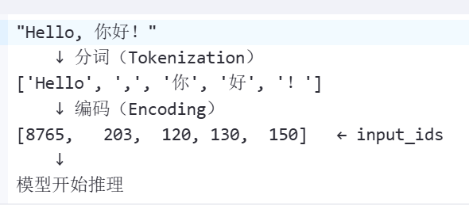

# 模型推理

1. 首先，直接上代码

```Python
# 合并后的模型
model_dir = r'D:\Ai_projects\loraLearnBase\qwen\Qwen1___5-0___5B-Chat'


# 测试下载回来的模型有没有问题
from transformers import AutoModelForCausalLM, AutoTokenizer
from transformers.generation import GenerationConfig


def load_view_model():
    *"""*

*    加载与查看模型信息*

*    """*
    
    #----加载，部署模型----
    
    # 1.加载分词器：Tokenizer 负责将文本拆分为子词单元（subword tokens），转换为数字 ID（input_ids），供模型输入。
*    *tokenizer = AutoTokenizer.from_pretrained(model_dir, trust_remote_code=True)

    #2. 加载模型，将模型参数转移到GPU上；切换评估模式，保持模型参数的稳定，确保推理稳定
    model = AutoModelForCausalLM.from_pretrained(
        model_dir,
        device_map="auto",
        trust_remote_code=True
    ).eval()

    print("查看模型信息")
    print(model)
    
    #----进入实际推理流程----
    
    #1.输入推理问题，对话模版（提示词工程）：其实是为了构造更好，效果更佳的模型输入
    test = '''在互联网普及的时代，社交媒体已经成为了现代人生活中不可缺少的一部分。从微信、微博、Facebook到Twitter、Instagram等等，社交媒体不仅满足了人们交流互动的需求，
    同时让人们更加容易地分享自己的生活瞬间、获取新闻资讯、找到志同道合的人群以及推广自己的业务。然而，与此同时，社交媒体也带来了一系列问题，如滥用个人信息、泄露隐私等。因此，
    如何正确地使用社交媒体已经成为了一个备受关注的话题。，总结上面这段文本的几个关键词。'''
   
    prompt = test
    messages = [
        {"role": "system", "content": "你是一个乐于助人的助手."},
        {"role": "user", "content": prompt}
    ]
   
    text = tokenizer.apply_chat_template(
        messages,
        tokenize=False,
        add_generation_prompt=True
    )
    
    #2.对拼接后的 prompt 进行编码（字符 ---> 数字），输入到GPU上
    model_inputs = tokenizer([text], return_tensors="pt").to('cuda')

    #3.生成token，这是最核心的操作
    generated_ids = model.generate(
        model_inputs.input_ids,
        max_new_tokens=512
    )
    
    #4.截取仅生成的部分
    generated_ids = [
        output_ids[len(input_ids):] for input_ids, output_ids in zip(model_inputs.input_ids, generated_ids)
    ]
    
    #5.将生成的 token ID 转回人类可读文本
    response = tokenizer.batch_decode(generated_ids, skip_special_tokens=True)[0]
    print('当前使用模型路径：',model_dir)
    print('问题：',test)
    print('-----------------result---------')
    print(response)

    # 以下代码适合1.8b模型的
    # response, history = model.chat(tokenizer, "你好,你是谁？", history=None)
    # print(response)

    # response, history = model.chat(tokenizer, test, history=None)
    # print(response)


if __name__ == '__main__':
    load_view_model()
```

### 分词器：

2. 分词器（Tokenizer）的核心作用：将人类可读的文本转换为模型能够理解的数字形式（即“token ID”序列），以及将模型输出的数字序列还原回文本。（文字  \<\-\-\-\-\>  数字）

3. LLM本质上处理的数字，而不是文字

4. 工作流程：

    1. 正向流程（输入给模型）：
    



    2. 反向流程（模型输出结果）：


5. 举例：这体现了分词器中的工作流程

```Python
from transformers import AutoTokenizer

tokenizer = AutoTokenizer.from_pretrained("qwen/Qwen1___5-0___5B-Chat")

text = "我喜欢学习人工智能。"

# 文本 → token IDs
tokens = tokenizer.tokenize(text)
ids = tokenizer.encode(text)

print("原文：", text)
print("分词结果：", tokens)
print("编码ID：", ids)
print("解码回来：", tokenizer.decode(ids))
```

输出结果：


1. 现象：tokens的长度小于字符串text“我喜欢学习人工智能。”

    1. 分析：

        1. 首先，tokens中的token就是我们日常谈论大模型的token，它是大语言模型的基本处理单元；至于为什么乱码，是因为分词结果往往取决于具体模型的分词器，不同模型使用不同的分词策略

        2. token到ID的转换：每个token都会被转换为对应的数字ID，模型实际处理的是这些数字序列

        3. 总结，模型的处理流程：文本 → 分词为tokens → 转换为IDs → 模型处理 → 生成新的IDs → 解码为文本

    

### 模型推理的两个阶段


1. 上半部分是Prefill（预填充），下半部分是Decode（自回归解码）

2. 从上图可以看出KV Cache在模型推理流程中，至关重要

#### Prefill\(预填充阶段\)

1. 目标：对每个输入的 prompt（例如：“你好，今天天气怎么样？”），将其所有 token 一次性送入模型，计算出对应的 Key 和 Value 向量，并存储到 KV Cache 中，供后续 decode 使用。

2. 每次输入的prompt在不超过模型的最大序列长度的情况下，都会被当做一个处理序列；

    1. 所以每个独立的用户请求就是一个sequence（序列）

    2. 每个序列都会输出对应的KV Cache

3. Prefill阶段在处理prompt时，是进行批量处理的

    1. Prefill阶段的输入是多个不同长度的 prompt 序列

##### 批量处理

1. 此前，已经理解每一次独立用户请求对应一个Token序列进行处理，但是如果模型依次单独逐顺序处理序列，就极大降低了模型的吞吐量和处理效率，故现代推理系统都会进行批处理，下面介绍批量Prefill（例如seq1=50 tokens, seq2=120 tokens）

    1. Packed input（扁平化拼接）：将所有序列的 token ID 拼接成一个一维张量。

        ```Python
        input_ids = [t1_0, t1_1, ..., t1_49, t2_0, t2_1, ..., t2_119]
        ```

    2. cu\_seqlens（累计序列长度）：记录每个序列的起始位置，用于在 attention 计算中正确划分

    ```Python
    cu_seqlens = [0, 50, 170]  # 表示 seq1 占 0～49，seq2 占 50～169
    ```

    3. Position IDs（位置编码）：每个序列的位置编码从 0 开始（或按实际逻辑偏移），避免跨序列干扰

    ```Python
    positions = [0,1,...,49, 0,1,...,119]
    ```

    4. Attention Mask

    5. 


#### Decode阶段

1. 目标：基于已有的 KV Cache，逐个生成新的 token，每一步只输入当前待预测的 token（通常是上一步生成的最后一个 token），并扩展 KV Cache。

2. 核心思想：

    1. 每次只处理一个token

    2. 利用之前缓存的KV值，避免重复计算

    3. 支持多个序列并行生成（一个序列可以理解为输入的一次prompt）

3. 大致处理逻辑

    ```Python
    # 假设模型函数支持 kv_cache 参数
    logits = model(
        input_ids=last_tokens,  #当前序列的最后一个token
        positions=current_positions, #最后一个token的位置，也可以标注新token的插入位置
        kv_cache=existing_kv_cache  # 包含前面所有 token 的 K/V
    )
    ```

    1. 使用当前序列的最后一个token和位置信息

    2. 从KV Cache中读取前面所有token的 K/V

    3. 计算当前last token的注意力权重

    4. 输出一个概率分布图（词汇表中的每一个token对应一个注意力分数logit）

    5. 经过采样参数的一些控制，选择最大概率的token，加入当前序列

    6. 更新KV Cache，

    7. 以上过程不断循环\.\.\.\.\.\.\.


#### KV Cache

1. 在模型的整个推理流程中，KV Cache是其中的核心所在；预填充阶段提取输入prompt的信息，生成KV Cache；Decode阶段利用上一阶段的KV Cahce不断生成新的token并不断更新当前序列（当前模型推理流程）的KV Cache

2. 节省计算，不再重复计算历史token的K/V，仅需计算新token和Q和Attention
（此处还需要补充相关知识和细节）

3. 支持流式生成，实现逐token输出

4. 支持批量推理，多个序列共享相同的KV Cache结果，实现并行化


