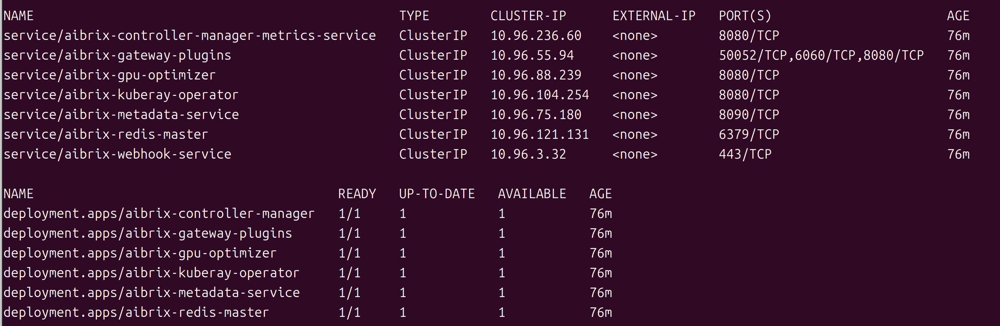
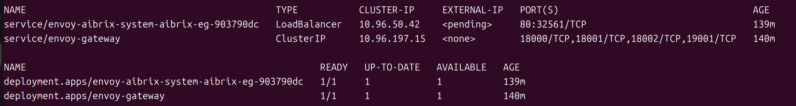

- 关键词：
  - Ai infrastructure；inference；Cloud-native；K8s；Vllm生态
- 我感觉AiBrix是站在集群的维度上，对所有推理服务和模型进行优化，推理加速，同时又包含了许多附加操作，比如LLM gateWay，HardWare detection
- 同时AiBrix内部又灵活利用了Vllm或Sglang等推理框架，所以AiBrix框架的本质依旧是推理加速，只不过其是站在集群角度上出发的
- AiBrix的启动方法：和K8s大量集成
  - 所以我需要先了解使用go语言开发K8s相关服务的流程

# 1.背景

AiBrix是一个面向大规模 LLM 推理服务的云原生控制平面 / 系统编排层，而非单纯的推理框架

- k8s集群   --->  AiBrix  ---> vllm,Sglang等推理引擎

（我不是第一次听说“云原生”这个词汇，我目前对“云原生”的联想就是k8s，docker，Go语言等，但是我始终无法解释什么是“云原生”）
如何理解“云原生”？

- “应用应该如何被构建、部署、运行、扩缩容和治理”的系统设计思想，**管理维护运行中的应用服务**；非某具体技术
- 特性：标准化，自动化，可声明（告诉系统“我希望始终有 2 个健康的模型实例在运行。”，系统自动维护）
- 产生原因：只有在**分布式、多服务器、微服务背景**下，才会强烈出现自动管理应用服务的需求，因此产生了云原生概念。
- 思考：
  - 在分布式，微服务的背景下，K8s 的出现，是为了通用地管理大规模容器化应用，比如各种web微服务，微服务中间件（redis，mysql）等。
  - 由于AI模型的参数量和服务体量不断增长，并且具备强烈的专用特性（KV Cache，请求形态等），此时单靠K8s管理还不够，故AiBrix应运而生。

# 2.组织形式

AiBrix在K8s集群中的安装方法

```bash
kubectl create -f https://github.com/vllm-project/aibrix/releases/download/v0.7.0/aibrix-dependency-v0.7.0.yaml

kubectl create -f https://github.com/vllm-project/aibrix/releases/download/v0.7.0/aibrix-core-crds-v0.7.0.yaml

kubectl create -f https://github.com/vllm-project/aibrix/releases/download/v0.7.0/aibrix-core-v0.7.0.yaml
```

- AiBrix利用以上命令在K8s集群中拉取镜像，创建nameSpace等相关资源


AiBrix在K8s集群中的分布和存在形式：K8s对象； （后续可以针对每个组件，结合相关代码，进行分析）

- aibrix-system命名空间：主要包含AiBrix自身组件；Deployment/Pod/Service；不同的Deployment或Pod承载不同“能力角色”

  

  - aibrix-controller-manager：**AiBrix控制面**核心；分别绑定了一个ClusterRole和一个Role
    - 监听 AiBrix CRD
    - 转化实际的K8s对象
    - 更新资源status
    - .....
  - aibrix-gateway-plugins：LLM请求路由；**AiBrix数据面**routing组件；将请求调度到合适的模型后端
    - 理解LLM请求语义
    - 根据model，LoRA adapter等信息做更细粒度的路由
  - aibrix-gpu-optimizer：GPU资源优化；资源决策辅助
    - 负载模式、GPU 类型、SLO  ---  gpu-optimizer --> 更优GPU资源配置或副本数建议
    - gpu-optimizer的输出指标，通过网络端口，被PodAutoscaler所捕捉，并进行后续流程
  - aibrix-kuberay-operator：多节点；推理编排
    - 和Ray高度依赖
    - **注意：**
      - 我大致知道它是和模型并行推理有关的，但是我不理解其具体负责哪部分内容？已经为什么需要单独划分出来？
  - aibrix-metadata-service：元数据；API Server；
    - 在我看来，更像是一个暴露给外部用户相关附属数据的API Server
  - aibrix-redis-master：状态存储；Redis；共享状态
    - 缓存
    - 内部状态存储
    - 元数据存储
    - ....
  - aibrix-webhook-service(纯svc组件)：Webhook；钩子
    - **注意：** 需要提前了解Webhook在K8s中的基本概念和作用
  - 总结:
    - 前4个deployment是AiBrix的核心组件，覆盖了vLLM推理实例的主流程，确实形成了**模型服务创建 → 推理实例运行 → 请求路由 → 负载感知 → 资源优化 → 分布式扩展**的完整闭环
    - 另外2个deployment，作为“支撑层”，分别负责外部数据的输出和内部数据的共享存储
- envoy-gateway-system命名空间：AiBrix网关组件和实际**流量**入口；

  

  - envoy-aibrix-system-aibrix-eg-903790dc：Enyoy**数据**面
    - 真实的流量入口代理
    - 外部请求 --->  envoy-aibrix-system-aibrix-eg-903790dc ---> AiBrix gateway plugin ---> 模型服务
  - envoy-gateway：控制面；Gateway API **控制**器
    - 生成Envoy的真实配置
    - 不直接处理大多数推理请求流量
  - 补充：
    - Envoy：高性能网络代理；类比Nginx等；数据面代理
    - `envoy-gateway` 作为 Gateway API controller，会根据 相关策略资源，**创建、配置、更新和维护** `envoy-aibrix-system-aibrix-eg-903790dc` 这个 Envoy 数据面 Deployment/Service；这也是`envoy-aibrix-system-aibrix-eg-903790dc`后缀这么长的原因
      - 其实现逻辑是，`envoy-gateway`中的pod中运行着一个Controller进程，通过K8s API创建/更新数据面Deployment；**（这也是K8s  Controller的通用模式 --- reconcile: 持续维护）**
- AiBrix自定义的**CRD**

  - CRD：K8s扩展框架的核心；给K8s所增加新的资源类型
    - 产生原因：
