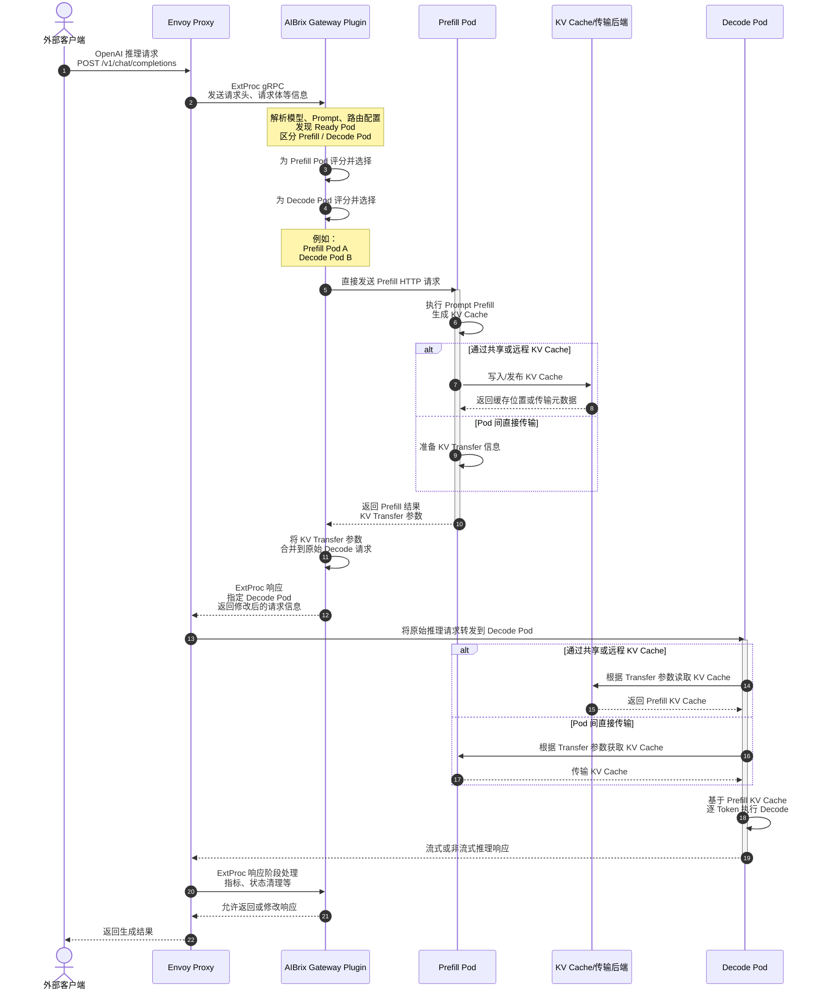
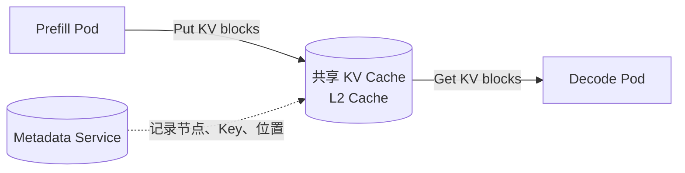
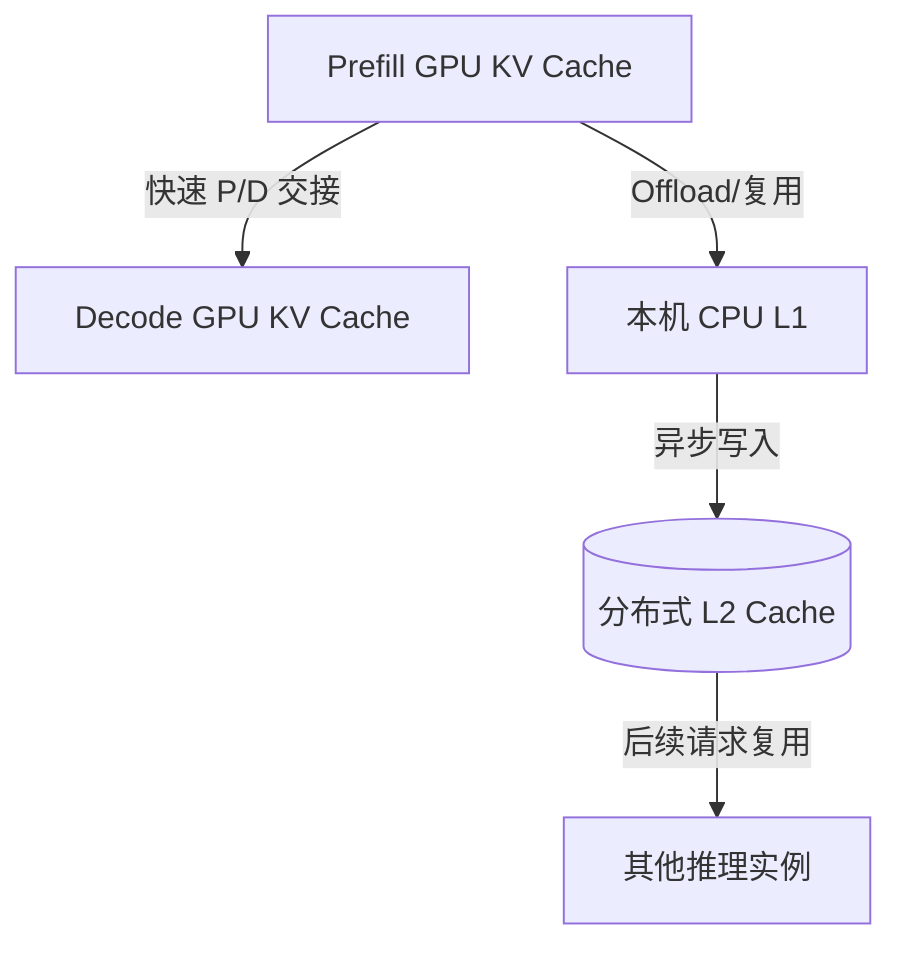

# 1.前文

| 数据链路阶段              | 代码/配置位置                                                             |
| ------------------------- | ------------------------------------------------------------------------- |
| Envoy 接收请求            | Envoy 外部组件及 Gateway 配置                                             |
| Envoy 调用 Gateway Plugin | `config/gateway/`、Helm/Deployment 配置                                 |
| Gateway Plugin 进程启动   | `cmd/plugins/main.go`                                                   |
| ExtProc 请求处理          | `pkg/plugins/gateway/gateway.go`、`gateway_req_*.go`                  |
| 构建请求上下文            | `pkg/plugins/gateway/types.go`、`pkg/types/`                          |
| 获取候选 Pod              | `pkg/plugins/gateway/gateway.go`、`pkg/cache/`                        |
| 选择路由算法              | `pkg/plugins/gateway/algorithms/router.go`                              |
| P/D 路由                  | `pkg/plugins/gateway/algorithms/pd_disaggregation.go`                   |
| Prefill 评分              | `pkg/plugins/gateway/algorithms/pd/prefill_scorer.go`                   |
| 请求计数                  | `pkg/plugins/gateway/algorithms/pd/trackers.go`                         |
| 发起 Prefill 请求         | `pkg/plugins/gateway/algorithms/pd_prefill_request.go`及`pd/prefill/` |
| 不同引擎差异              | `pkg/plugins/gateway/algorithms/pd/engine/`                             |
| Prefix Cache 信息         | `pkg/cache/`、`pkg/kvevent/`、Prefix Index                            |
| 真正执行推理              | 外部 vLLM/SGLang                                                          |
| KV Cache 数据处理         | `python/aibrix_kvcache/`                                                |
| Runtime Sidecar           | `python/aibrix/aibrix/runtime/`                                         |

## 1.1 请求转发流程

请求到达AiBrix，转发给底层的vLLM实例Pod，中间需要经过aibrix-system和envoy-gateway-system命名空间的哪些组件（deployment）？

大致流程：外部请求 --->  envoy-aibrix-system-aibrix-eg-903790dc ---> AiBrix gateway plugin ---> 模型服务

下面作一个简单的拆解：

* `envoy-aibrix-system-aibrix-eg-903790dc`：真正接收外部推理请求
* `aibrix-gateway-plugins`：决定路由，挑选目标Pod；gRPC ExtProc与Envoy通信

在Aibrxi中，PD分离场景和非PD分离场景是有所不同的

**普通非 P/D 场景**

```
外部客户端
    ↓ HTTP/OpenAI API
Envoy Service
    ↓
Envoy Proxy
    ↓ gRPC ExtProc
AIBrix Gateway Plugin
    ↓ 返回选中的模型 Pod/路由信息
Envoy Proxy
    ↓ HTTP
vLLM/SGLang 模型服务
    ↓ 流式或非流式响应
Envoy Proxy
    ↓
外部客户端
```

发现：

* Envoy：接收请求，转发请求
* Gateway plugin：根据目标，选择Pod，修改路由信息

**P/D 分离场景**



P/D分离涉及KVCache传输，故需要Envoy和Gateway plugin执行多次操作

在P/D分离场景下，一个请求需要被先后调用到Prefill Pod和Decode Pod上，所以单请求处理需要Gateway plugin执行两次路由操作，分别筛选Prefill和Decode Pod

* Envoy 不直接把原始请求转发给 Prefill Pod
  * 和“非P/D分离场景”不同
* Envoy 最终转发的是 Decode 请求
  * Gateway Plugin 从 Prefill Pod 获得 KV Transfer 参数后，修改请求中的路由配置，返回给Envoy，Envoy转发给Decode Pod
* KV Cache 不一定经过独立服务
  * 在我的理解，KVCache的传输是由vLLM  KVConnector（MoonCakeConnector等），并且是Pull形式的，即Decode pod接收到请求后，根据请求一些标识信息，通过KVConnector从Prefill Pod中拉取对应的KVCache数据
  * KVCache的传输，AiBrix中的gateway-plugin只会转移相关控制信息（KVCache位置信息），它是不会参与KVCac数据转移过程

问：什么是KVCache Runtime？在考虑KVCache Runtime的情况下，似乎又不一样

## 1.2 KVCache传输

这部分偏向理论，考虑转移至“推理系统/其他细节/PD分离.md”中

### 1.2.1 点对点

Pod间直接传输；Prefill Pod  ---- RDMA/高速网络 ----> Decode Pod

* KVCache主要保存在Prefill Pod中
* Decode Pod根据相关信息**拉取** KV 数据（通常）
* 追求单次 P/D 请求的低延迟（优点）

典型实现包括：

* NIXL Connector；
* Mooncake P/D Connector；

**补充：**

点对点的传输，完全可能会加剧Prefill Pod的压力，再加上AiBrix中的一些超时配置（`AIBRIX_PREFILL_REQUEST_TIMEOUT`），极大可能是造成此前实验，请求504的原因

如果是，我感觉解决方案就是：

* 尽一切办法提升Prefill实例比重，因为目前Decode实例算力利用率比较低，无法看到P/D分离在P2P传输中的能力上限
* 探讨Pod间接传输，根据生产环境，考虑混合模式

关于AiBrix：是否可以优化？当检测到Prefill Pod显存压力过大时，降低该Prefill Pod请求接收速度，回压

### 1.2.2 Pod间接传输



中间层可能会负责：

* 跨实例共享；
* Prefix Cache 复用；
* 多级存储；

它可以解决“因decode无法及时获取KV Cache而导致请求超时”的问题

AiBri中也有这部分的内容，后续可以探讨

Mooncake Distributed Store；nfiniStore（AiBrix支持）

### 1.2.3 混合模式



感觉更贴近生产环境

# 2.源码解读

可以根据以下表格进行梳理

| 阶段                 | 主要代码                                            | 核心问题                                              |
| -------------------- | --------------------------------------------------- | ----------------------------------------------------- |
| 进程启动             | `cmd/plugins/main.go`                             | Gateway Plugin 如何启动、监听什么端口、依赖如何注入？ |
| ExtProc 请求生命周期 | `pkg/plugins/gateway/gateway.go`                  | Envoy 发来的流式 gRPC 消息如何被处理？                |
| 请求头处理           | `gateway_req_headers.go`                          | 如何确定路由对象、用户、请求路径及初始上下文？        |
| 请求体处理           | `gateway_req_body.go`                             | 如何解析模型、Prompt、路由策略并触发选 Pod？          |
| 响应处理             | `gateway_rsp_headers.go`、`gateway_rsp_body.go` | 如何统计结果、清理状态并处理流式响应？                |
| 路由上下文           | `pkg/types/router_context.go`                     | 一个请求在整个路由过程保存哪些状态？                  |
| 候选 Pod 发现        | `gateway.go`、`pkg/cache/`                      | Pod 从哪里来，如何过滤为 Ready 候选集？               |
| Router 框架          | `pkg/types/router.go`、`algorithms/router.go`   | 算法如何注册、选择和执行？                            |
| 普通路由算法         | `pkg/plugins/gateway/algorithms/*.go`             | random、least-request、prefix-cache 等如何选择 Pod？  |
| P/D 路由             | `algorithms/pd_disaggregation.go`                 | 如何选择 Prefill 和 Decode Pod？                      |
| P/D 评分策略         | `algorithms/pd/*.go`                              | Prefill/Decode 的评分数据和公式是什么？               |
| Prefill 执行         | `algorithms/pd/prefill/`                          | Gateway Plugin 如何主动调用 Prefill Pod？             |
| 引擎适配             | `algorithms/pd/engine/`                           | vLLM、SGLang、TensorRT-LLM 请求有何差异？             |
| KV 传输元数据适配    | `algorithms/pd/transfer/`                         | NIXL、SHFS、Mooncake 的元数据如何合并？               |
| 缓存与指标           | `pkg/cache/`、`pkg/kvevent/`                    | 路由算法所需 Pod、指标和 Prefix Cache 信息来自哪里？  |

## 2.1 cmd/plugins/main.go

standalone模式：脱离k8s，本地进程运行AIBrix GateWay

* 直接从配置文件读取推理服务地址，不依赖 Kubernetes 控制面。

redis，建立redis客户端

discovery.Provider：interface，推理后端，？？？

**1. k8sClient**对K8s集群中的服务执行Get，List，Watch操作

1. 构造 `rest.Config`，保存k8s API Server所需要的所有信息，比如API  Server地址，CA证书等等
   1. inClusterConfig(Pod内运行)：
      1. 当AiBrix plugins本身运行在Pod内容，直接读取Pod关联的ServiceAccount中的相关信息
      2. 读取环境变量`KUBERNETES_SERVICE_HOST`和`KUBERNETES_SERVICE_PORT`
   2. KubeConfig(集群外运行)：读取具体的kubeconfig文件
2. 构建Clientset
   ```Go
   k8sClient, err = kubernetes.NewForConfig(config)
   ```

k8sClient - inClusterConfig：当 `cmd/plugins/main.go` 开始执行时（image），承载的Pod以及RBAC配置已经由k8s创建好了

**2. servingLister函数：**`k8scache.GenericLister`（查询接口），可以执行类似：

```Go
lister.List(selector)
lister.ByNamespace(namespace).List(selector)
lister.ByNamespace(namespace).Get(name)
```

关联llmservings CRD

完整的数据流程：

**Informer**：长期运行的k8s资源同步器，只干3件事

1. 首次 List：向 API Server 获取当前监听对象CR
2. 持续 Watch：监听资源对象变化，收到各种事件日志（Added，Modifed，....）
3. 维护本地缓存：将对象保存在内存（index/store），目的：不需要每次请求 API Server。

informer的list/watch会将CR的全部信息写入缓存并不断同步，目的是查询更快

**Lister**：只读查询，读取informer保存在本地缓存的对象信息

informer ---- 本地缓存，indexer -----> lister

**dynamic**

通过资源的GVR在**运行时**访问**任意**k8s资源的客户端，故资源类型在运行时动态确定

专用k8s查询客户端，在构建时，需要明确资源类型；dynamic客户端不需要

**GVR（三字段：Group Version Resource）**

Group：属于哪个 API 组？
Version：使用哪个 API 版本？
Resource：访问哪种资源？

它们通常来自CRD，比如

```YAML
apiVersion: apiextensions.k8s.io/v1
kind: CustomResourceDefinition

spec:
  group: serving.cambricon.com

  names:
    kind: LLMServing
    plural: llmservings

  versions:
    - name: v1alpha1
```

对应关系：

CRD spec.group          → GVR.Group
CRD spec.versions.name  → GVR.Version
CRD spec.names.plural   → GVR.Resource

**一个GVR标识一个CRD**

**3.GateWayLister** **函数**

构建方式和servingsLister十分一致，使用强类型客户端，关联CRD：gateway.v1.httproutes

该函数返回Lister和client，一个读，一个写，因为AiBrix GateWay需要修改请求路由信息


**4.Corev1Lister函数**

提供查询集群Pod和Service的Lister

5.cache.InitWithOptions()：初始化AIBrix


**疑点：**

* 为什么k8sClient重复创建了两次？
* AiBrix项目中，没有LLMServing crd相关定义
