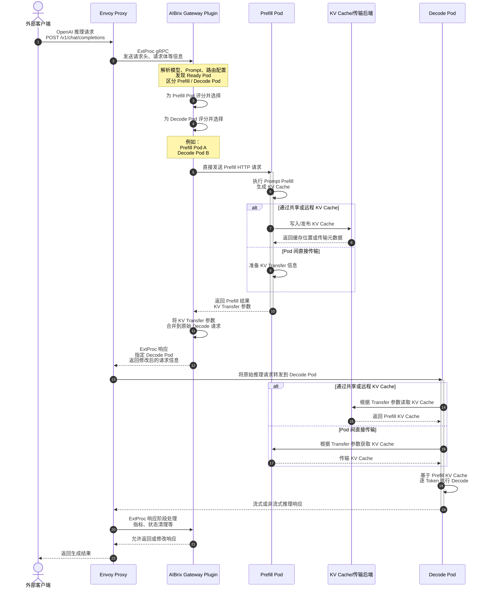

# 1.前文

| 数据链路阶段              | 代码/配置位置                                                             |
| ------------------------- | ------------------------------------------------------------------------- |
| Envoy 接收请求            | Envoy 外部组件及 Gateway 配置                                             |
| Envoy 调用 Gateway Plugin | `config/gateway/`、Helm/Deployment 配置                                 |
| Gateway Plugin 进程启动   | `cmd/plugins/main.go`                                                   |
| ExtProc 请求处理          | `pkg/plugins/gateway/gateway.go`、`gateway_req_*.go`                  |
| 构建请求上下文            | `pkg/plugins/gateway/types.go`、`pkg/types/`                          |
| 获取候选 Pod              | `pkg/plugins/gateway/gateway.go`、`pkg/cache/`                        |
| 选择路由算法              | `pkg/plugins/gateway/algorithms/router.go`                              |
| P/D 路由                  | `pkg/plugins/gateway/algorithms/pd_disaggregation.go`                   |
| Prefill 评分              | `pkg/plugins/gateway/algorithms/pd/prefill_scorer.go`                   |
| 请求计数                  | `pkg/plugins/gateway/algorithms/pd/trackers.go`                         |
| 发起 Prefill 请求         | `pkg/plugins/gateway/algorithms/pd_prefill_request.go`及`pd/prefill/` |
| 不同引擎差异              | `pkg/plugins/gateway/algorithms/pd/engine/`                             |
| Prefix Cache 信息         | `pkg/cache/`、`pkg/kvevent/`、Prefix Index                            |
| 真正执行推理              | 外部 vLLM/SGLang                                                          |
| KV Cache 数据处理         | `python/aibrix_kvcache/`                                                |
| Runtime Sidecar           | `python/aibrix/aibrix/runtime/`                                         |

## 1.1 请求转发流程

请求到达AiBrix，转发给底层的vLLM实例Pod，中间需要经过aibrix-system和envoy-gateway-system命名空间的哪些组件（deployment）？

大致流程：外部请求 --->  envoy-aibrix-system-aibrix-eg-903790dc ---> AiBrix gateway plugin ---> 模型服务

下面作一个简单的拆解：

* `envoy-aibrix-system-aibrix-eg-903790dc`：真正接收外部推理请求
* `aibrix-gateway-plugins`：决定路由，挑选目标Pod；gRPC ExtProc与Envoy通信

在Aibrxi中，PD分离场景和非PD分离场景是有所不同的

**普通非 P/D 场景**

```
外部客户端
    ↓ HTTP/OpenAI API
Envoy Service
    ↓
Envoy Proxy
    ↓ gRPC ExtProc
AIBrix Gateway Plugin
    ↓ 返回选中的模型 Pod/路由信息
Envoy Proxy
    ↓ HTTP
vLLM/SGLang 模型服务
    ↓ 流式或非流式响应
Envoy Proxy
    ↓
外部客户端
```

发现：

* Envoy：接收请求，转发请求
* Gateway plugin：根据目标，选择Pod，修改路由信息

**P/D 分离场景**



P/D分离涉及KVCache传输，故需要Envoy和Gateway plugin执行多次操作

在P/D分离场景下，一个请求需要被先后调用到Prefill Pod和Decode Pod上，所以单请求处理需要Gateway plugin执行两次路由操作，分别筛选Prefill和Decode Pod

* Envoy 不直接把原始请求转发给 Prefill Pod
  * 和“非P/D分离场景”不同
* Envoy 最终转发的是 Decode 请求
  * Gateway Plugin 从 Prefill Pod 获得 KV Transfer 参数后，修改请求中的路由配置，返回给Envoy，Envoy转发给Decode Pod
* KV Cache 不一定经过独立服务
  * 在我的理解，KVCache的传输是由vLLM  KVConnector（MoonCakeConnector等），并且是Pull形式的，即Decode pod接收到请求后，根据请求一些标识信息，通过KVConnector从Prefill Pod中拉取对应的KVCache数据
  * KVCache的传输，AiBrix中的gateway-plugin只会转移相关控制信息（KVCache位置信息），它是不会参与KVCac数据转移过程

问：什么是KVCache Runtime？在考虑KVCache Runtime的情况下，似乎又不一样

关于KVCache传输等细节，具体可参考**“推理系统/其他细节/PD分离/KVCache传输.md”**

# 2.源码解读

可以根据以下表格进行梳理

| 阶段                 | 主要代码                                            | 核心问题                                              |
| -------------------- | --------------------------------------------------- | ----------------------------------------------------- |
| 进程启动             | `cmd/plugins/main.go`                             | Gateway Plugin 如何启动、监听什么端口、依赖如何注入？ |
| ExtProc 请求生命周期 | `pkg/plugins/gateway/gateway.go`                  | Envoy 发来的流式 gRPC 消息如何被处理？                |
| 请求头处理           | `gateway_req_headers.go`                          | 如何确定路由对象、用户、请求路径及初始上下文？        |
| 请求体处理           | `gateway_req_body.go`                             | 如何解析模型、Prompt、路由策略并触发选 Pod？          |
| 响应处理             | `gateway_rsp_headers.go`、`gateway_rsp_body.go` | 如何统计结果、清理状态并处理流式响应？                |
| 路由上下文           | `pkg/types/router_context.go`                     | 一个请求在整个路由过程保存哪些状态？                  |
| 候选 Pod 发现        | `gateway.go`、`pkg/cache/`                      | Pod 从哪里来，如何过滤为 Ready 候选集？               |
| Router 框架          | `pkg/types/router.go`、`algorithms/router.go`   | 算法如何注册、选择和执行？                            |
| 普通路由算法         | `pkg/plugins/gateway/algorithms/*.go`             | random、least-request、prefix-cache 等如何选择 Pod？  |
| P/D 路由             | `algorithms/pd_disaggregation.go`                 | 如何选择 Prefill 和 Decode Pod？                      |
| P/D 评分策略         | `algorithms/pd/*.go`                              | Prefill/Decode 的评分数据和公式是什么？               |
| Prefill 执行         | `algorithms/pd/prefill/`                          | Gateway Plugin 如何主动调用 Prefill Pod？             |
| 引擎适配             | `algorithms/pd/engine/`                           | vLLM、SGLang、TensorRT-LLM 请求有何差异？             |
| KV 传输元数据适配    | `algorithms/pd/transfer/`                         | NIXL、SHFS、Mooncake 的元数据如何合并？               |
| 缓存与指标           | `pkg/cache/`、`pkg/kvevent/`                    | 路由算法所需 Pod、指标和 Prefix Cache 信息来自哪里？  |

## 2.1extProcPb

来着gateway-plugin上层envoy组件，但是又和gateway-plugin内部处理逻辑高度耦合

按阶段处理req和rsp，非传统的http req和rsp

`extProcPb.ProcessingRequest`和`extProcPb.ProcessingResponse`

核心对象：

```
ExternalProcessor_ProcessServer （双向grpc流）

ProcessingRequest
├── RequestHeaders: HttpHeaders
├── RequestBody:    HttpBody
├── ResponseHeaders: HttpHeaders
└── ResponseBody:    HttpBody

ProcessingResponse
├── RequestHeaders: HeadersResponse
├── RequestBody:    BodyResponse
├── ResponseHeaders: HeadersResponse
├── ResponseBody:   BodyResponse
└── ImmediateResponse
```

## 2.1 cmd/plugins/main.go

对应镜像：aibrix/gateway-plugins；Dockerfile构建<tag></tag>

standalone模式：脱离k8s，本地进程运行AIBrix GateWay

* 直接从配置文件读取推理服务地址，不依赖 Kubernetes 控制面。

redis，建立redis客户端

discovery.Provider：interface，推理后端，？？？

**1. k8sClient**对K8s集群中的服务执行Get，List，Watch操作

1. 构造 `rest.Config`，保存k8s API Server所需要的所有信息，比如API  Server地址，CA证书等等
   1. inClusterConfig(Pod内运行)：
      1. 当AiBrix plugins本身运行在Pod内容，直接读取Pod关联的ServiceAccount中的相关信息
      2. 读取环境变量`KUBERNETES_SERVICE_HOST`和`KUBERNETES_SERVICE_PORT`
   2. KubeConfig(集群外运行)：读取具体的kubeconfig文件
2. 构建Clientset
   ```Go
   k8sClient, err = kubernetes.NewForConfig(config)
   ```

k8sClient - inClusterConfig：当 `cmd/plugins/main.go` 开始执行时（image），承载的Pod以及RBAC配置已经由k8s创建好了

**2. servingLister函数：**`k8scache.GenericLister`（查询接口），可以执行类似：

```Go
lister.List(selector)
lister.ByNamespace(namespace).List(selector)
lister.ByNamespace(namespace).Get(name)
```

关联llmservings CRD

完整的数据流程：

**Informer**：长期运行的k8s资源同步器，只干3件事

1. 首次 List：向 API Server 获取当前监听对象CR
2. 持续 Watch：监听资源对象变化，收到各种事件日志（Added，Modifed，....）
3. 维护本地缓存：将对象保存在内存（index/store），目的：不需要每次请求 API Server。

informer的list/watch会将CR的全部信息写入缓存并不断同步，目的是查询更快

**Lister**：只读查询，读取informer保存在本地缓存的对象信息

informer ---- 本地缓存，indexer -----> lister

**dynamic**

通过资源的GVR在**运行时**访问**任意**k8s资源的客户端，故资源类型在运行时动态确定

专用k8s查询客户端，在构建时，需要明确资源类型；dynamic客户端不需要

**GVR（三字段：Group Version Resource）**

Group：属于哪个 API 组？
Version：使用哪个 API 版本？
Resource：访问哪种资源？

它们通常来自CRD，比如

```YAML
apiVersion: apiextensions.k8s.io/v1
kind: CustomResourceDefinition

spec:
  group: serving.cambricon.com

  names:
    kind: LLMServing
    plural: llmservings

  versions:
    - name: v1alpha1
```

对应关系：

CRD spec.group          → GVR.Group
CRD spec.versions.name  → GVR.Version
CRD spec.names.plural   → GVR.Resource

**一个GVR标识一个CRD**

**3.GateWayLister** **函数**

构建方式和servingsLister十分一致，使用强类型客户端，关联CRD：gateway.v1.httproutes

该函数返回Lister和client，一个读，一个写，因为AiBrix GateWay需要修改请求路由信息

**4.Corev1Lister函数**

提供查询集群Pod和Service的Lister

5.cache.InitWithOptions()：初始化AIBrix

**疑点：**

* 为什么k8sClient重复创建了两次？
* AiBrix项目中，没有LLMServing crd相关定义

**5.初始化缓存`cache.InitWithOptions()`**

**本质上：**将相关信息同步到当前进程所在内存，实现快速查询，和informer作用类似

缓存：plugin进程在Node A所分配的内存空间Cache.Store

Cache.Store是 AiBrix Gateway 路由所依赖的本地状态中心，包括`metaPods`，`metaModels`，`metaPodRouters`等等

Cache.Store大致包含服务发现信息，实时负载信息，路由辅助信息，性能预测信息等，目的：优先读取本地store，不需每次都查询K8s，Prometheus 和 Redis

InitOptions内容包含两类：数据源（DiscoveryProvider，RedisClient，ModelRouterProvider），功能开关

* Cache.store会通过这些数据源拉取相关数据，并保存

**6.小结**

前面的Lister和Cache.store作用类似，简单进行一个小结

* Informer 内部维护 Kubernetes **原始**对象缓存，查询方法也是固定的
* Cache.store维护的是AiBrix 加工后的业务状态

存在一条数据链路：**加工处理是核心**

```
Kubernetes API Server
          │
          ▼
     Pod Informer
          │ 原始 *v1.Pod
          ▼
     Store.addPod()
          │ 加工、过滤、聚合
          ▼
      cache.Store
```

* 真正执行数据过滤，转换，加工的是Cache.Store自己的方法，例如pkg/cache/cache_init.go中的addPod()，updateModelAdapter()等方法
  * InitOptions()主要提供原生数据源
* **Cache.store存在的核心原因**：调度需要派生和外部信息
  * Informer拉取的数据（k8s原生资源）只能表达 k8s 中已有的状态，无法完整表达 AiBrix 路由决策所需要的数据，故需要Cache.Store进行加工

grpc服务和web服务：

本质上都是：监听网络端口，接收外部请求，执行对应业务逻辑，再返回响应。

后续的流程是一个标准的grpc服务启动流程，启动以下3个服务

* gateway.server：核心业务逻辑
  * 面对Envoy发来的请求，根据本地缓存（Cache.store）和外部依赖`InitOptions`{}，处理请求并返回给Envoy
* Metrics Server：供`Prometheus`抓取，使用独立的网络端口
* localhost:6060（？？？）

正常的grpc，通常利用.proto文件生成客户端和服务端代码

* AiBrix直接使用Envoy项目定义好的相关API，原始.proto文件和.pb.go由Envoy项目维护
  ```
  Envoy 项目中的 ext_proc.proto
               │ protoc 生成
               ▼
  go-control-plane 中的 Go 代码
               │ Go Module 引入
               ▼
  AiBrix import extProcPb
               │
               ▼
  实现 ExternalProcessorServer 接口
  ```

在AiBrix场景中，Envoy接收用户请求后，会通过grpc将其转发给Gateway Plugin，故采用Envoy维护的grpc方法

## 2.2 pkg/plugin

将前面main.go初始化好的 Redis、Kubernetes 客户端、Lister、Cache 和路由算法组装成一个能够处理 Envoy ext_proc 请求的 `gateway.Server`

**1.Gateway.go**

核心流程：从Envoy接收请求，**进行相关内部操作**，返回给Envoy

核心方法：

```
HandleRequestHeaders()  --->  	gateway_req_headers.go
HandleRequestBody()		--->	gateway_req_body.go
HandleResponseHeaders() --->	gateway_rsp_headers.go
HandleResponseBody()	--->	gateway_rsp_body.go
```

一个推理请求的req和resp都需要经过Envoy 和 GateWay plugin，以下是大致流程

```
客户端
   │ HTTP Request
   ▼
Envoy
   │
   ├── Request Headers/Body 发给 Gateway Plugin 检查
   │
   ▼
推理 Service / vLLM Pod
   │
   │ HTTP Response
   ▼
Envoy
   │
   ├── Response Headers/Body 发给 Gateway Plugin 检查
   │
   ▼
客户端
```

**Server** （进程级生命周期）

大致分组:

| 依赖                             | 用途                                  |
| -------------------------------- | ------------------------------------- |
| `redisClient`、`ratelimiter` | 用户限流                              |
| `gatewayLister`                | 从本地 informer cache 读取 HTTPRoute  |
| `podLister`、`serviceLister` | 解析`HTTPRoute → Service → Pod`   |
| `gatewayClient`、`client`    | 必要时写 Kubernetes 对象              |
| `cache`                        | Pod 状态、请求计数、路由指标、KV 信息 |
| `shutdownCh`                   | 优雅关闭                              |

关联CRD：HTTPRoute

**processState**：一次 HTTP 请求对应的状态

对于单个request；其中又包含RoutingContext（路由决策相关信息）

**核心方法：**

Process()

`extProcPb.ExternalProcessor_ProcessServer`：

ProcessOnce()

标准五段式：

* 检查 shutdown/context cancellation；
* 从 Envoy 接收一个 ExtProc 消息；
* 按消息类型处理；
* 记录该阶段指标；
* 把 `ProcessingResponse` 发回 Envoy。

目前重点放在“`handleProcessingRequest`”上

handleProcessingRequest()

四阶段

| 阶段            | 主要产物                                               |
| --------------- | ------------------------------------------------------ |
| RequestHeaders  | `requestID`、用户、authority、初始`RoutingContext` |
| RequestBody     | `model`、prompt、路由策略、目标 Pod                  |
| ResponseHeaders | 后端状态码、响应是否错误                               |
| ResponseBody    | token/请求统计、流式完成判断、资源清理                 |

问：一个请求应该是header和body都需要处理，为什么使用switch req.Request.(type)？

因为extProcPb是按阶段处理rsp和req，handleProcessingRequest对应的是一个阶段的处理过程

selectTargetPod()

选择路由Pod的核心逻辑；大概分为两个阶段

```
#第一部分
RoutingContext.Algorithm
        ↓
routing.Select()
        ↓
得到 Router 实例

#第二部分
HTTPRoute
   ↓ BackendRefs
Service
   ↓ selector
Pods
   ↓ Ready/routable/bucket 过滤
候选 Pod 集合
        ↓
Router.Route()
        ↓
目标 Pod IP:Port
```

候选Pods是`filterDomainPods`（）方法得到的，后续还得具体的路由算法router.route()得到最适配的Pod

filterDomainPods()

目标：筛选出可路由的Pods；其中新增了许多有关“桶调度”的相关策略

```
HTTPRoute
  ↓ getRouteServices()
Service 名称
  ↓ getServicePods()
Pod 列表
  ↓ FilterRoutablePods()
Ready 候选 Pod
```

大致：先找Service，Service关联一些Pod，筛选可路由的Pods

其中的FilterRouteablePods()，简单判断Pod的状态（Pod是否ready,是否有IP等）

### 总结：

整个gateway.go可以分为两个主要模块

* 模块一：ExtProc请求生命周期编排
* 模块二：候选Pod发现和最终路由

处理RequestBody阶段调用selectTargetPod()关联两个模块

**模块一**

Server，processState

ExtProc主循环：Process()，ProcessOnce()，handleProcessingRequest(),		   四阶段handler

```
RequestHeaders
    → gateway_req_headers.go

RequestBody
    → gateway_req_body.go

ResponseHeaders
    → gateway_rsp_headers.go

ResponseBody
    → gateway_rsp_body.go
```

**模块二**

以selectTargetPod()作为入口

gateway.go 负责候选集，主要方法：`filterDomainPods()`，`filterDomainPods()`等等

algorithms/ 负责最终选择(`pkg/plugins/gateway/algorithms/`)
比如random，least-request，pd等

注意：不是所有 ExtProc 阶段都会调用 `selectTargetPod()`。普通推理请求主要在 RequestBody 阶段触发 Pod 选择。

## 2.3 HTTPRoute

Kubernetes Gateway API（另一个项目）：某类 HTTP 请求应该关联到哪些模型 **Service** 的声明。

Kubernetes Gateway API定义了GatewayClass，Gateway，HTTPRoute等相关数据链路，对标的是K8s内置Ingress；Aibrix和Envoy-Gateway都是使用了HTTPRoute

例子：

```YAML
apiVersion: gateway.networking.k8s.io/v1
kind: HTTPRoute
metadata:
  name: deepseek-router
  namespace: aibrix-system
spec:
  parentRefs:
    - name: aibrix-eg

  rules:
    - matches:
        - path:
            type: PathPrefix
            value: /v1/chat/completions
          headers:
            - name: model
              type: Exact
              value: deepseek

      backendRefs:
        - name: deepseek
          namespace: default
          port: 8000
          weight: 1

      timeouts:
        request: 120s
```

目前重点理解：HTTPRoute 在 AIBrix 中提供了哪些路由信息
（Gateway、GatewayClass 和 Envoy Gateway Controller 暂时只需知道其存在及职责）

涉及HTTPRoute的主链路:

```
请求 Header/Body
    ↓
确定 RouterNamespace、RouterName
    ↓
从 HTTPRouteLister 查找 HTTPRoute
    ↓
读取 Rules[0].BackendRefs
    ↓
得到模型 Service
    ↓
根据 Service selector 找到候选 Pods
    ↓
执行 Router.Route()
```

整个HTTPRoute链路关联的内容有点儿广，

* AIBrix Controller 负责创建/删除模型 HTTPRoute；
* 请求匹配主要由 Envoy 完成；
* Gateway Plugin 则读取 HTTPRoute 来确定路由上下文和后端 Service/Pod。

在AiBrix数据面阶段，同一个HTTPRoute，既被Envoy Gateway Controller读取，又被Gateway plugin Informer所缓存

## 2.4 四阶段Handler

一个客户端 HTTP 请求，对应 Envoy 和 gateway-plugin 之间的一条 ext_proc gRPC 双向流，也对应服务端一次 `Process()` 调用。

一个客户端HTTP请求的整体生命周期：

```
Envoy 建立 ext_proc gRPC 双向流
        ↓
gateway-plugin 调用一次 Process(srv)
        ↓
创建一份 processState
        ↓
for 循环反复调用 processOnce()
        ↓
依次处理：
RequestHeaders
RequestBody
ResponseHeaders
ResponseBody（可能多次）
        ↓
Envoy关闭发送方向
        ↓
srv.Recv() 返回 io.EOF
        ↓
Process() 返回
        ↓
当前 gRPC 流结束
```

Process()中for循环的结束标志来自`srv.Recv()`

**ReqHandle**

ENvoy接收到HTTP请求后，转换为protobuf消息，先将`RequestHeaders`发给gatewau-plugin处理，然后将`Request Body`....，整个过程如图

```
客户端发送 HTTP 请求
        ↓
Envoy 收到 Request Headers
        ↓
发送 ProcessingRequest_RequestHeaders
        ↓
gateway-plugin 执行 HandleRequestHeaders
        ↓
返回 ProcessingResponse_RequestHeaders
        ↓
Envoy 收到处理结果
        ↓
Envoy 缓冲完整 Request Body
        ↓
发送 ProcessingRequest_RequestBody
        ↓
gateway-plugin 执行 HandleRequestBody
        ↓
返回 ProcessingResponse_RequestBody
        ↓
Envoy 根据处理结果继续转发请求
```

* 在同一条ext_proc gRpc双向流执行
* ReqHandle做的两件事：
  * 将相关信息保存到processState
  * 维护RoutingContext
    * Header阶段：创建 RoutingContext，由于Body中可能包含路由信息，此时一般不会进行路由操作
    * Body阶段：补全RoutingContext并路由SelectTargetPod

**RespHandle**

处理“模型后端返回给客户端”的过程

```
vLLM / SGLang 后端
  │
  │ HTTP Response
  ▼
Envoy
  │
  │ ResponseHeaders / ResponseBody
  ▼
gateway-plugin
  │
  │ 检查响应、统计 token、结束请求记账
  ▼
Envoy
  │
  ▼
客户端
```

整个ResponseHandle阶段主要都是提取和记录，同时也会在返回给客户端的响应中做一些修改，比如添加“`request-id`”，“`target-pod`”，“`请求时间和耗时`”

### 2.4.1HandleRequestHeaders()

pkg/plugins/gateway/gateway_req_headers.go

函数返回6项结果

```
ProcessingResponse     给 Envoy 的阶段响应
User                   当前用户
RPM                    用户限流信息
RoutingContext         AIBrix 路由上下文
requestAuthority       请求 Host/:authority
requestID              请求唯一标识
```

大致流程：

1. 读取`extProcPb.ProcessingRequest_RequestHeaders`中的Header
   1. 其中包含了许多请求信息，比如权限，路由策略等
2. `getRequestRouterInfo()函数`：其中包含4种处理场景，但是处理流程和目的是固定的
   1. 根据请求相关信息requestBody和requestAuthority提取出uid
   2. 利用uid+LabelSelector匹配对应的HTTPRoute
   3. 从HTTPRoute中提取相关信息（`HTTPRoute namespace`，`HTTPRoute name`，`router strategy`）
3. `buildNoBodyRequestHeaders()`：核心，执行selectTargetPod()路由操作
   1. 检查匹配的HTTPRoute是否有效
   2. 调用sever.SelectTargetPod方法
   3. 在Header中添加对应的TargetPodIP

补充`buildNoBodyRequestHeaders()`：**某些Req，只有Header，没有Body**

* Envoy调用AiBrix-plugin，分4个阶段
* 对于有NoBody的请求，直接在处理Header的过程中，直接路由selectTargetPod
  * 因为NoBody的请求，可能没有handleRequestBody的阶段
* 对于有Body的请求，由于Body中包含路由决策信息，比如routing_strategy，model等，那么此时就无法在handleRequestHeader()进行selectTargetPod

在HandleReqHeader阶段，会有两件事：

* 返回给Envoy一个ProcessingResponse（信号性质），表示Envoy可以处理下一阶段的消息
* 将真正提取的大量信息保存到processState，辅助后续reqBody阶段的路由决策

关于processState st，整个GatewayPlugin在Process阶段，就只有

问题：

1. 在当前代码中，如果是NoBody的POST请求，并且没有handleRequestBody阶段，此时好像会出bug

**HandleReqHeaderTest**

ProcessRequest protobuf消息示例：

```go
req := &extProcPb.ProcessingRequest{
	Request: &extProcPb.ProcessingRequest_RequestHeaders{
		RequestHeaders: &extProcPb.HttpHeaders{
			Headers: &configPb.HeaderMap{
				Headers: []*configPb.HeaderValue{
					{
						Key:      "routing-strategy",
						RawValue: []byte("not-found-strategy"),
					},
					{
						Key:      ":path",
						RawValue: []byte(
							"/app/router/test-uid/v1/chat/completions",
						),
					},
					{
						Key:      ":authority",
						RawValue: []byte(
							"router-test-uid.serving.cluster.local",
						),
					},
				},
			},
		},
	},
}
```

这部分是为test中，来自Envoy的，Req_Header阶段的protobuf消息（Envoy 将 HTTP 请求转换后产生）

真实环境下，Envoy就会给gateway_plugin发生类似的protobuf消息

ProcessingResponse示例

```Go
//正常rsp（No路由）
resp := &extProcPb.ProcessingResponse{
	Response: &extProcPb.ProcessingResponse_RequestHeaders{
		RequestHeaders: &extProcPb.HeadersResponse{
			Response: &extProcPb.CommonResponse{
				HeaderMutation: &extProcPb.HeaderMutation{
					SetHeaders: []*configPb.HeaderValueOption{
						{
							Header: &configPb.HeaderValue{
								Key:      "x-went-into-req-headers",
								RawValue: []byte("true"),
							},
						},
					},
				},
				ClearRouteCache: true,
			},
		},
	},
}

//正常rsp（路由Select）--新增targer-pod和request-id
resp := &extProcPb.ProcessingResponse{
	Response: &extProcPb.ProcessingResponse_RequestHeaders{
		RequestHeaders: &extProcPb.HeadersResponse{
			Response: &extProcPb.CommonResponse{
				HeaderMutation: &extProcPb.HeaderMutation{
					SetHeaders: []*configPb.HeaderValueOption{
						{
							Header: &configPb.HeaderValue{
								Key:      "x-went-into-req-headers",
								RawValue: []byte("true"),
							},
						},
						{
							Header: &configPb.HeaderValue{
								Key:      "target-pod",
								RawValue: []byte("10.0.0.42:8000"),
							},
						},
						{
							Header: &configPb.HeaderValue{
								Key:      "X-Request-Id",
								RawValue: []byte("test-request-id"),
							},
						},
					},
				},
				ClearRouteCache: true,
			},
		},
	},
}

//失败rsp
resp := &extProcPb.ProcessingResponse{
	Response: &extProcPb.ProcessingResponse_ImmediateResponse{
		ImmediateResponse: &extProcPb.ImmediateResponse{
			Status: &envoyTypePb.HttpStatus{
				Code: envoyTypePb.StatusCode_BadRequest,
			},
			Body: []byte(/* 错误 JSON */),
		},
	},
}
```

该响应体只包含需要发送给Envoy的内；

* `routingCtx`、`user` 和 `rpm` 是 `HandleRequestHeaders()` 返回给 gateway-plugin 内部后续处理阶段的数据，并不在 protobuf 响应中

问题：

* `MockHTTPRouteLister`中，不应该出现MockGatewayClient，因为真实的k8s中，Lister是从Informer将相关资源拉取到本地缓存的indexer中的

  * 更标准的做法：mock模拟Indexer

### 2.4.2HandleReqBody()

ReqBody是ReqHeader之后的一个阶段，ReqHeader阶段已经生成：

```Go
st.requestID = "demo-request-id"

st.routerCtx = &types.RoutingContext{
	ReqPath:         "/app/router/test-uid/v1/chat/completions",
	RouterNamespace: "aibrix-system",
	RouterName:      "test-model-router",
	ReqHeaders: map[string]string{
		"routing-strategy": "random",
	},
}
```

ReqBody阶段接受的Proto信息，类似

```Go
requestBody := []byte(
	`{"model":"test-model","messages":[{"role":"user","content":"hello"}],"stream":true}`,
)

req := &extProcPb.ProcessingRequest{
	Request: &extProcPb.ProcessingRequest_RequestBody{
		RequestBody: &extProcPb.HttpBody{
			Body:        requestBody,
			EndOfStream: true,
		},
	},
}
```

其中`EndOfStream`表示完整请求体的最后一块；对于请求体Body特别大，Envoy通常会缓冲完整的body，再发送一个RequestBody消息

假设根据RoutingCtx，放回targetIP：10.0.0.43:8000，此时ProcessingResponse应该为

```
resp := &extProcPb.ProcessingResponse{
	Response: &extProcPb.ProcessingResponse_RequestBody{
		RequestBody: &extProcPb.BodyResponse{
			Response: &extProcPb.CommonResponse{
				HeaderMutation: &extProcPb.HeaderMutation{
					SetHeaders: []*configPb.HeaderValueOption{
						{
							Header: &configPb.HeaderValue{
								Key:      "routing-strategy",
								RawValue: []byte("random"),
							},
						},
						{
							Header: &configPb.HeaderValue{
								Key:      "target-pod",
								RawValue: []byte("10.0.0.42:8000"),
							},
						},
						{
							Header: &configPb.HeaderValue{
								Key:      "content-length",
								RawValue: []byte("83"),
							},
						},
						{
							Header: &configPb.HeaderValue{
								Key:      "X-Request-Id",
								RawValue: []byte("demo-request-id"),
							},
						},
					},
				},
				BodyMutation: &extProcPb.BodyMutation{
					Mutation: &extProcPb.BodyMutation_Body{
						Body: requestBody,
					},
				},
			},
		},
	},
}
```

以上为ReqBody阶段的示例Req和Rsp，所以ReqBody阶段主要作用：提取补充RoutingCtx，并执行路由操作

1. 从reqBody中提取相关信息
   1. 处理multipart类型的请求，从中提取model和stream字段
   2. 处理json类型表示的请求，从中提取model，message，stream相关信息
2. 放入routeCtx中
3. 从routeCtx中，提取出strategy，并检查该strategy是否已经注册
   1. 在routerManager中，`routerFactory`为一个map对象，并存在写入的可能，故检查时需要上锁`RLock()`
4. 构建resp的Header
   1. RouterNotSet：检查HTTPRoute是否可用；向Header注入model信息
   2. RouterAlgorithms：
      1. 执行selectTargetPod()路由，获取TargetPodIP，同时routeCtx会保存具体的目标Pod（v1.Pod）
      2. 从routeCtx中查询当前Pod正在处理的请求数量
      3. 计算RoutingDelay（PD分离场景有区别）
5. 在Cache中，将该请求记录为“运行中”状态
6. 构建ProcessingResponse，并返回

### 2.4.3HandleRespHeader

Envoy收到vLLM后端响应头后，会发送：

```Go
req := &extProcPb.ProcessingRequest{
	Request:&extProcPb.ProcessingRequest_ResponseHeaders{
			ResponseHeaders: &extProcPb.HttpHeaders{
				Headers: &configPb.HeaderMap{
					Headers: []*configPb.HeaderValue{
						{
							Key:      ":status",
							RawValue: []byte("200"),
						},
						{
							Key:      "content-type",
							RawValue: []byte("application/json"),
						},
					},
				},
			},
		},
}
```

RespHeader阶段返回给Envoy的响应：

```Go
headers := []*configPb.HeaderValueOption{
	{
		Header: &configPb.HeaderValue{
			Key:      "x-went-into-req-headers",
			RawValue: []byte("true"),
		},
	},
	{
		Header: &configPb.HeaderValue{
			Key:      "request-id",
			RawValue: []byte("request-123"),
		},
	},
	{
		Header: &configPb.HeaderValue{
			Key:      "x-request-id",
			RawValue: []byte("request-123"),
		},
	},
	{
		Header: &configPb.HeaderValue{
			Key:      "routing-strategy",
			RawValue: []byte("least_request"),
		},
	},
	{
		Header: &configPb.HeaderValue{
			Key:      "target-pod",
			RawValue: []byte("llama-worker-abc"),
		},
	},
	{
		Header: &configPb.HeaderValue{
			Key:      "target-pod-name",
			RawValue: []byte("llama-worker-abc"),
		},
	},
	{
		Header: &configPb.HeaderValue{
			Key:      "target-pod-ip",
			RawValue: []byte("10.0.0.42:8000"),
		},
	},
	{
		Header: &configPb.HeaderValue{
			Key:      "request-arrive-time",
			RawValue: []byte("1786492800123"),
		},
	},
	{
		Header: &configPb.HeaderValue{
			Key:      "response-start-time",
			RawValue: []byte("1786492800253"),
		},
	},
	{
		Header: &configPb.HeaderValue{
			Key:      "request-cost-time",
			RawValue: []byte("130"),
		},
	},
	{
		Header: &configPb.HeaderValue{
			Key:      ":status",
			RawValue: []byte("200"),
		},
	},
}

resp := &extProcPb.ProcessingResponse{
	Response:&extProcPb.ProcessingResponse_ResponseHeaders{
			ResponseHeaders:&extProcPb.HeadersResponse{
					Response:&extProcPb.CommonResponse{
							HeaderMutation:&extProcPb.HeaderMutation{
									SetHeaders: headers,
								},
							ClearRouteCache: true,
						},
				},
		},
}
```

同一个HTTP请求的4个处理阶段，都是在同一条Envoy ext_proc gRPC 双向流中处理，并共享同一个 `processState`。

RespHeader需要干的事情：

1. 接收ResponseHeader
   1. Envoy 收到目标 vLLM Pod 的 HTTP 响应 Header 后，将其转换成 ext_proc 的 `ProcessingRequest_ResponseHeaders`，发送给 gateway-plugin。
2. 复用同一个请求的状态（st: ProcessState）
3. 向响应的 Header插入相关信息
   1. `routingCtx.RespHeaders`中的session_id（来自路由router）
   2. 添加时间信息
4. 构造HeaderMutation
5. 返回ProcessingResponse

### 2.4.4HandleRespBody

#### 2.4.4.1HandleErrorResponse

vLLM上游返回：

```
HTTP/1.1 503 Service Unavailable
Content-Type: application/json

{"error":{"message":"model is overloaded"}}
```

RespHeader阶段已经识别出：

```
st.isRespError = true
st.respErrorCode = 503
```

开始进入RespBody阶段，Envoy把错误Body发送给Gateway-plugin

```Go
req := &extProcPb.ProcessingRequest{
	Request: &extProcPb.ProcessingRequest_ResponseBody{
		ResponseBody: &extProcPb.HttpBody{
			Body: []byte(
				`{"error":{"message":"model is overloaded"}}`,
			),
			EndOfStream: true,
		},
	},
}
```

gateway-plugin发现ErrorResponse

返回`ImmediateResponse`

```Go
resp := &extProcPb.ProcessingResponse{
	Response: &extProcPb.ProcessingResponse_ImmediateResponse{
		ImmediateResponse: &extProcPb.ImmediateResponse{
			Status: &envoyTypePb.HttpStatus{
				Code: envoyTypePb.StatusCode_ServiceUnavailable,
			},
			Headers: &extProcPb.HeaderMutation{
				SetHeaders: []*configPb.HeaderValueOption{
					// 来自上一阶段保存的 st.lastRespHeaders
					{
						Header: &configPb.HeaderValue{
							Key:      "request-id",
							RawValue: []byte("req-123"),
						},
					},
					{
						Header: &configPb.HeaderValue{
							Key:      "target-pod",
							RawValue: []byte("vllm-pod-0"),
						},
					},
					{
						Header: &configPb.HeaderValue{
							Key:      "Content-Type",
							RawValue: []byte("application/json"),
						},
					},
				},
			},
			Body: `{"error":{"message":"{\"error\":{\"message\":\"model is overloaded\"}}","type":"overloaded_error","code":"service_unavailable","param":null}}`,
		},
	},
}
```

#### 2.4.4.2HandleResponseBody

在正常resp处理过程中，其实会分为“流式”和“非流式”两部分处理逻辑，但是处理方法和目标是一致的，下面以“非流式”举例

vLLM返回Chat Completions 响应

```JSON
{
  "id": "chatcmpl-123",
  "model": "llama-3",
  "choices": [
    {
      "message": {
        "role": "assistant",
        "content": "Hello!"
      }
    }
  ],
  "usage": {
    "prompt_tokens": 10,
    "completion_tokens": 5,
    "total_tokens": 15
  }
}
```

envoy向gateway-plugin发送

```Go
req := &extProcPb.ProcessingRequest{
	Request: &extProcPb.ProcessingRequest_ResponseBody{
		ResponseBody: &extProcPb.HttpBody{
			Body: []byte(`{
				"id": "chatcmpl-123",
				"model": "llama-3",
				"choices": [
					{
						"message": {
							"role": "assistant",
							"content": "Hello!"
						}
					}
				],
				"usage": {
					"prompt_tokens": 10,
					"completion_tokens": 5,
					"total_tokens": 15
				}
			}`),
			EndOfStream: true,
		},
	},
}
```

经过respBody处理后，返回

```Go
resp := &extProcPb.ProcessingResponse{
	Response: &extProcPb.ProcessingResponse_ResponseBody{
		ResponseBody: &extProcPb.BodyResponse{
			Response: &extProcPb.CommonResponse{
				HeaderMutation: &extProcPb.HeaderMutation{
					SetHeaders: []*configPb.HeaderValueOption{
						{
							Header: &configPb.HeaderValue{
								Key:      "request-id",
								RawValue: []byte("req-123"),
							},
						},
						{
							Header: &configPb.HeaderValue{
								Key:      "x-request-id",
								RawValue: []byte("req-123"),
							},
						},
					},
				},
			},
		},
	},
}
```

RespBody阶段处理逻辑：

1. 提取Usage中的Token指标
   1. 流式：
      1. 从最终的 SSE 事件中提取 usage
      2. `逐行扫描 SSE 数据`
   2. 非流式：
      1. `ResponseBody 分片`
      2. `requestBuffers 按 requestID 拼接`，直到`EndOfStream=true`
      3. `解析完整 JSON`
      4. `提取 usage中的promptTokens,completionTokens,totalTokens`
2. 更新限流
   1. “限流”是针对**用户**在一定时间窗口内的请求量和 Token 使用量进行限制
      1. RPM：Requests Per Minute，每分钟请求数
      2. TPM：Tokens Per Minute，每分钟 Token 数
   2. 返回更新后的RPM和TPM
3. 请求完成后，日志和指标收尾`requestEndHelper()`
4. 生成相关Header，并返回ProcessingResponse

关于“非流式提取Token指标”，需要解释一下

* `requestBuffers`存放的response分片
* vLLM后端依旧是等待模型回答结束，再返回一个完整的json响应，
  * 但是**该json响应体可能会进行分块，故变为多个response分片**
* 只有解析出完整Json(`EndOfStream`==True)，才能开始提取Token指标
  * 当`EndOfStream`==False，此时返回一个正常但不包含任何修改指令的 `ProcessingResponse`
