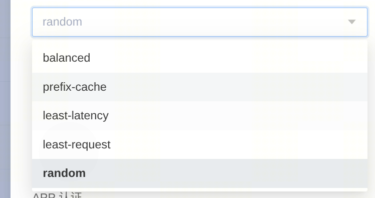

在AiBrix中，routing路由对应selectTargetPod()方法，一般发生在reqBody阶段，但是对于NoBody的请求，它则可能会发生在reqHeader阶段



# 1. selectTargetPod()

方法；AiBrix Routing路由的入口方法；

大致逻辑:

1. 根据RoutingCtx.Algorithm筛选对应的Router
2. 筛选候选Pods（HTTPRoute等等....）
   1. 如果len(Pods) == 1，直接确定TargetPodIp
   2. 如果len(Pods) > 1，执行router.route()决定最终的Pod

# 2.RouterManager

## 2.1注册router

**1.普通Router**

`Register()`函数中的逻辑有点绕

```
// 创建 Router 实例
type RouterConstructor func() (Router, error)

// 根据请求上下文获取 Router
type RouterProviderFunc func(*RoutingContext) (Router, error)

// 初始化后生成一个 Provider
type RouterProviderRegistrationFunc func() RouterProviderFunc
```

# 3.具体router实现

## 3.1leastReqestRouter

核心思想：在所有可路由执行单元（普通Pod/DP rank）中，选择当前运行请求数最少的目标；如果并列，则随机选择。

**普通 Pod：Pod 级路由**

```
候选 Pod
  → 从 Cache 读取各 Pod 的实时运行请求数
  → 找出最小值
  → 并列时随机选择
  → 设置 TargetPod
  → 返回 PodIP:Port
```

当任意候选 Pod配置 data-parallel-size > 1时，触发DP rank级路由

**DP 多端口 Pod：DP rank 级路由**

大致为，从以下单位中选择目标

```
pod-a/8000：5
pod-a/8001：1  ← 选中
pod-b/8000：3
pod-b/8001：4
```

对于单Pod多DP rank的vLLM，Route路由粒度为DP rank，故而单独处理；此时，你会发现Cache.Cache也是以Dp rank为单位捕捉相关指标的，参考`ListPortsForPod()`

**问题：**

* 使用DP的Pod都需要增加“data_parallel_size”环境变量，表示当前Pod内拥有多少个DP rank
  * 目前没有暴露问题，是因为目前所有的DP pod都只有一个Dp rank，因为目前的模型比较大，无法在一个8卡机器上部署两个模型
  * 如果一个DP Pod包含两个DP rank，按照现有的做法，
    * 其中就会存在一个DP rank，无法被aiBrix所探查到，存在bug

## 3.2PrefixCache

核心思想：优先把请求发送到已经缓存最多相同 prompt 前缀的 Pod，同时避免该 Pod 负载过高。

目的：提高系统整体PrefixCache命中率，减少vLLM的Prefill计算压力

负载失衡；阈值：`defaultPodRunningRequestImbalanceAbsCount`

**PrefixCacheMetrics**：和Prometheus高度结合

整个PrefixCache路由形式上为1个router，但是实际对应两种不同类型的Router，将`kvSyncRouter`单独封装到了`prefixCacheRouter`中

代码如下

```Go
type prefixCacheRouter struct {
	cache              cache.Cache
	tokenizer          tokenizer.Tokenizer
	prefixCacheIndexer *prefixcacheindexer.PrefixHashTable

	// Add TokenizerPool field
	tokenizerPool TokenizerPoolInterface // nil when not using remote tokenizer

	// KV sync router - only created when needed
	kvSyncRouter *kvSyncPrefixCacheRouter
}
```

Tokenizer：AiBrix中的分词通过`TokenizeInputText()`方法将message:string转换为tokens:[]byte

注意：tokens中元素为tokenID(int)，然后每个token ID被AiBrix转换为unit32(4bytes)，所以tokens转换为[]byte，并且在`SyncPrefixHashTable`中的`GetPrefixHashes`函数也体现了tokenSize=4；因为存在AiBrix和vLLM实例内容Prefix hash存在map映射，所以在AiBrix后续会用token ID来做Prefix Hash计算，无伤大雅

**小结：**

整个prefix_cache.go中的代码涵盖的模块比较多，大致包含：

* Gateway路由算法（algorithms/prefix_cache.go，algorithms/tokenizer_pool.go)
* 本地 Prefix Cache 索引
* KV Event Sync Prefix 索引
* TokenizerPool
* AIBrix 全局 Cache

### 3.2.1prefixCacheRouter

**PrefixHashTable**

```
type PrefixHashTable struct {
	mu    sync.RWMutex
	seed  uint64
	cap   int
	store lrustore.Store[uint64, Block]
}

type Block struct {
	modelToPods map[string]map[string]time.Time // model_name: map[pod_name]pod_last_access_time
}
```

模拟了一个KVCache Block Map，但是Block没有存储KVCache具体信息，说明本地tokenizer就是纯纯模拟

#### 3.2.1.1PrefillHash Table

aiBrix模拟了一个Prefill Hash Table，目的是估算PrefixCache命中率

```
type PrefixHashTable struct {
	mu    sync.RWMutex
	seed  uint64
	cap   int
	store lrustore.Store[uint64, Block]
}
type Block struct {
	modelToPods map[string]map[string]time.Time // model_name: map[pod_name]pod_last_access_time
}
type LRUStore[K comparable, V any] struct {
	sync.RWMutex
	freeTable map[K]*entry[K, V]
	lruList   *list[K, V]
	cap       int

	getCurrentTime
	interval time.Duration
	ttl      time.Duration
}
type entry[K comparable, V any] struct {
	Key            K
	Value          V
	prev           *entry[K, V]
	next           *entry[K, V]
	lastAccessTime time.Time
}
type list[K comparable, V any] struct {
	head *entry[K, V]
	tail *entry[K, V]
}
```

整个PrefixHashTable的主要数据`freeTable`，大致结构：

```
freeTable[key] ─────────┐
                        ▼
head <-> ... <-> entry <-> ... <-> tail
```

链式hash；顺序匹配；

**MatchPrefix()** 计算各个Pod Prefix命中率的核心函数，最后返回一个map[string]int对象（key：podName；value：PrefixCache命中率）

PrefixHashTable 会：

1. 将 token 按 block 分割；
2. 为每个连续前缀计算链式 hash；
3. 按顺序查询这些 hash；
4. 找出缓存了对应前缀的 Ready Pod；
5. 计算每个 Pod 的最长前缀匹配百分比。

**RouterOriginal()**：Local模式下的route()方法，大致流程：

1. 获取本地Tokenizer，并进行分词
   1. 将ctx.message分词为[]byte
2. 检查当前ReadyPods是否存在“负载不均”？（这里存在隐含问题）
   1. 如果“负载不均”，则在`leastReqPodList`中进行PrefixCache调度
3. 进行前缀匹配MaychPrefix()
4. 从matchedPods中选择Pod
   1. 前缀匹配率越高，优先级越高；
   2. 匹配率相同时，请求数越少越优先；
   3. 跳过负载超过 `平均值 + 标准差系数 × 标准差` 的 Pod；
   4. 条件完全相同时随机选择。
5. 如果没有Prefix匹配的Pod(matchedPods=0)，则直接使用“LeastRequest”

### 3.2.2kvSyncPrefixCacheRouter

```Go
type kvSyncPrefixCacheRouter struct {
	cache          cache.Cache
	tokenizerPool  TokenizerPoolInterface // Add TokenizerPool reference
	syncIndexer    *syncindexer.SyncPrefixHashTable
	metricsEnabled bool
}
```

启用KV Event Sync

核心目标：使用远程模型 tokenizer 对请求进行准确分词，并根据同步得到的真实 KV Cache 事件选择 Pod。

#### 3.2.2.1TokenizerPool

KV Sync 模式强制要求 remote tokenizer（KV Sync 的前缀哈希必须和推理实例的token ID一致）

延迟初始化，按请求创建（发生在具体请求的route()方法中，不是在AiBrix初始化时，将所有推理实例的tokenizer端口拉取下来）

TokenizerPool ---> tokenizerBucket ---> []*tokenizerEntry ---> tokenizer.Tokenizer

```Go
type Tokenizer interface {
	TokenizeInputText(string) ([]byte, error)
	CountTokens(ctx context.Context, text string) (int, error)
}
```

在 **KV Sync 正常工作路径**中，实际使用的实现（remote_tokenizer.go）

```Go
type remoteTokenizerImpl struct {
    config  RemoteTokenizerConfig
    client  *httpClient
    adapter engineAdapter
}
```

显然，aiBrix是通过HTTP调用vLLM实例远端Tokenizer

**adapter**

出现动机：AiBrix在获取HTTPClient时，在发送request和解析response时，不清楚如何按照vLLM或sglang推理引擎的格式（Adapter/Strategy 模式）

定义3个接口

```Go
const (
    vllmTokenizePath    = "/tokenize"      //分词接口
    vllmDetokenizePath  = "/detokenize"    //反分词，将一组token ID还原为文本
    vllmCountTokensPath = "/v1/messages/count_tokens"
)
```

大致流程：

假设配置：

```
RemoteTokenizerConfig{
      Engine:   "vllm",
      Endpoint: "http://10.0.0.12:8000",
      Model:    "Qwen/Qwen3-8B",
  }
```

adapter会构造以下请求

```
POST http://10.0.0.12:8000/tokenize
  Content-Type: application/json

  {
    "model": "Qwen/Qwen3-8B",
    "prompt": "用户输入",
    "add_special_tokens": true,
    "return_token_strs": true
  }
```

vLLM返回

```
{
  "count": 3,
  "max_model_len": 32768,
  "tokens": [123, 456, 789]TokenizeResult{
    Count:  3,
    Tokens: []int{123, 456, 789},
}
}
```

adapter又负责解析响应

```
TokenizeResult{
    Count:  3,
    Tokens: []int{123, 456, 789},
}
```

#### 3.2.2.2syncIndexer

上下文隔离更完整；Pod 使用完整 Key（namespace/podName）；接收 KV Cache 事件

**SyncPrefixHashTable**

结构：

```
SyncPrefixHashTable
  │
  ├── contextMap
  │   │
  │   └── ModelContext
  │       ├── Router
  │       ├── ModelName
  │       └── LoraID
  │            │
  │            ▼
  │       ContextData
  │       ├── hashMapping
  │       │   └── engineHash → aibrixHash
  │       │
  │       └── prefixStore
  │           └── aibrixHash
  │               └── podKey
  │                   └── PodInfo
  │                       ├── SourcePod
  │                       └── LastAccessTime
  │
  └── blockIndex
      └── engineHash → []ModelContext
```

该router使用的SyncPrefixHashTable是由Cache.init()方法创建出来的，大致流程

```
Cache Init
  -> 初始化 Pod/Service/HTTPRoute informer
  -> store.initKVEventSync()
  -> 创建 KVEventManager
  -> 校验 KV Sync 配置
  -> NewSyncPrefixHashTable()
  -> 启动 KVEventManager
```

Store 负责创建和持有 SyncPrefixHashTable

kvEventManager负责接收 KV Cache 事件，并驱动SyncPrefixHashTable更新。

第一级索引(key):ModelContext  --->  ContextData

```
type ModelContext struct {
    ModelName string
    LoraID    int64
    Router    string
}
```

* `LoraID`：Lora模型和基础模型使用同一个ModelName，但是Lora会改变计算结果(KVCache)，故只用ModelName已经不足以进行区分，还需要添加LoraID
* `Router`：HTTPRoute的唯一标识（namespace/HTTPRouteName）
  * 同一个模型或同一组 Pod，可能被不同 HTTPRoute 使用，不同 Route 可能有着不一样的作用

ModelContext对应的Value：ContextData

```
type ContextData struct {
      prefixMu  sync.RWMutex
      mappingMu sync.RWMutex

      prefixStore *PrefixStore
      hashMapping *EngineHashMapping

      markedForEviction atomic.Bool
  }
```

`hashMapping`：vLLM engine block hash → AIBrix prefix hash（vLLM实例和AiBrix计算hash不能直接相等，故建立映射）

第二级索引：PrefixHash ----> Pod集合（PrefixStore）

```
type PrefixStore struct {
    prefixMap map[uint64]map[string]*PodInfo

    createTime    time.Time
    lastAccess    atomic.Int64
    totalPrefixes int64
}
type PodInfo struct {
    LastAccessTime atomic.Int64
    SourcePod      string
}
```

核心数据prefixMap（AIBrix Prefix Hash ---> Pod Key ---> PodInfo）

#### **3.2.2.3基本流程**

整个route()函数的大致流程：

```
请求进入
  -> 获取模型信息
  -> 使用 TokenizerPool 获取 remote tokenizer
  -> 将 message 转换成 token IDs 字节序列
  -> 构造 Ready Pod 集合
  -> 检查整体负载是否严重失衡
  -> 使用 SyncPrefixHashTable 匹配缓存前缀
  -> 综合前缀匹配率和负载选择 Pod
  -> 无合适匹配则选择请求数最少的 Pod
  -> 将本次请求前缀关联到目标 Pod
  -> 记录 metrics
  -> 返回目标 Pod 地址
```

**MatchPrefix()**

基本流程：

1. 构造 Context Key
   1. ModeName，LoraID，Router
2. 计算请求的 Prefix Hash（[]uint64）
   1. token_size = 4：4个Byte对应1个token，这是AiBrix前期处理好的
3. 查找ContextData
4. 检查该ContextData是否正在淘汰
   1. markedForEviction
5. 获取PrefixStore读锁
   1. 读取ContextData中的prefixStore（核心数据对象）
6. 顺序匹配所有 Prefix Hash
   1. 大致计算方法和prefixCacheRouter保持一致
   2. PrefixStore中的PrefixMap的key为hash，对应一个KVCache block的hash

补充：Model Context ---> ContextData，其中的ContextData会长期驻留在内存里的索引数据

之后发生“HTTPRoute 被删除”，“模型下线”，“旧 Pod 被删除”等等变化，`sync.Map` 本身不会自动删除对应数据，因此需要ContextData的淘汰流程
