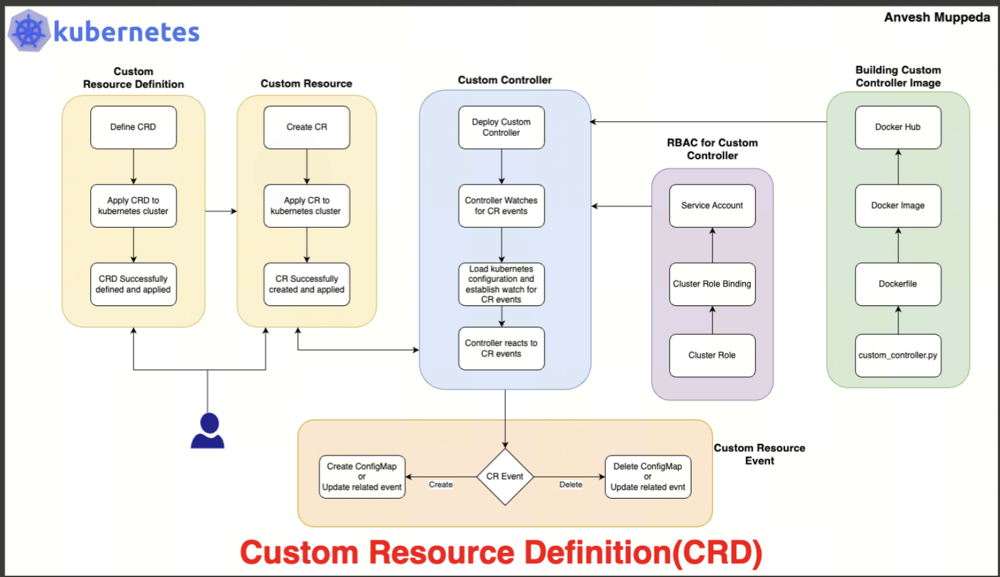

Go struct
    定义程序中的数据类型，也可以绑定方法

CRD
    定义 Kubernetes 中的自定义 API 类型和 Schema
    本身不包含业务方法

CR
    CRD 类型的具体实例
    本质上是存储在 API Server / etcd 中的声明式数据

Controller
    监听 CR，根据 spec 执行业务行为，并更新 status

import corev1 "k8s.io/api/core/v1"

type FooSpec struct {
	Resources corev1.ResourceRequirements `json:"resources,omitempty"`

    NodeSelector map[string]string`json:"nodeSelector,omitempty"`

    Tolerations []corev1.Toleration`json:"tolerations,omitempty"`

    Affinity *corev1.Affinity`json:"affinity,omitempty"`
}

# 1. 开发K8s组件

- 我认为开发AiBrix等庞大K8s组件和开发一个简单的k8s调度器的基本流程是一样的
  - 所以，我打算先用kind虚拟环境去简单设计一个k8s调度器，来熟悉一下开发范式
- 开发范式：

```
声明期望状态
  ↓
API Server 保存状态
  ↓
组件监听资源变化
  ↓
组件根据当前状态做决策
  ↓
修改 K8s 对象或外部系统
  ↓
让实际状态逐渐靠近期望状态
```

    - 该开发范式也体现出了“云原生”概念

- AiBrix，Volcano是如何和K8s进行集成的？
  - AiBrix和Volcano的安装和部署都是以“kubectl apply -f/-k xxx.yaml”所进行的
    - 所以我们可以把Volcano，AiBrix理解为**特定nameSpace中的一组服务**（若干Pod/Service/Deployment）
    - 同时，他们又不仅仅是普通服务，它们还会向整个集群注册CRD，ClusterRole，Webhook等就**集群级能力**
  - AiBrix和Volcano：
    - 运行形态上是普通服务
    - 能力上又具备集群级别的能力
    - 所以，它们是介于普通服务和K8s之间的扩展控制面组件现在的



## 1.1 Controller

一个k8s Opetrator完整运行的流程：

```
先安装 CRD
    ↓
API Server 才认识 aiBrix CR
    ↓
安装 RBAC
    ↓
Controller 才有权读取和修改资源
    ↓
部署 Controller Manager
    ↓
Controller 开始监听和调谐 CR
```


### 1.1.1 调谐

调谐：Reconcile；

核心意思：**不断**比较用户期望的状态和系统实际状态，并采取行动消除二者的差异。

调谐持续循环，而非执行一次的传统程序


# 2. 定义CRD

k8s原生资源：Deployment，Service，Node等，内置资源

CRD：允许用户在k8s集群中继续扩展新的资源，比如Volcano中的vsjob，AiBrix中的EnvoyProxy等等

CRD的yaml格式：

```
apiVersion: apiextensions.k8s.io/v1
kind: CustomResourceDefinition
metadata:
  name: foos.example.com
spec:
  group: example.com
  scope: Namespaced              //作用域:命名空间级别；Cluster：集群级别
  names:
    kind: Foo
    plural: foos
  versions:
    - name: v1
      served: true
      storage: true
      schema:
        openAPIV3Schema:
          type: object
          properties:
            spec:
              type: object
              properties:
                message:
                  type: string
```

其中最关键的配置为spec.versions.schema（元数据）

* K8s API Server会依赖schema对CR提交进行校验，比如字段类型，约束检查
* 创建CR，需要依赖schema的相关定义

CRD：资源类型；CR：具体资源实例

## 2.1 CRD schema

schema在CRD是核心部分，描述“这个资源内部长什么样”，定义校验规则

CRD自动生成（k8s框架开发）：在 Go 代码中定义 API 类型，再通过 Kubebuilder、Operator SDK 和 `controller-gen` **自动**生成 CRD YAML，CRD 通常不是直接手写完整 YAML

**CRD流程（go开发）**

1. Kubebuilder 先创建 API

   ```
   kubebuilder create api --group example --version v1alpha1 --kind Foo
   ```
2. 生成类似文件：api/v1alpha1/foo_types.go
3. go文件定义：

   ```Go
   package v1alpha1

   import (
   	metav1 "k8s.io/apimachinery/pkg/apis/meta/v1"
   )

   type FooSpec struct {
   	Message  string `json:"message"`
   	Replicas int32  `json:"replicas,omitempty"`
   }

   type FooStatus struct {
   	ReadyReplicas int32              `json:"readyReplicas,omitempty"`
   	Conditions    []metav1.Condition `json:"conditions,omitempty"`
   }

   // +kubebuilder:object:root=true
   // +kubebuilder:subresource:status

   type Foo struct {
   	metav1.TypeMeta   `json:",inline"`
   	metav1.ObjectMeta `json:"metadata,omitempty"`

   	Spec   FooSpec   `json:"spec,omitempty"`
   	Status FooStatus `json:"status,omitempty"`
   }

   // +kubebuilder:object:root=true

   type FooList struct {
   	metav1.TypeMeta `json:",inline"`
   	metav1.ListMeta `json:"metadata,omitempty"`

   	Items []Foo `json:"items"`
   }
   ```
4. 执行以下命令

   ```
   make manifests
   #或者
   controller-gen crd paths="./..." output:crd:artifacts:config=config/crd/bases
   ```
5. Kubebuilder Marker生成CRD yaml

其中Go struct就像一个单纯的“数据类型”，和json十分相关，并且没有任何方法函数，本质上就是**存储信息（image，replicas等）**

真实项目中，经常直接复用 Kubernetes 已有类型：

```Go
import corev1 "k8s.io/api/core/v1"

type FooSpec struct {
	Resources corev1.ResourceRequirements `json:"resources,omitempty"`

	NodeSelector map[string]string `json:"nodeSelector,omitempty"`

	Tolerations []corev1.Toleration `json:"tolerations,omitempty"`

	Affinity *corev1.Affinity `json:"affinity,omitempty"`
}
```

**CRD的作用：**

CRD 是框架对外暴露的 **API**，类似后端的接口格式，供k8s组件(controller等)使用的API

**常见Schema结构：**

```YAML
schema:
  openAPIV3Schema:
    type: object

    properties:
      apiVersion:
        type: string

      kind:
        type: string

      metadata:
        type: object

      spec:
        type: object
        properties:
          # 用户期望字段

      status:
        type: object
        properties:
          # Controller 观测字段
```

开发者重点关注：spec，status

**CRD和Pod等原生资源的区别**

两者核心模式一致：

    声明资源对象 --->  API Server存储期望状态 ----> 控制组件watch资源变化 ----> 执行具体动作 ---> 更新实际状态

Pod 的类型是静态编译进 Kubernetes 的；CR 的类型是运行时通过 CRD 注册的

Pod，Deployment，Service等属于Kubernetes 的**内置资源类型** ，不是通过 CRD 创建的，需要同CRD进行区分

对应关系：

```
Go struct
    定义程序中的数据类型，也可以绑定方法

CRD
    定义 Kubernetes 中的自定义 API 类型和 Schema
    本身不包含业务方法

CR
    CRD 类型的具体实例
    本质上是存储在 API Server / etcd 中的声明式数据

Controller
    监听 CR，根据 spec 执行业务行为，并更新 status
```
